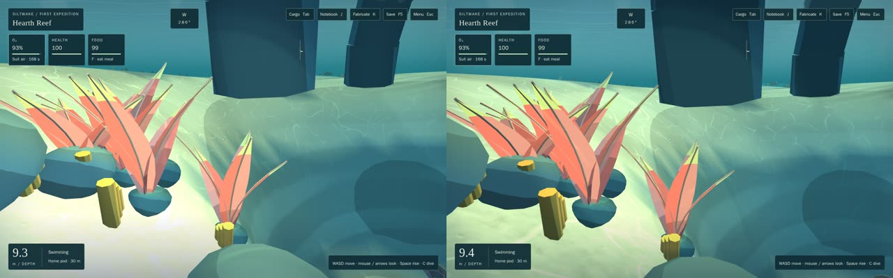
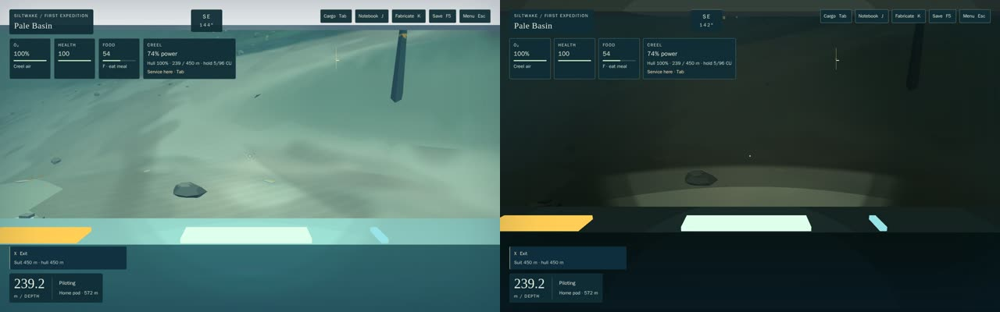
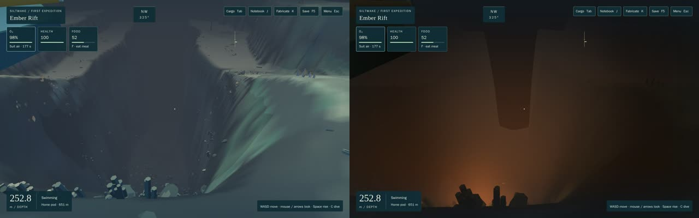
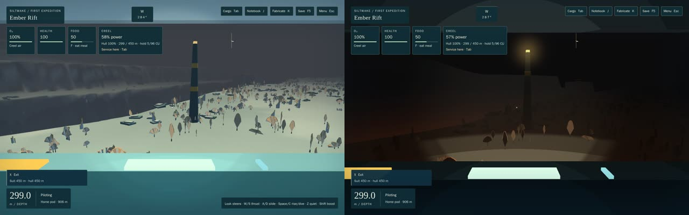
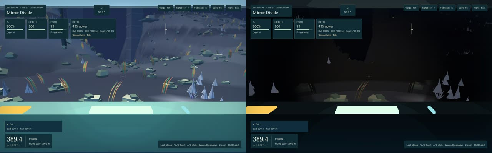
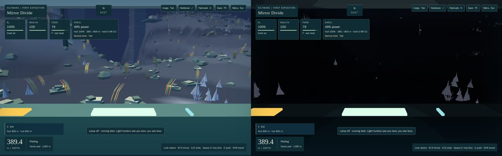
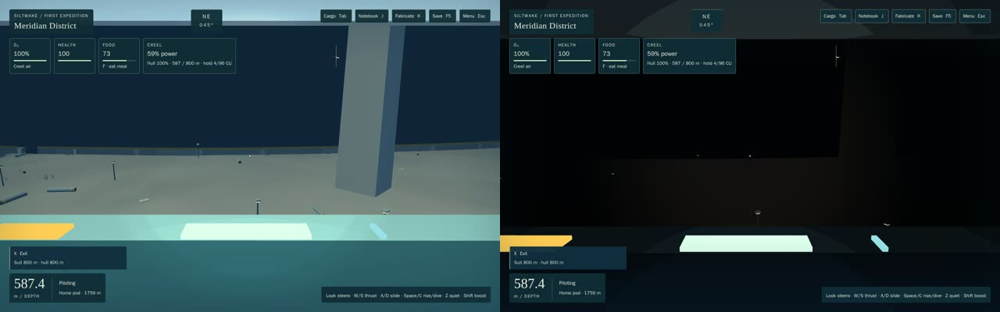
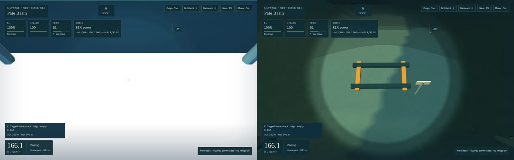
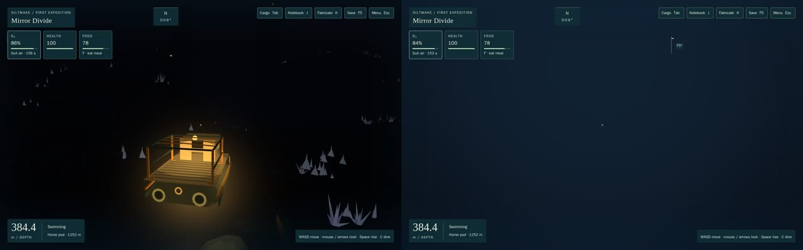

# ATM-1: depth has a feel

Opus 5.5 high. Branch `t3/atm-1-depth-lighting` from C4 stage A (`b08747f`). Code `7897c6b`; this page and the evidence follow it. Answers the M2 audit's #1 (deep game not dark, Creel arm whiteout), #6 (camera in the Dart cradle) and #10 (cold Rift).

## Outcome
Going down now gets dark. Down to 20 m the shallows look as they did, with gentle god rays added. Below that, lit colour falls steeply with each surface's own depth, and past about 250 m everything is near-black except:
- the lamp cone;
- local lights: lamps, lit windows, vents, crystals, creature glows and cave glimmers;
- a faint glow overhead.

Each region tints the light that's left: Canopy teal, Basin silt-green (brighter, because silt scatters), Rift bone above an ember-lit trench, Divide slate, Meridian near-black with its district lamps. The cockpit no longer glows as if it were sunlit, and pitching down to work the Creel arm shows the work.

## What changed (contracts)
- **Depth light, `render/lighting/depthLight.ts`** (new, Babylon-free). One knot table, `AMBIENT_KNOTS`, drives two things:
  - **the CPU curve:** `ambientAt`, `fogLightAt`, `waterLightAt` and the per-region `REGION_LIGHT`;
  - **the generated GLSL** (`ambientGlsl`, `DEPTH_LIGHT_SHADER`).

  How it behaves:
  - Region light is blended over a 64 m disc, so a border never pops.
  - The water dims more slowly than surfaces, so near rock reads as a silhouette. Fog tightens by up to ×1.8 by 450 m.
  - The fog has a direction (`fogUp`/`fogDown`, part of the shared optical set): a surface glow overhead, darker below, ember below in the Rift.
- **`materials.ts`:**
  - The cel fragment multiplies lit colour by `depthLightAt(vWorld)`. Dry rooms (pod, lab, carrier air) are exempt.
  - Local lights and halos are added after the unlit mix.
  - The old multiplicative near-eye "lamp pool" is removed.
  - New vertex alpha **−0.3 = faintly luminous** (Divide crystal shards, `biomes/templates.ts`).
  - Glass sheen follows the depth light. Deep panes used to veil the dark with teal.
  - `updateOpticalUniforms` now **returns** the `WaterLight` it applied.
  - **The single cave splice is intact:** same anchors, still one `injectCaveLight`.
- **The lamp, `caves/caveLight.ts`.** One lamp in caves and in open water: `DEFAULT_LAMP` is 32 m (was 22), a 15°/33° cone and brighter. `caveShade` weights the lamp by `daylightAt` as well as cave daylight, so it is the main light below about 200 m. Its in-water beam is fainter in open water than in a cave. A 32 m ray stays inside the walk budget: `LAMP_WALK_STEPS` 200 against 3 × 64. The lamp's gameplay meaning (stimulus, noise) is untouched.
- **Local lights, `lighting/localLights.ts` + `sceneLights.ts`** (new).
  - **Sources:** every emissive cel mesh is clustered once into point lights (4 m cells; thin instances too), in ≤1.5 ms slices per frame.
  - **Extras:**
    - authored Rift vent seeps down the head and trench, with small glowing vents;
    - a soft instrument light in the piloted Dart or Creel. The piloted hull's own glows are skipped, because they glared;
    - a lamp marker on every parked craft below 25 m.
  - **Per frame:** the 12 best lights within 200 m go to the cel and sky materials, reserved ones first. They use cel bands and halos in the water.
- **Camera, `render/camera.ts`** (new; the renderer's pose code moved here).
  - **Creel work view:** pitching below about −23° slides the eye over the bow through the forward window's opening. It is complete by −41°, and the lamp follows it.
  - **Eye collision:** every exterior eye is kept out of solids and terrain. I reproduced the cradle case: a diver rising from under a rail ends up overlapping it, because the sim's sweep ignores a starting overlap, and the eye was then inside it. The camera now steps out to the nearest clear point.
- **`renderer.ts`** wires the camera and `createSceneLights`, and adds `dataset.localLights` and `dataset.workView`.
- **`atmosphere.ts`:** the sky uses the directional water, god rays and light halos.

## Checks
- **`npm test`:** 1,098/1,098. That's 1,088 plus 10 new tests in `tests/atm1-lighting.test.ts`:
  - the curve's shape and GLSL equal to the CPU curve;
  - region palettes, the water and the way up;
  - no step at region borders;
  - clustering and selection;
  - the work-view path through the window opening;
  - eye collision, including the rail case.
- **Heavy (`npm run test:heavy`):** all files pass.
  - Changed: `render-cache.heavy` "Pale Basin". It pinned the old deep water at the 118 m and 142 m route poses. It now expects that water darkened by the depth light, keeps exact equality for the shallow poses, and compares the Basin with route water at the same depth, because the depth light is the intended change.
- **`npm run build`:** OK. `bake-terrain --verify`: 220/220.
- **`tools/cave-gpu-check.mjs` on the 3090:** 0/2,734 lamp-ray mismatches. The vault reads 50.4 with the lamp on against 22.5 off; W1 read 38.1 against 22.8.
- **3090, ordinary keys:** a task-owned headless Chrome (ANGLE GL-EGL, "NVIDIA GeForce RTX 3090") through `heavy-check.sh`, in sessions of 25 minutes or less, closed after each.
  - **Saves:** derived headless with the game's own step from the audit's milestone saves ([derive](atm1/derive.mjs)).
  - **The same script shot both builds:** before (`b08747f`) and after ([server](atm1/server.mjs), [script](atm1/evidence.js), [before](atm1/before.json), [after](atm1/after.json)).
  - **Means:** scene only, with the HUD hidden; 0–255.

| View | Before | After | After: frame time while flying |
|---|---|---|---|
| Reef, 10 m (diver) | 140.7 | 132.8 | 60 fps, p95 16.7, worst 16.8 ms |
| Basin, 240 m | 140.2 | 38.5 | 60, 16.7, 16.8 |
| Rift head, 253 m (diver) | 68.1 | 30.9 | – |
| Rift, 300 m | 105.9 | 27.0 | 60, 16.8, 16.8 |
| Divide, 395 m, lamp on / off | 91.5 / 77.9 | 18.0 / 13.9 | 60, 16.7, 16.8 (lamp off) |
| Meridian, 590 m | 90.2 | 15.5 | 60, 16.8, 16.8 |
| Creel arm at −70° | 178.4 (white) | 61.3 | – |

**Performance before:** the same runs were 59.4–60 fps, with worst frames of 33–50 ms. There is no regression in the shallows.

| | |
|---|---|
|  Reef 10 m: before / after |  Basin 240 m |
|  Rift head, down the trench: Ember |  Rift 300 m |
|  Divide 395 m, lamp on |  Divide 395 m, lamp off |
|  Meridian 590 m |  Creel arm at −70°: was white, now the frame host in the cone |

## Adverse case: a diver at 395 m with the lamp off, no local light
At the Divide, I left the Creel with the lamp off and swam backward 16 m. The scene reads 7.1 between blinks and 97% of pixels are under 24/255.
- **Finding the craft:** the craft's amber marker and its faint hull glow are the cue, and the marker blinks to 12.1.
- **Finding the way up:** looking up shows the surface glow, which reads 26.1 against 7 at the horizon.
- **Bearing:** the HUD's existing distance-to-pod line stays.

## Known limits
- **Landmarks vanish:** past about 450 m, distant structures disappear rather than loom. The Meridian's tower is gone in the after shot. They show only against the overhead glow, or if they carry lights. A rim or landmark light is a later atmosphere item.
- **Local lights:** they have no shadows. A cave colony's light can leak a few metres through rock. Only 12 are sent per frame; the nearest and biggest win.
- **The shallow lamp:** the old near-eye pool brightened nearby surfaces up to ×1.6 in daylight, and is gone. In the shallows the lamp is now the cave lamp's faint pool, so the reef near-field glare is a little lower.
- **The carrier:** its interior counts as a dry room only while docking. Elsewhere, its rooms below about 100 m are lit by their own glows.
- **The work view** is Creel-only. Hush, Spindle, Mantle and Hearthline pilot views are unchanged and have no eye collision, because they are local rooms.
- **Flagged for review:**
  - an edit outside the brief's list: `biomes/templates.ts`, two shard templates set to alpha −0.3. Templates aren't baked, and the bake verifies;
  - a small edit to `caveShade` and the beam in `caves/caveLight.ts`.
