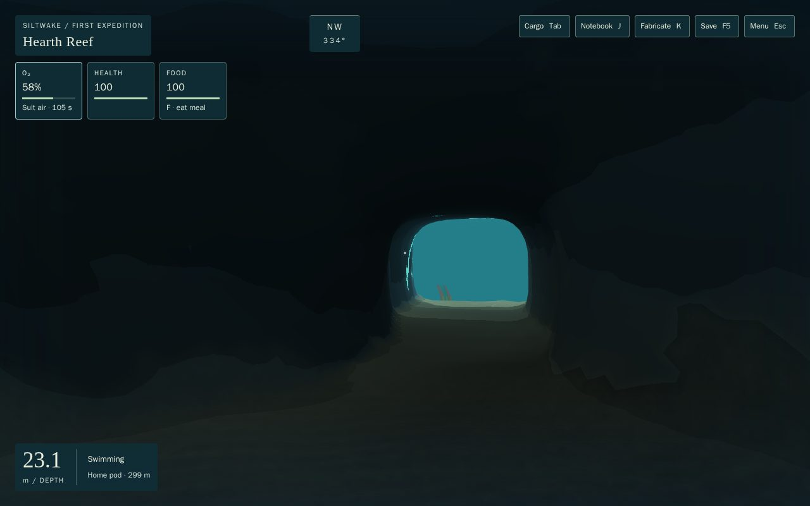
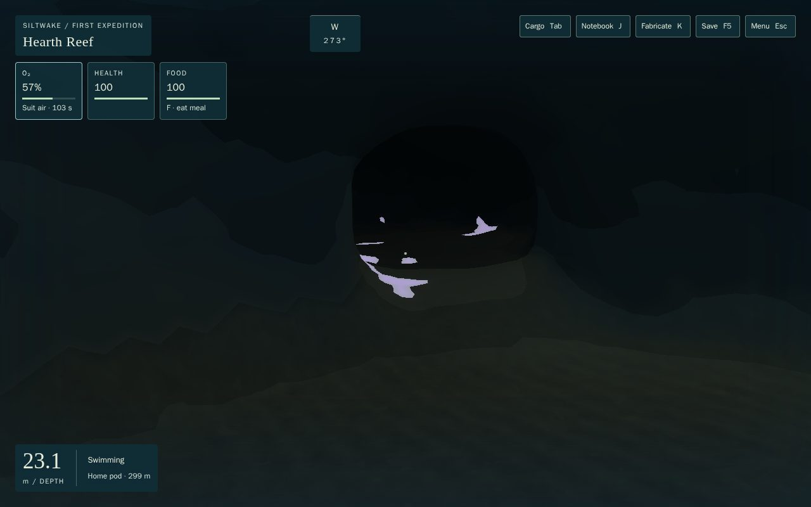
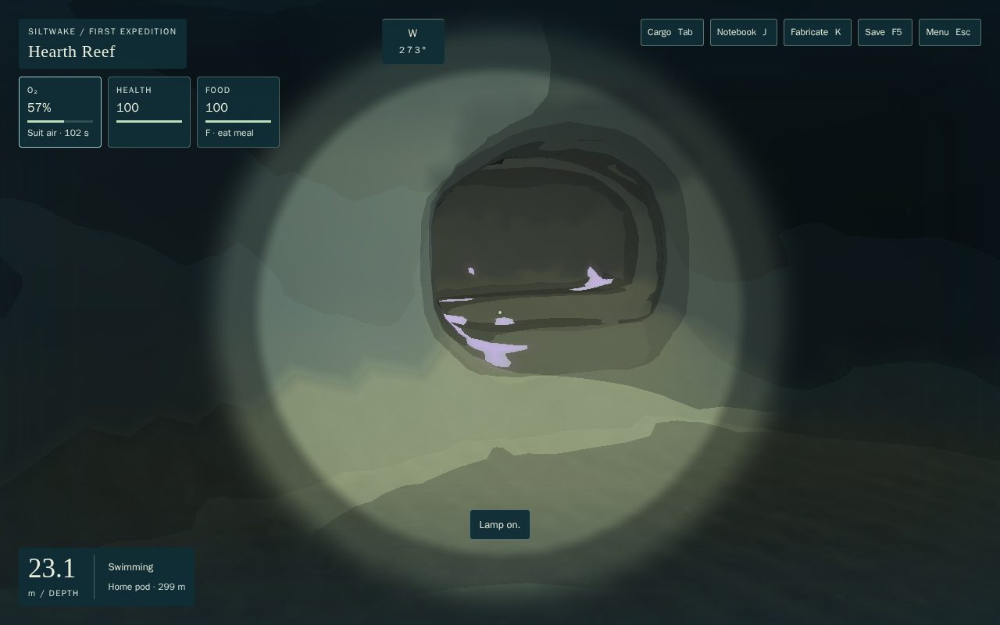
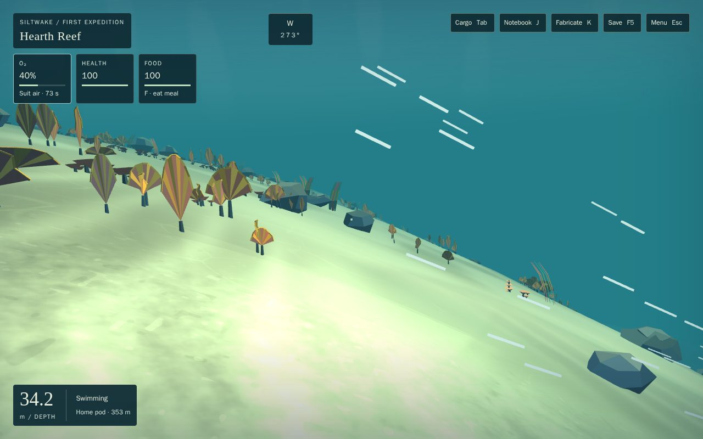
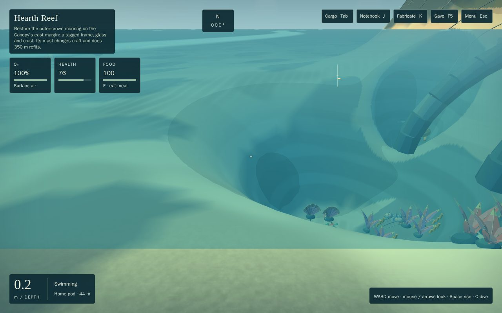
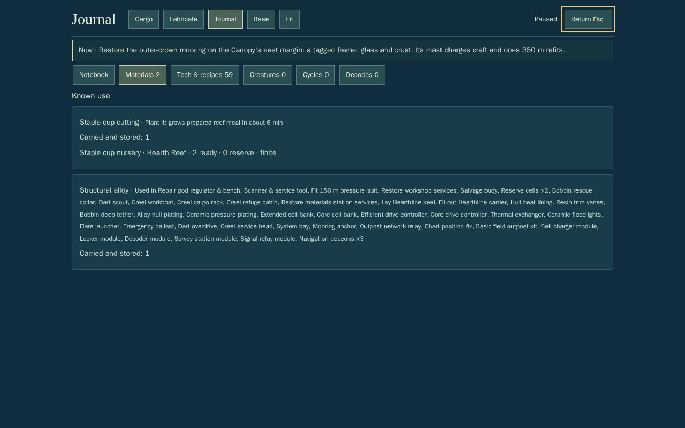
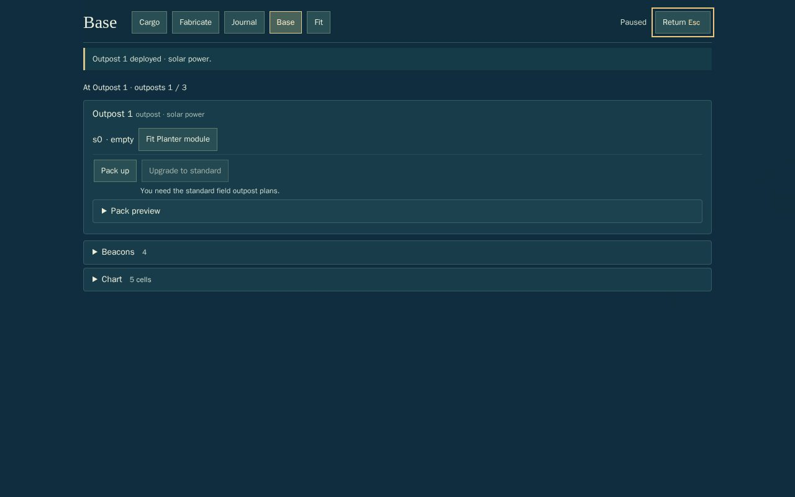
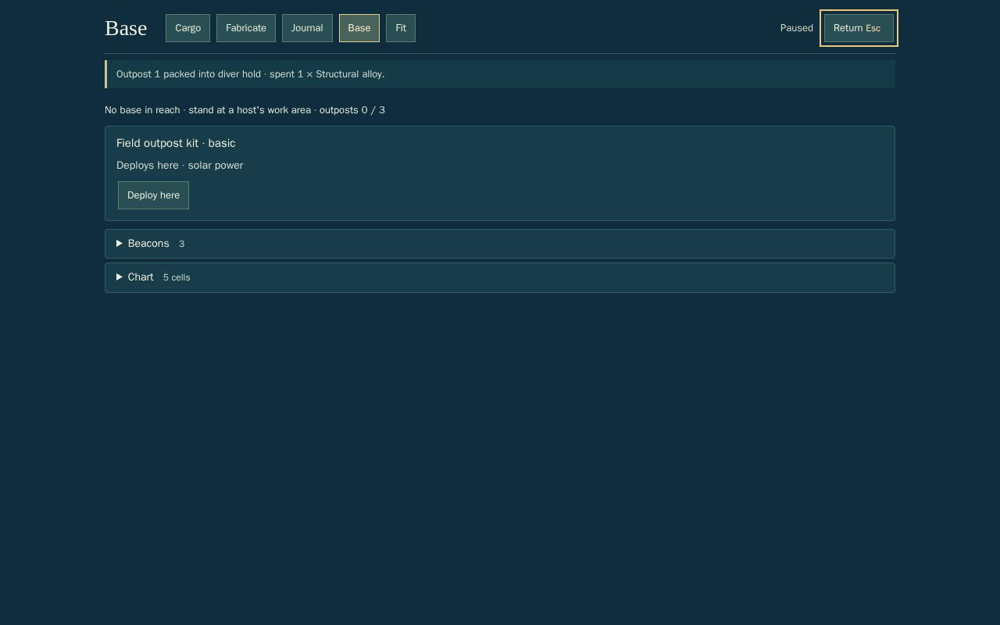

# C4: the accepted systems in the real game

Opus 5.5 high. Branch `t3/75d095f9`, from `feat/siltwake-first-expedition` at `ffc9847`. Two stages, each reviewed separately by Sol.

## Stage A: caves and currents (code `d06e434`)

### Outcome
The Fanvault is a real place on Hearth Reef. A diver swims into its north mouth, through the vault and out the south mouth. Rock collides from one source; the lamp and the dark come from the production cel shader; the baked world carries the shell. Currents are now one field and one movement owner. That covers S4's two migrated flows and one new, strong, visible race on the reef shelf break. The race pushes and costs power, but you can't ride it, and grazing rock in it never wears a hull. Both routes still reach the ending.

### What changed (contracts)
- **World queries (`sim/world.ts`).** The W1 adapter moved here from `sim/caveWorld.ts`, which now only re-exports it.
  - Ownership is chosen per sub-sweep, every exterior solid is kept, and the collar band is unchanged.
  - The composite gets its own 8 m index (`CAVE_INDEX_CELL`, from W1-PRE-06).
  - **`gameWorld()` is the one exterior world.** The runtime, recovery, survival, the fleet refuge check and the playthrough driver all use it. `createWorldQueries()` stays as the raw, cave-free world for local rooms and old tests.
- **`step.ts`.**
  - **Diver.** The swim cliff guard reads `supportHeight`, not `groundHeight`. **New rule:** a swimmer stopped by a riser of at most 0.6 m (one 0.5 m cave voxel) glides up onto it, only while submerged. Without it, a swimmer stuck on every terrace lip inside the cave.
  - **Currents.** One `flowAt` sample before the move.
    - Diver: `respondToFlow` drift is added inside each 0.12 m slice; velocity stays the drive alone.
    - Hull: drift goes into the same `moveHull` call through `supportedDrift`; the hold is `station` when powered with no input.
    - **(a) Impact:** `impactLoss` on the drive's component into the refused travel. A rise refused by the floor guard counts as nothing.
    - **(b) Damping:** `dampIntoFace`.
    - **(c) Drain:** follows the drive, not displacement, plus `extraDrain`.
    - Ascent and thrust samples are skipped while drifting, so they still measure still-water propulsion.
  - A current's cue shows once, on entry.
- **Ecology.** `ecologyLink.ts` no longer applies `effects.drift`.
  - Clocks: S4's hazard cycles name their framework cycle (`cycleId`), and `sim/ecology/hazards.ts` evaluates the trapezoid with `sim/cycles`. The test checks it against S4's original code, tick for tick, over two periods.
  - S2's chimney pulse names the same cycle.
- **Currents (`sim/currents/world.ts`, `content/currents/world.ts`).** The field is `WORLD_CURRENTS` plus `migratedHazardCurrents()` (`fromHazardField` for `divide_downwelling` and `basin_sediment_lane`), on `WORLD_CYCLES`. Its flow equals `sampleHazards().flow` to 1e-12 at sampled points and ticks.
- **Bake and render.**
  - **Bake.** `TessellationOptions.pits` (W1's suggested `holes: Rect[]`) cuts cave footprints out of the heightfield, skirt included. A pit cuts a chunk border only where it reaches that line. Each column gets `caveShellByColumn` as `<chunk>.cave-fanvault`. Chunk Y bounds now cover the cave, and scatter stays out of the footprint. The bake hash picks up `caves.ts` and `caveGeometry.ts` through esbuild's metafile. `bake-terrain --verify` gives 220/220.
  - **Shader.** `materials.ts`: `CEL_FRAGMENT = injectCaveLight(BASE_CEL_FRAGMENT)`, once. `CEL_UNIFORMS` and `CEL_SAMPLERS` include the cave set, and the kit, cave and production materials share them. Splicing twice throws, and a test pins that.
  - **Renderer.** `render/caves/caveView.ts` holds one `CaveLighting`; the nearest cave within 60 m is active, and its field is built in idle `prepare()` time. `render/currentStreaks.ts` draws grit streaks carried by `flowAt` (139 in view at the race).
- **Keep or cut (owner may override):**
  - **Vent pulse:** kept, on the framework.
  - **Slackening:** one current, the Divide crest (CB's `divide.crest_slack`): 52 s running, 30 s slack at 15% strength, cued by ribbons standing upright. It gates nothing, since every craft and the diver can cross it at any time.
  - **Bloom:** dropped as a clock; regrowth is stage B.
  - **Migration:** skipped; no real creature fits yet.
  - **Turbine:** stage B, as a Hearthline mooring-anchor perk only.
- **Saves:** no persisted change; cycles are pure functions of the tick.

### Checks
- `npm test`: **1,088/1,088**. New: `tests/c4-world.test.ts` (14) and `tests/c4-cave-bake.test.ts` (3). The cave tests now run in the real frame against `gameWorld()` (`SHIFT` is 0).
  - Four tests changed:
    - the hull drain expectation now follows the drive;
    - the downwelling test samples the running phase;
    - the chimney test checks the shared cycle ID;
    - the splice test checks the single splice.
- **Heavy, through `heavy-check.sh`:** every file passes. `cave-light.heavy` gained the cave-view and streaks test.
- `npm run build`: OK. `bake-terrain --verify`: 220/220. All six dev labs typecheck; the cave lab now uses `gameWorld()`.
- `npm run playthrough -- --jobs 2`: **exit 0, 5/5 complete**, no blockers. Creel 170.6 min, carrier 283.1, creel-loss 179.6, reverse 175.2, no-optional 169.7, the same as C3.
- **3090, keys only, from New Game** ([`c4/play-a.mjs`](c4/play-a.mjs), [record](c4/play-a.json)). It ran on a task-owned headless Chrome with ANGLE GL-EGL ("NVIDIA GeForce RTX 3090"), through `heavy-check.sh`, closed at the end, with 0 errors.
  - Pod → surface swim → north mouth → vault (`cave=fanvault`).
  - Lamp off and on, looking at the exit, the pocket and the skylight.
  - Lamp off, vault → south mouth.
  - Across the race heading west on W alone: crossed, swept 7 m downslope, health 100.
  - Surfaced.
  - Every segment ran at 60 fps (p95 16.7–16.8 ms). The surface swim had one 100 ms frame.

| | |
|---|---|
|  Lamp off: the south exit glows |  Lamp off: the pocket is dark, its colonies glow |
|  Lamp on, same view |  The shelf-break race from its east edge |

### Adverse cases
- **Fanvault, lamp off, 15% air (27 s), starting in the catch pocket.** A keyboard swimmer follows the glow route out by the skylight and surfaces with air left, never incapacitated. Without the lip glide this swimmer stalled at the pocket throat and drowned; the first run of the test showed it.
- **A Creel driven along a rock wall in the race at cruise and boost, the current pressing it onto the face.** Health stays 100, there are no impact events, and it keeps sliding (more than 6 m). Control: a head-on boost into the same wall still damages.
- **A powerless diver at 16 points in the race** reaches still water within 25 s, health unchanged.

### Known limits and flags for review
- **Two movement changes that reach beyond caves:**
  - the impact rule (glancing contact at speed no longer wears a hull);
  - drain by drive (pushing into rock at full throttle now costs cruise power).
- **The 0.6 m lip glide** is new. It runs only on a stopped submerged slice and only if it gets further.
- **One cave is lit at a time** (within 60 m). The lamp is the camera's.
- **Streaks are placeholder art.** The race has no cue animal yet; it has text, streaks and the leaning fans the cue describes.
- **Not touched:**
  - `src/content/regions/caves/*`, `src/world/caves/large/*`, `src/render/caves/large/*` and `src/content/caves/*`.
  - When CA-1, CA-2 and LC land, adding a source to `CAVE_SOURCES` is the whole hook. Pits, shells, light, scatter exclusion and `gameWorld()` follow from it, but `assertDisjointFootprints` and the legacy-guard check will apply.
- **Stage B:** cycle observation into the journal (SYS-2's `knowledge.cycles`), the turbine perk, and SYS-1 craft profiles feeding current authority. Today authority comes from S4's `protectionFor`.

## Stage B: upgrades, bases, knowledge and CB's recipe deltas (code `686079f`; WIP checkpoints `6349636` and `66bdd6e`, the root merge `9c7b3f8` with ATM-1; review range `b08747f..686079f`)

### Outcome
The accepted SYS-1 and SYS-2 systems and CB's recipe deltas are now in the real game. You can make an upgrade and fit it to a hull. A basic outpost deploys on a ledge, charges craft and holds a locker, then packs back into its kit. Lost sites are found by swimming up to them and decode in the background at a powered decoder. Planters grow food from cuttings. The HUD and the tabbed journal show one practical objective. Waking after incapacity happens at the last restored base you rested at. Both fleet routes still reach the ending, and both play a kit plan, a decode, a planter harvest and an upgrade fit on the way. The independent route deploys a forward outpost, which saves a trip home between the Rift and the Divide.

### What changed (contracts)
- **Saves: schema 6, content `expedition.7`** (meaning changed). `save/bridge5.ts` bridges schema 5 once:
  - New Game's `systems` slice, flares, upgrade runtime and bio feed are added.
  - Hull protections carried in a hold are fitted to a free socket, so they protect as before.
  - Investment is recomputed against current costs, and stock is clamped to the new reduced deposits.
  - Schemas 1–4 are refused as an older build. Fixtures were converted once; the originals are archived in `tests/fixtures/archive/` with their hashes pinned.
- **SYS-1.**
  - `content/upgrades/registry.ts` composes 24 upgrades whose effects run (`WIRED_UPGRADES`), plus the Hush 350/450 and Dart 450 refits and the knowledge-scope host upgrades.
  - `sim/fittings.ts` feeds hull profiles into step (speed, loudness, drain, current authority, impact damage), survival (rating, air line) and ecology (lamp, protections).
  - Power sources: trickle, bio feed, Spindle deck charging.
  - Upgrade needs follow the tier suits (150, 350 and 450 m).
  - Socket limits are checked in `modules.ts` and the validator. A berthed hull is fitted from inside the carrier, never mid-transaction.
  - The Dart's maximum rating is now 450 m (the depth-line refit).
- **Refits at restored stops** (M2 audit #3): 350 m refits run at the outer-crown mooring, 450 m refits at the Rift station, 800 m at the Divide dock (`REFIT_STOP_SITES`).
- **SYS-2.** `GameState.systems` is wired in through `sim/systemsLink.ts`:
  - Host power comes from the SYS-1 model.
  - A Spindle mast relays a remote decoder.
  - Outposts are sited against the composed world.
  - The carrier powers 2 system sockets (4 with the system bay), and its bridge socket takes a decoder.
  - Lost-site discovery is within 10 m; seven of CB's exterior lost sites are lifted.
  - Every SYS-2 command is wired. `recovery.ts` keeps identity items (modules, kits) with the diver.
  - The timeline recorder, the N feedback key and timeline export are in.
  - `engines` is set to `>=22.18`.
- **Waking** (`content/bases.ts`): `rest` at the pod, the restored workshop, the Rift station, the Divide dock or the Meridian office sets `refugeId`. Incapacity wakes you there while that base still works, otherwise at the pod. W2's crown station will be one more row.
- **CB recipe deltas.**
  - Frames move into `creel_base`, `hush_base`, `spindle_base` and `suit_350`.
  - Core goes into `suit_450` and the keel.
  - The 290 m core shoulders become scan-only; scan-only sites read their scan (`inspect`).
  - The 366/375 m lattice ledges become one-crystal tastes.
  - Frontier deposits (`content/c4Sources.ts`): frames on the Canopy's south rim at 150 m (two patches), core on the Rift's 350 m lower ledges, lattice on the Divide's 450 m east flank.
  - `kitPlanRoute` / `kitPlanProblems` (`sim/storyCampaign.ts`) check that the basic, standard and advanced kit plans stay reachable in that order on both routes.
- **UI.**
  - A **tabbed journal** (notebook, materials, tech, creatures, cycles, decodes) with a "Now" objective line on top, and preparation advice that follows the current objective.
  - **Base** (O): hosts, sockets, deploy and pack with a preview, decodes, planters, beacons, chart.
  - **Fit** (U).
  - The craft panel gives one "Why not" line, with detail folded away.
  - The HUD objective replaces the "SILTWAKE / FIRST EXPEDITION" header and can be switched off in settings.
  - H gives the practical step first, and recovery steps while a craft is disabled.
  - Continue is primary only when it is usable.
  - Re-importing the same save works.
- **Signature uses** (audit #4):
  - **Hush listening array:** bearings to lost sites, marked on the chart.
  - **Hush specimen bay:** samples the spores that tear by hand.
  - **Spindle solar array:** charges reserve cells in the hold while surfaced.
  - **Spindle radio mast:** relays a decoder.
  - **Spindle shore ramp:** the hold can be reached from the shore.

### Checks
- `npm test`: **1,111/1,111** (new: `tests/c4-systems.test.ts`, 13 tests; `c4-world` now 16).
  - The stage A P3 pins are added to `tests/c4-world.test.ts`:
    - **Held thrust into rock:** one bounded hit, closing speed damped, the slide along the face survives. It fails when `dampIntoFace` is removed: 248 hits, hull 0.
    - **Mouth premise:** the support-height change at the mouth is pinned (sill 17 m above the masked floor).
    - **Cliff guard:** a swimmer is never stopped by a heightfield that disagrees with support. It fails when the guard reads the raw floor. In today's Fanvault the two readings agree at every one of 1,156 sampled starts, so this pin uses its own world.
- **Heavy, through `heavy-check.sh`:** every file passes after the root merge. `placed-hosts` failed once, because the seed patches now build by the pod; its expectation was updated and it was rerun alone.
- `npm run build`: OK.
- **Economy:** the four `check-*-economy.mjs` scripts and `check-progression-curve` exit 0. `upgrade-economy` reports PASS; the advisories are the registry's Creel 450/800 lines.
- `npm run playthrough -- --jobs 3`: **exit 0, 5/5 complete**, no blockers. Play time: creel 197.3 min, carrier 319.0, creel-loss 206.8, reverse 202.5, no-optional 196.5.
  - The shared **systems** phase: read the workshop's outpost sheet and signal rack; make plating and fit it to the Creel; make a decoder (workshop socket), a basic kit and a planter (pod socket); plant a staple cutting; fly the Dart to the pump house; start its decode.
  - At the end of the refits, the crop is harvested and the decode has granted the field-fabricator plan.
  - **Independent route:** stages a forward outpost on the Basin anchorage ledge (kit, two cells, the Divide stock) and does its 450 m refits at the Rift station. It recharges and restocks at the outpost instead of going home between the Rift and the Divide, then packs the outpost on the way home.
  - **Both routes** cut core on the 350 m lower ledge and lift frames on the 150 m rim. The carrier route dives to the 450 m flank by suit from the carrier at 395 m.
- **3090, keys only** ([`c4b/play-b.mjs`](c4b/play-b.mjs), [record](c4b/play-b.json)). It starts from a save derived headless (`derive-b.mjs`) and imported through the menu. Task-owned Chrome, ANGLE GL-EGL on the RTX 3090, through `heavy-check.sh`, 0 errors.
  - J opens the journal; the materials, tech and decodes tabs are reached with Tab and Enter.
  - U opens the fit screen.
  - The diver swims to the west ledge at 60 fps.
  - O opens the base screen; **Deploy here**, then **Pack up**, both by Tab and Enter. The kit comes back, the seal alloy is spent.

| | |
|---|---|
|  HUD objective line |  Journal tabs |
|  Outpost deployed from the base screen |  Packed: the kit is back |

### Adverse case
Dying beside a standard outpost while it runs a decode in one socket and grows staple cups in the other (`tests/c4-systems.test.ts`):
- the conserved totals of every item, module and kit are unchanged;
- both modules stay socketed, and the decode and the crop are kept where they stood;
- the save round-trips;
- back at the ledge, the decode finishes and grants its plan, and the crop harvests two meals.

### Known limits and flags for review
- **A deployed outpost has no world mesh yet.** It works and shows on the base screen and the chart, but you can't see it in the water (shot 10 of the 3090 run). This is the first render follow-up, for the render owner or after ATM-1.
- **Not wired** (catalogue data only, no recipe, so nothing fabricable does nothing): Dart wide sonar and range tagger; Creel cutting arm, grapple and drop pod; Spindle deck crane; Mantle salvage clamp and drone bay; Hearthline berth extension. Module-scope host upgrades (decoder lattice, survey arrays) are also not composed.
- **CB's lost-site plans with no rules yet are left out:** locker extension, ping lens, chart fix, thermal tap, current turbine and beacon array. Until the locker extension lands, the pump-house log carries SYS-2's small-fabricator plan, which had no source.
  - Cave reveals wait for their caves. The hub beacon house waits for W2's crown terrain.
- **Content needs:**
  - The Spindle shore ramp needs authored island shore sites; today any beach works.
  - The 350 m core ledges are marked for a terrain pad (W3).
  - The signal rack datum is moved onto the workshop's bench wall; SYS-2's datum sat behind the back wall.
- **Owner calls:**
  - The air line now feeds every parked, powered craft (SYS-1's basic line), so a diver beside one breathes on the craft's battery.
  - `trim_vanes` was added to the catalogue.
  - SYS-1's Mantle, Hearthline and Hush base rows were aligned to the hulls' handling.
