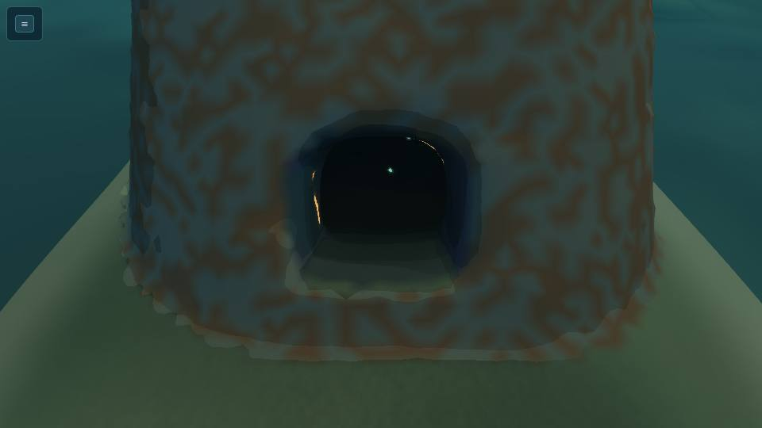
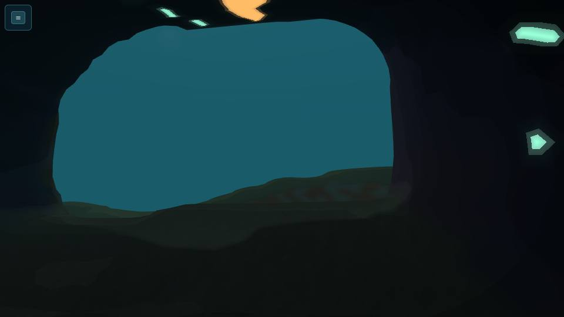
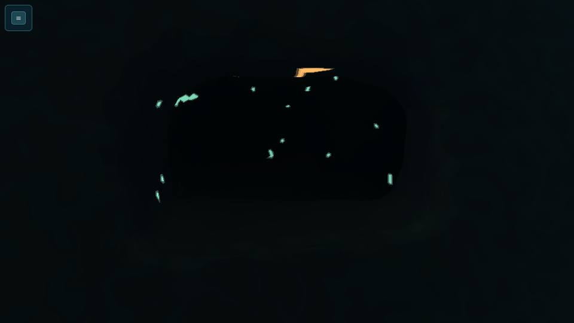
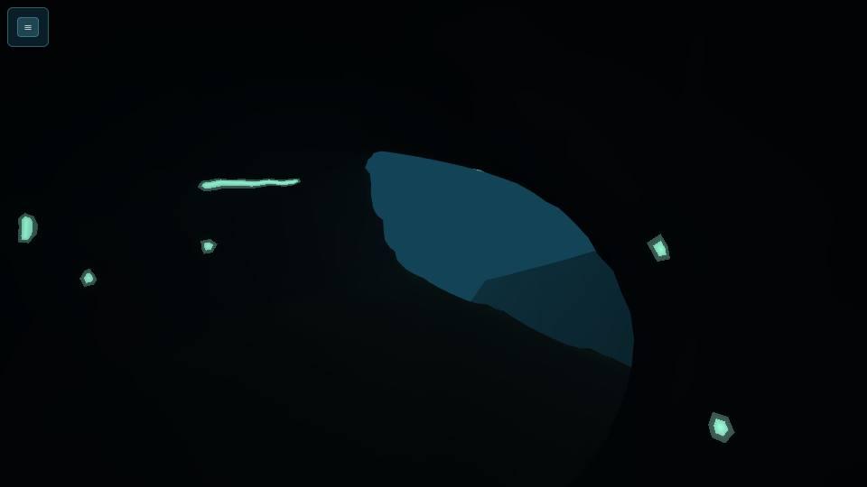

# CA-2: Lantern Canopy and Pale Basin small and medium caves (handoff)

Opus 5.5, branch `t3/canopy-basin-caves`, rebased on `feat/siltwake-first-expedition` (C4 stage A, the bible accepted). R0 code was `9502bd7`; this revision answers [Sol R1](../reviews/CA-2-SOL-XHIGH-R1.md). Code: **`44f7ff1`**. New files only: no kit file, `tools/cave-lab.*`, shared root, save or package change.

## R1 fixes
- **CA-2-01, datums on rock faces.** Four datums sat exactly on a rock box's face, so the production host (a source's sits 0.2 m below its datum) was in rock or behind it. They are now on the water side, IDs and stock unchanged:
  - Knot crust: y −123 → −122.6;
  - Lee resin: y −195 → −194.6;
  - the hut's lens: x 556 → 556.4;
  - the fracture faces: z −363 → −362.6.

  The new check also caught a fifth, the west cut's worked layers. It was on the sump floor, more than 4 m from any diver route; it is now on the wall at y −279.

  **New heavy check, per group:** every pocket and find is registered as a temporary production source. Pockets use the default source host; finds use a zero-offset host, because their adapter is C4's. Each must be returned by `aimedInteraction`, through the production aim ray and `lineOfSight`, from a reachable diver pose within interaction reach. Reachable poses are every 0.5 m of a swept diver route, or a clear spot one swept hop from one. Before the fix the check failed exactly those five; it passes all 12 groups now.
- **CA-2-02, the light fix.** `caves/lightFix.ts` is deleted. The tests and lab use the kit's `caveLightField`, which carries CA-1's Float64 fix and its regression test.
- **CA-2-03, the wake test.** The adverse case now asks the production `oldestVisible` for every hop. It passes it the eligible wake: glowing, more than 0.4 m away, reachable by a swept hop, and older than the wake the diver is at. The diver swims to the returned point through `stepGame` with ordinary look and move commands, lamp off, starting at 20% air, and the daylight leg is swum the same way.
  - **New assertion:** wake hops average at least 3 m. A selector that prefers newer wake creeps back point by point and fails it.
  - **Control:** the newest-wake reading also runs through `stepGame`.
- **Cave count:** it is **15 caves** in 12 sources, not 13.
- **Composition:** rebased onto root with CA-1's `AUTHORED_CAVE_SOURCES` and W2's hub caves in `CAVE_SOURCES`. These sources stay separate, as `CANOPY_BASIN_SOURCES`; joining the game is C4's step. The disjointness assertion and the overlap test now cover every authored cave (CA-1's and the hub's) with no skip, collar bands included.

## Outcome
All 15 bible caves for the two regions (8 Canopy, 7 Basin) are authored with the W1 kit and pass the kit's own checks in the composed world (C4's `createCaveWorldQueries` with its 8 m cave index):
- **Canopy:** 6 small and 2 medium **root hollows**. Bark and rib bands outside, petrol and violet inside, amber colonies at each mouth, sparse mint root tips.
- **Basin:** 5 small and 2 medium **silt-buried vaults**. Grey sediment layers, pale soft floors, a cool grey mouth glow, and **wakeglow drift**: your own wake glows for about a minute, so the way back is lit.

They live in 12 kit sources ("groups"). Crawlway-linked caves share one footprint, the bible's "explicit union" of rock ownership, because two sources can't carve one passage across a shared edge.

| Cave | Size | Group (owner) | Footprint | Water (x × z × y), depth | Exits | Rock boxes |
| --- | --- | --- | --- | --- | --- | --- |
| `canopy_knot_hollow` | small | own | 708..732 × -134..-110 | 16 × 14 × 8 m, 116–124 m | knot mouth | 479 |
| `canopy_bladder_pocket` + `canopy_quiet_crawl` | small × 2 | `canopy_eastcrown` | 748..813 × -92..-44 | 14 × 14 × 7 / 13 × 17 × 5 m, 83–93 m | rim mouth; slope mouth, pocket end | 1,858 |
| `canopy_lee_hollow` | small | own | 678..702 × -267..-243 | 18 × 7 × 9 m, 188–196 m | lee mouth | 334 |
| `canopy_fin_cleft` | small | own (**moved**) | 614..638 × -142..-118 | 5 × 15 × 11 m, 110–120 m | north end, south end | 364 |
| `canopy_arch_hollows` + `canopy_escarp_gallery` | small, medium | `canopy_root_arch` | 1236..1310 × -298..-260 | 21 × 13 × 8 / 39 × 22 × 28 m, 251–280 m | arch-foot mouth, escarpment window; arch mouth, escarpment lip | 5,064 |
| `canopy_lantern_hall` | medium | own (**moved**) | 470..538 × -260..-204 | 49 × 25 × 10 m, 164–174 m | mooring mouth, terrace mouth | 2,141 |
| `basin_culvert_north` | small | own | 398..422 × -507..-483 | 7 × 16 × 5 m, 267–272 m | culvert mouth | 393 |
| `basin_burrow_warren` | small | own | 776..812 × -702..-672 | 15 × 16 × 6 m, 294–300 m | burrow mouth (+ sealed biome face) | 2,918 |
| `basin_buried_hut` | small | own | 548..572 × -782..-758 | 10 × 6 × 10 m, 373–382 m | door slot (roof) | 383 |
| `basin_fracture_pocket` | small | own (**moved**) | 322..346 × -376..-352 | 16 × 5 × 7 m, 208–215 m | fracture mouth | 455 |
| `basin_rim_pipes` + `basin_west_rim_cut` | small, medium | `basin_west_rim` | 198..286 × -848..-798 | 15 × 12 × 5 / 52 × 27 × 36 m, 256–291 m | pipe mouth; rim mouth, Rift-side mouth | 3,587 |
| `basin_dish_lee_vault` | medium | own | 524..574 × -682..-629 | 31 × 29 × 13 m, 293–306 m | cliff mouth, slope mouth | 5,447 |

**Medium caves.** Every bible chamber, passage and closing passage maps to a real aperture. The tests prove a cycle in the *generated* rooms that breaks without the closing passage, and a diver route that swims through it.
- **Halls:** the lantern hall and the escarpment gallery take the Dart (small); the dish-lee vault takes the Creel (medium). Its parking chamber is a staging point for small and medium craft.
- **The west rim cut** is a small-craft pass from the rim to the Rift side over the collapsed bulkhead.

**Links.** The bible's crawlways are each owned by one footprint and each has a swept diver rescue route:
- bladder pocket ↔ quiet crawl;
- arch hollows ↔ escarpment gallery;
- rim pipes ↔ west rim cut.

None was left out. The **burrow warren**'s back entrance to `basin_ridge_vaults` stops in a sealed turning bay 2 m inside the footprint edge. The face the biome must open is typed (`handoffs`): centre (809.5, -297.8, -676.4), +X, 2.2 × 2.2 m.

**Contents (typed, `CaveGroup.pockets/residents/finds`).**
- **Bible resources:** `canopy_knot_hollow_crust`, `canopy_bladder_ceiling_resin` and `basin_culvert_crust` are placed in their caves.
- **New pockets** (`status: "proposed"`, with stock) for the bible's prose contents:
  - lee-hollow resin;
  - fin-cleft crust;
  - lantern-hall nest resin;
  - rim-pipe crust.

  All of them are common materials with at least two exterior sources. No frontier material sits in any cave.
- **Residents:** resin weavers in five Canopy caves, wakeglow in every Basin cave, and a scavenger den in the warren.
- **Finds:**
  - the root-arch scan;
  - the survey lens spare;
  - the fracture faces;
  - the worked layers;
  - a 4-alloy salvage bench;
  - the bible's `canopy.escarp_window` and `canopy.lantern_pass`.

## Checks
- **`npm test`: 1,159/1,159.** `tests/caves-canopy-basin.test.ts` (10 tests) checks:
  - the authored caves equal the bible's list, sizes, exits, chambers, passages and closing passages;
  - medium caves form a loop only through their closing passage;
  - footprints are disjoint from each other and from every authored cave (CA-1's and the hub's, collar bands included; with a control), outside the preserve and its collar band, in their own region, and moves are recorded;
  - no existing site, structure, source, place or bible exterior point lies inside a footprint;
  - links have one owner and swept rescue routes;
  - contents resolve against the bible and are never cave-only;
  - the required ledger stays outside every footprint;
  - the edge-shelf floor and the wakeglow rules hold.

- **Heavy, through `heavy-check.sh`: 161/161 pass** in 321 s. Peaks: 699 MiB (canopy), 713 MiB (basin) and 507 MiB (all caves loaded), each against a 1,024 MiB budget. A newest-preferring `oldestVisible` mutation fails both wake adverse tests (hops average 0.62 m and 0.65 m).
  - **`caves-canopy.heavy` / `caves-basin.heavy`**, per group:
    - thick rock;
    - **shell and rock agree** (the shell lies within 0.35 m of rock, faces water, and room water is never in rock);
    - **mouth and route clearance** (every aperture is clear in rock and in both shells, diver-only mouths stop a Dart, and every route sweeps its profile pose to pose);
    - **roof support** (solid, at least 2 m, carries a diver, drawn in both LODs, no roof holes);
    - **coarse LOD never closes an opening** (both shells stay 0.6 m off every route);
    - the collar meets the heightfield;
    - rooms touch only where portals say;
    - size classes come from the generated water;
    - medium caves have a real loop;
    - **lamp-off swept retreat from every metre of every diver route**, with sealed-cave negative controls on four caves;
    - contents sit in their room's water;
    - **every pocket and find is targetable** by production aim and line of sight from a reachable diver pose (R1);
    - the warren's sealed face and turning bay.
  - **`caves-canopy-basin.heavy`:** every cave loaded together. It checks route corridors against the plain world, craft parking, and per-step cost.
- **Lamp-off retreat:** every start in all 12 groups gets out. The longest swim is 51.5 m, in the west rim cut. Two-exit caves use both exits.

## The numbers (every Canopy and Basin cave loaded, plus the game's caves: the Fanvault and the hub's)
- **Rock:** 23,423 CA-2 boxes, 36,495 with the game's five caves. Each cave also brings about 10k collar columns.
- **Build:** the composed world builds in 15.1 s on the shared host (R0: 8.7–12.5 s with only the Fanvault). Most of that is the collar columns, built once when `gameWorld()` is first used. The per-cave light field takes 0.02–0.33 s with the kit's fixed Dijkstra.
- **Per-step cost** for a diver step (move plus support), on the 8 m cave index:

  | Cave | µs per step |
  | --- | --- |
  | Mean, inside caves | 61.3 |
  | Dish-lee vault (worst) | 204.6 |
  | Escarpment gallery | 196.2 |
  | Open water | 3.7 |

## Adverse case: deepest Basin vault, lamp off, 20% air
At 20% air the suit has **36 s**.
- **Every Basin room** has a lamp-off swept way out from its deepest diver pose, shorter than the air allows.
- **Farthest by water: `basin_west_rim_cut.pipe_gallery`**, 47 m out. The diver swam in along the pipe-gallery route and waited 10 or 20 s. Then, each hop, the production `oldestVisible` picks among the eligible wake: glowing, reachable by a swept hop, and older than where the diver is. The diver swims there through `stepGame`.
  - The wake leads to the rim mouth in 7 hops (39.7 m), and the daylight takes them out.
  - Out in **13.3 s** of game step, with **12.6% air** left and health 100.
  - No hop moves further from open water.
- **Deepest below the surface: `basin_buried_hut.room`** (382 m): 2 hops, out in 3.9 s with 17.9% air left.
- **Controls:**
  - following the *newest* wake (through the game step) never gets within 5 m of open water;
  - wake hops must average at least 3 m, which a newer-preferring selector fails;
  - after 90 s nothing glows (the cue is gone and only the daylight retreat is left).

| | |
|---|---|
|  Dish-lee vault, lamp off: the wake leads to the glowing slope mouth |  Dish-lee cliff mouth |
|  Knot hollow, daylight: root bands, amber colonies |  Lantern hall, lamp off: root tips and the exit |
|  Escarpment gallery, arch mouth |  Gallery, lamp off, towards the lip |

All 24 shots (daylight and lamp off, one pair per group) are in [`ca-2/`](ca-2/), taken by [`ca-2/shots.mjs`](ca-2/shots.mjs) on the RTX 3090 (ANGLE GL-EGL, task-owned headless Chrome, closed afterwards).

**Lab:** `tools/cave-lab-canopy-basin.html?cave=<group>` gives free swim in the composed world, L lamp, K LOD, region styles, overlays and the live wake. Its views come from each cave's mouths and rooms.

## Bible changes
- **`basin_fracture_pocket`** moved 34 m east: `route.basin.legacy_anchorage` crosses the bible footprint.
- **`canopy_fin_cleft`** moved 69 m north-east, and **`canopy_lantern_hall`** 16 m west. Carrier corridors (`route.isles.canopy_east`, `route.canopy_east.basin`) pass over or beside them, and the world refuses the carrier's 17 m box over any footprint.
- **Unions:** the east-crown, root-arch and west-rim footprints are each a union of the bible's two.
- **Smaller moves:**
  - the dish-lee vault sits 14 m east of the bible's, with its north edge kept 1 m off the south dish's structures;
  - the burrow warren extends 12 m west and 6 m north into the ridge nose, for a sound roof over the bay.
- **Proposed IDs** (pockets and finds), to add to the bible:
  - `canopy_lee_hollow_resin`;
  - `canopy_fin_cleft_crust`;
  - `canopy_lantern_nest_resin`;
  - `basin_rim_pipes_crust`;
  - `basin_burrow_warren.handoff`;
  - the finds listed above.
- **Carrier corridors** must keep about 25 m (the carrier's half-box plus one move) of plan clearance from every cave footprint. That constrains every future cave placement.

## Proposed kit changes (not made; owned files)
1. **Light-field path length:** fixed on root (CA-1's Float64 change, with a regression test). Nothing left here.
2. **Rock at uphill footprint edges** (`caveGeometry.ts` thick rock).
   - **Problem:** the opening only fits 2 m cubes inside the footprint. Where ground rises outward, or at a crest or high corner, the rock top sinks up to 2 m × slope under a shell that is snapped to the floor at the edge (over a metre on these slopes).
   - **Workaround:** `caveFloor` builds each group on a floor with a 2.25 m level band along each edge, following the edge's open profile, plus a 2 m lip.
   - **Kit fix:** let the cube fit-test count the pad's heightfield rock as rock, while keeping only owned voxels in the roster.
3. **Oversize refusal is plan-only.** The adapter refuses a carrier anywhere above a footprint, even 30 m over the rock. Add a vertical test (`def.bounds`) to `touches`, so corridors can run over caves.
4. **Shell colours are the Fanvault's.** `caveShell`'s palette and mouth colours are the reef's. `styledShell(def, lod, style)` here recolours the same mesh per region. The bake should take it per group, or the kit should take a palette.

## Wiring after C4 (coordinator)
- **Sources:** add each `CANOPY_BASIN_GROUPS[i].source` to `CAVE_SOURCES`, built with `groupDef` (on `caveFloor`), or apply kit change 2 and use `buildCave`. Pits, collision, scatter exclusion and `gameWorld()` then follow (C4's hook).
- **Art and light:**
  - the bake uses `styledShell(def, lod, group.style)`;
- **Contents:**
  - pockets → `SOURCES`/sites with the given stock (bible IDs keep the bible's stock);
  - residents → ecology spawns;
  - finds → SYS-2 scan targets and caches, with `canopy.lantern_pass` and `canopy.escarp_window` as the bible's side rewards.
- **Wakeglow:** a sim tick lays the player's and craft wakes in still cave water (`layWake`, strength by body). The renderer draws `wakeGlow` points, dimmed in the lamp cone, as the lab does. A hint can use `oldestVisible`.
- **Biome face:** the ridge-vaults builder opens the warren face named in `handoffs`.
- **Persisted state:** none new. Pocket stock uses the existing renewal saves.

## Known limits
- **Carrier corridors near caves:** see the bible changes and kit change 3.
- **The per-route lamp-off retreat is a policy model** (swept hops), not a keyboard play. The wake adverse case runs through `stepGame`, and Sol R1 drove all 21 diver and 4 hull routes through it; no keys-only GPU swim was run per cave.
- **Corner seams:** footprint corners on slopes leave a step of up to 2.6 m against the outside floor, within each corner's own relief bound. The tests report each one.
- **The style is a first pass:** colour by vertex, no flora mesh, the wake drawn as dots.
