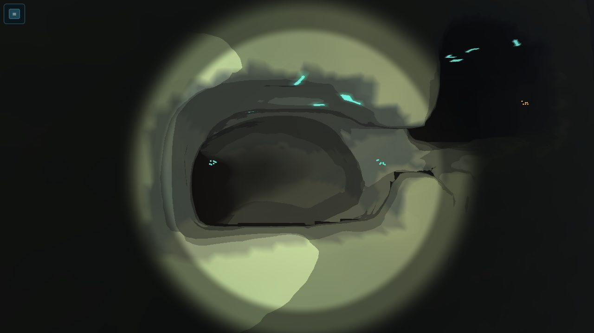
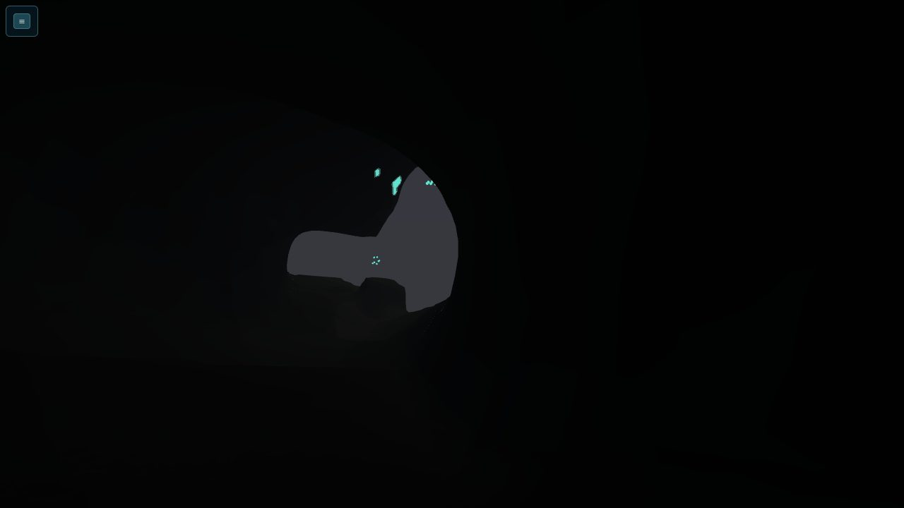
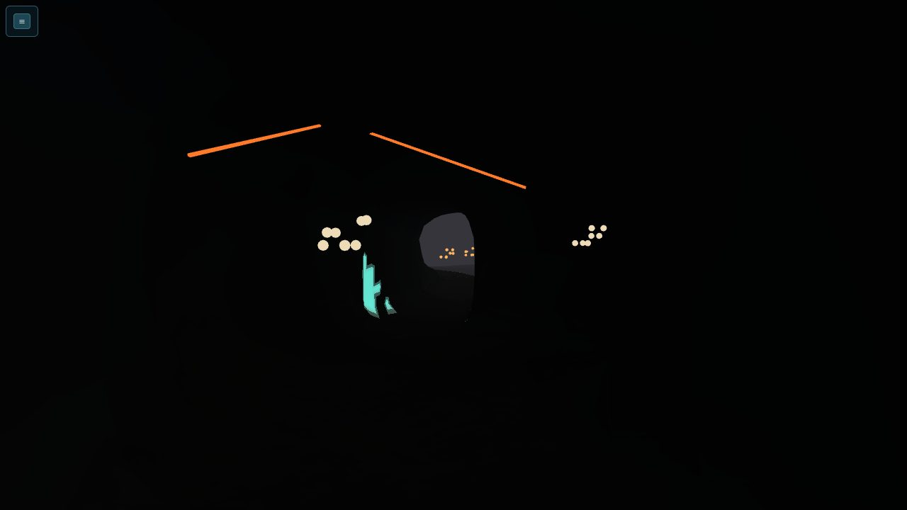
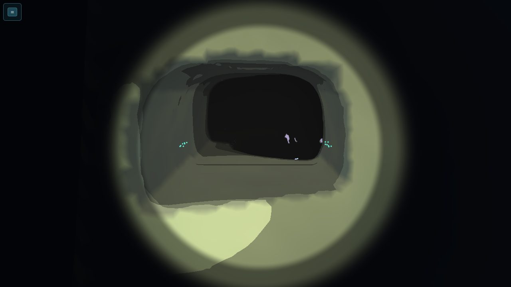
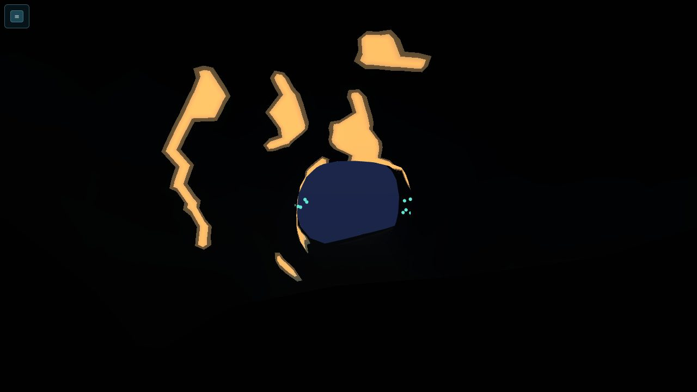
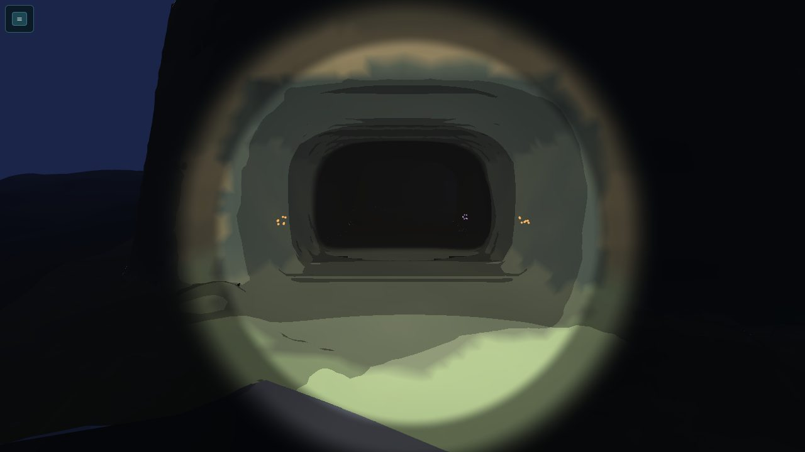
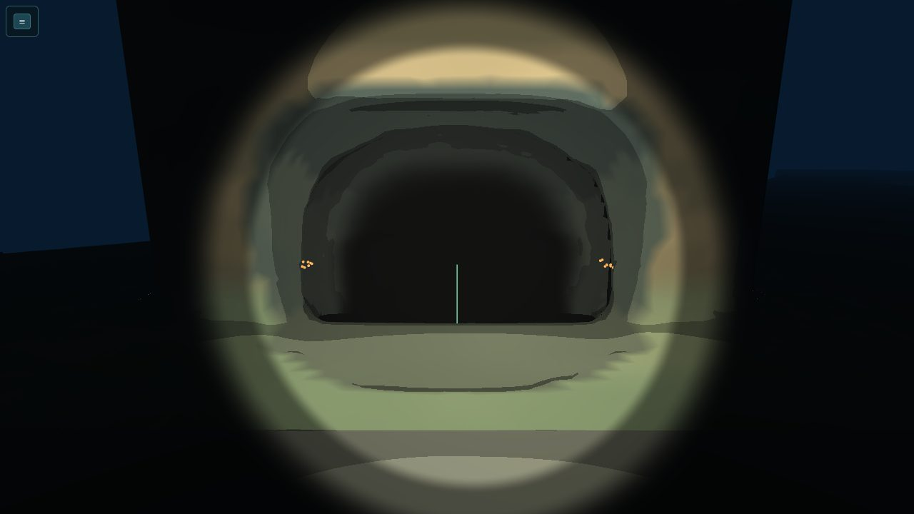
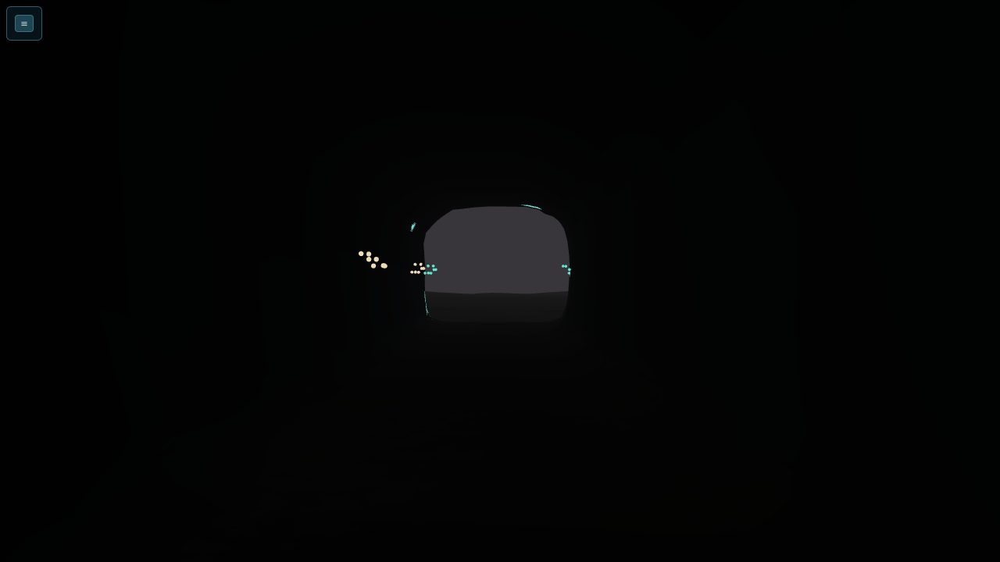

# CA-3: Rift, Divide and Meridian small and medium caves (handoff)

Opus 5.5 high. Branch `t3/rift-divide-meridian-caves`, rebased onto `feat/siltwake-first-expedition` at `4d3a7b9` (CA-1 integrated). R1 fixes below answer [Sol R1](../reviews/CA-3-SOL-XHIGH-R1.md) (on `review/ca-3-r1`). New files only, except one line in a kit file (see *Kit touch*). **Not registered** in `CAVE_SOURCES`; the step is below. Bible: [ember-rift](../../content/regions/ember-rift.md), [mirror-divide](../../content/regions/mirror-divide.md), [meridian](../../content/regions/meridian.md).

## R1 fixes
- **CA-3-01, content in rock.**
  - `CaveContent` gains `hostOffset`, the interaction host relative to the datum, for `INTERACTION_HOSTS` at composition. Without it, each kind uses the production default: sources, seeds and resources −0.2 m in Y, caches +0.3 m, scans 0.
  - Six points moved into water: the north-tube core scan (z −793 → −793.6), the stub lamina scan (y −261 → −261.6), the mirror-pocket cress (x −1 m), the window-gallery ceramic (y −554.5 → −554.1), and the west-tube shelter point. The **cistern lattice keeps its 450 m datum**, with host offset +0.15 m; the tier check still holds.
  - **New heavy check, per cave:**
    - every content point and host is open water against the whole rock roster;
    - every targeted item (resource, seed, cache, scan) has a reachable diver pose within 4 m that sees its host with production `lineOfSight` (the swimming eye), from which production `aimedInteraction` picks it. The item is staged as a source with its real host offset.

    "Reachable" means a lamp-off retreat start (each proven to swim out) or a diver route pose. Negative control: the kiln ceramic pushed 2 m into the wall is caught.
- **CA-3-02, craft on the hull floor.**
  - `routeProblems` now holds every craft route to production `sweptHullClearance`, and every parking pad to `hullClearance`, for every hull the hall lists or the pad admits, with the support floor under the whole footprint.
  - The west-tube Dart start is now the reviewer's `(−318, −284, −940)` → `(−318, −284, −953)`, followed by the original waypoints. Its parking moved up to −284, and the east-pocket parking to −394.
- **CA-3-03, positive danger controls.**
  - **Fast:** every field is dangerous inside itself at its peak. That means heat above the suit's tolerance at the warm end and the end vent, dense water in every pool, and the blister floor warm but under tolerance. Every breath eases at slack, and the end vent stays hot.
  - **Heavy, `caves-deep-hazard-step` (new):** the cave fields are registered in the canonical `HAZARD_FIELDS` before the simulation loads. An unprotected diver is then held at the reachable pose each field hits hardest, through `stepGame`:
    - the real load must rise at least 15 in 3 s at the peak;
    - a breath must load nothing at slack;
    - each route's exit must load nothing at the peak.

    Zeroing every intensity fails it (negative control in the file).
- **Kiln niche, corrected:** the reviewer's real-step runs from inside the end-vent niche at load 90 and peak breath cost **11–14 health** (10.6–15.5 s). My earlier "about 5" came from the constant-speed model. At load 70 it costs nothing. This is an optional warned risk: the warnings come at 40 and 70, and the crawlers lead the breath by 5 s.

## Outcome
All 21 bible small and medium caves for the three deep regions are built with the W1 kit, as **20 sources**. The north-shoulder crawl and tube are one network, in one footprint. Each source builds its rock and its shell from the same data, with rooms, portals, swept routes and staging. Each also has a typed layer: contents keyed to the bible's IDs, lamp-off cues, hazard fields in S4's own form, the hall and its craft, and the chamber graph.
- **Rift: lava tubes that breathe heat.** Black-glass tubes; heat lives only at the warm end of three caves, on the `KILN_BREATH` clock (50 s period, 10 s active, crawlers file into cracks 5 s before). Every warm cave keeps cool water and a cool way out.
- **Divide: brine pockets with mirror floors.** Trapped pools (S4's `layer` shape, 1 m edge) sit in basins at least a metre under every route. Skimmers mark each pool's edge. No route pose dips under the interface.
- **Meridian: cut voids.** Masonry plinths on the flat terraces; culverts, ducts and shafts cut into the real terrace walls. Cable tenders trace live lines, and each line names the lit site it feeds (the spire, or the cut strata's burning work lamps). Story-neutral: every footprint is 30 m or more from every placed story site; no clue, decode or story prop.

| Cave | Size | Footprint (x × z) | Depth m | Water m (x × z × y) | Exits | Hall | Hazard | Moved |
| --- | --- | --- | --- | --- | --- | --- | --- | --- |
| `rift_north_shoulder` (`rift_tube_north` + `rift_shoulder_crawl`) | small ×2 | -124..-64 × -808..-784 | 284–318 | tube 25 × 16 × 6.5; crawl 21.5 × 14.5 × 4.5 | shoulder mouth, ledge mouth | diver | — | 30 m |
| `rift_tube_mites` | small | -128..-107 × -1136..-1112 | 302–308 | 17 × 20.5 × 5.5 | shoulder mouth, split crack | diver | heat (breath) | 3 m |
| `rift_stub_hollow` | small | -4..20 × -1148..-1124 | 261–266 | 18 × 7 × 5.5 | stub mouth | diver | — | 16 m |
| `rift_west_blister` | small | -414..-386 × -974..-946 | 245–255 | 13 × 17.5 × 10.5 | blister mouth, skylight crack | diver | heat (below tolerance) | 20 m |
| `rift_west_tube` | medium | -346..-302 × -1010..-956 | 282–291 | 21.5 × 51 × 9.5 | north mouth, south mouth | Dart, Hush | — | 29 m |
| `rift_kiln_tube` | medium | 140..180 × -856..-798 | 273–291 | 33 × 54 × 18 | plateau mouth, rim mouth | Dart, Hush | heat (breath, end vent) | 30 m |
| `divide_mirror_pocket` | small | 388..412 × -1252..-1228 | 354–368 | 10.5 × 15.5 × 13.5 | ledge mouth | diver | brine (pool, crack) | — |
| `divide_crest_hollow` | small | 678..702 × -1222..-1198 | 362–369 | 10.5 × 15 × 6.5 | crest mouth | diver | brine (film) | — |
| `divide_east_pocket` | small | 782..822 × -1247..-1223 | 387–401 | 23 × 8 × 14.5 | flank mouth | diver | brine (two pools) | 8 m |
| `divide_lee_burrow` | small | 456..482 × -1097..-1073 | 389–394 | 19 × 6.5 × 5 | shelf mouth | diver | — | 1 m |
| `divide_fissure_window` | small | 533..557 × -1336..-1316 | 423–437 | 12.5 × 17.5 × 14 | fissure mouth, window | diver | — | 4 m |
| `divide_lintel_galleries` | medium | 686..754 × -1300..-1228 | 349–365 | 49 × 64 × 16 | crest mouth, south-face mouth | Creel, Mantle, Hush | brine (bay sump) | 4 m |
| `divide_brine_cistern` | medium | 886..924 × -1233..-1192 | 438–454 | 33 × 35.5 × 15.5 | crest mouth, south-face mouth | Creel, Mantle, Hush | brine (lake) | 81 m |
| `meridian_footing_void` | small | 1038..1062 × -1237..-1213 | 517–522 | 18.5 × 8.5 × 5 | shelf-edge mouth | diver | — | — |
| `meridian_culvert_north` | small | 1224..1240 × -1164..-1136 | 577–600 | 5 × 18 × 23 | terrace mouth, cable duct | diver | — | 31 m |
| `meridian_spire_footing` | small | 1170..1194 × -1370..-1346 | 595–601 | 12.5 × 18 × 6 | footing mouth | diver | — | 11 m |
| `meridian_escarp_pocket` | small | 1378..1396 × -944..-920 | 499–505 | 13 × 9 × 6 | ledge mouth | diver | — | 57 m |
| `meridian_terrace_crack` | small | 1113..1131 × -1487..-1469 | 600–623 | 12 × 5 × 23 | terrace mouth, wall slot | diver | — | 28 m |
| `meridian_window_gallery` | medium | 1014..1052 × -1326..-1288 | 513–557 | 33.5 × 23 × 43.5 | window mouth, wall mouth | Creel, Mantle | — | 29 m |
| `meridian_escarp_culvert` | medium | 1320..1352 × -990..-946 | 510–537 | 28.5 × 32 × 26.5 | foot mouth, ledge mouth | Creel, Mantle | — | 40 m |

**Medium caves.** Each has the bible's chambers and a real cycle in the generated water, with the bible's closer realised:
- kiln tube: upper tube, vent, return tube and the diver junction under the lip;
- west tube: arms, fork and the diver bypass;
- lintel galleries: galleries, bay and the cable crawl;
- cistern: landing, north rim and south rim;
- window gallery: window room, gallery shaft, sump room and the service stair;
- escarpment culvert: lower culvert, upper chamber and the overflow tunnel.

Each has two or more exits. Craft legs run along the axes, because the clearance box is axis-aligned.

**Halls are rated for their depth.** A hall lists only craft whose collider fits its profile *and* whose rating reaches its deepest keel:
- **Rift halls (273–291 m):** the Dart's 350 m refit and the Hush.
- **Divide and Meridian halls (349–537 m):** the medium profile. The Dart is not rated, and the Hush is optional and only reaches 450 m, so the Creel 450/800 and Mantle are listed. The fast test fails if a rated, fitting hull is left off the list.

## Files
- `src/content/regions/caves/{rift,divide,meridian}.ts` hold the sources and typed layer.
- `deepKit.ts` holds the constructors and the typed layer's types (`DeepCave`, `CaveContent`, `CaveCue`, `CaveHazard`, `CaveHall`, `CaveGraph`), plus `KILN_BREATH` and the field builders `heatBox`, `heatVent` and `brinePool`.
- `deep.ts` holds `DEEP_CAVES`, `DEEP_CAVE_SOURCES`, `DEEP_CAVE_HAZARDS` and `sampleDeepHazards`. The last is S4's `sampleHazards` plus the cave fields, using the same rule.
- **Tests:**
  - `tests/caves-deep.test.ts` (fast, 8);
  - `caves-deep.heavy.test.ts` (geometry, 90);
  - `caves-deep-dark.heavy.test.ts` (lamp-off, hazards, adverse case: 31);
  - `caves-deep-perf.heavy.test.ts` (cost);
  - shared checks in `caves-deep-support.ts`.
- **Lab:** `tools/cave-lab-deep.html` and `.ts` (with its own tsconfig).
  - **Features:** a cave picker; generated bookmarks (approach, inside toward the exit, plan, overview, each mouth); the lamp; LOD; collision.
  - **Overlays:** cues (unlit), hazards (heat boxes, brine sheets), solids, portals, routes and rooms.
  - **Running it:** `npx vite --port <port> --strictPort --host 127.0.0.1`, then `/tools/cave-lab-deep.html?cave=rift_kiln_tube`.
- **GPU shots:** `tools/cave-deep-shots.mjs` (through `heavy-check.sh`).

## Checks (code at `8a64355`)
- **`npm test`:** 1,106/1,106, including the 8 new fast tests. `npm run build`: OK; the bake is unchanged while the caves are unregistered.
- **Heavy, through `heavy-check.sh`:**

  | File | Time | Peak RSS (MiB) | Tests |
  | --- | --- | --- | --- |
  | `caves-deep.heavy` | 20.3 s | 625 | 90/90 |
  | `caves-deep-dark.heavy` | 61.8 s | 596 | 31/31 |
  | `caves-deep-perf.heavy` | 9.6 s | 438 | 1/1 |

  Root's `cave-light.heavy` still passes after the kit touch (203 MiB).
- **Per cave (heavy):**
  - shell and rock agree (solids are exactly the owned rock voxels, and the shell sits within 0.35 m of rock);
  - every portal's clear rectangle is free of rock and of both shells;
  - every route sweeps its own profile in the composed world;
  - roof support (thick roof over probe columns; a diver stands on it and can't sink through) and no roof holes;
  - coarse LOD keeps every opening and route;
  - the collar meets the floor;
  - the envelope holds at least 2.5 m of rock under the floor;
  - staging outside the footprint;
  - a cycle among the chambers in every medium cave, with no sealed room;
  - every bible cave's water fits its size class.
- **Negative controls:** a 2 m block in the kiln's plateau mouth stops its craft loop, and plugging every kiln opening makes the retreat fail.
- **Composition:**
  - root's caves plus these build one world on the 8 m index;
  - every non-carrier route near them sweeps exactly as before;
  - the deep caves alone build without a legacy-guard or overlap throw.
- **Fast (data):**
  - every bible cave realised once, with matching exits, chambers and loop closers;
  - footprints are disjoint, in-region, clear of the preserve, sites, sources, structures and routes, and 30 m or more from story sites;
  - hulls are rated and fit;
  - contents keep the bible's items and stock, and every bible resource in these caves is placed;
  - required materials keep at least 2 exterior sources outside the caves;
  - every exit has an unlit cue, and a cave's exits never share a cue colour;
  - each bible resident is present, and live lines name lit sites;
  - hazard rules hold, and no value imports come from `caves.ts` (`EXTERIOR` is pinned equal).
- **GPU (RTX 3090, ANGLE GL-EGL, task-owned headless Chrome on port 5371, everything closed):** daylight (lamp on, at the approach) and lamp-off (inside, about 12 m back from the exit) for all 20 caves. 0 page or GL errors. Record: [`ca-3/shots.json`](ca-3/shots.json).

| | | |
|---|---|---|
|  Kiln tube, plateau mouth |  Kiln, lamp off: the plateau mouth reads, teal colonies frame it |  Mite tube, lamp off: ember cracks, crawlers, the split crack's amber glimmers |
|  Cistern, crest mouth on the flank |  Mirror pocket, lamp off: the ledge mouth |  Lintel galleries, crest mouth |
|  Window gallery: window mouth, a tender's live line |  North culvert, lamp off: live lines toward the terrace mouth |  North tube, lamp off: the bench mouth |

The other 31 shots are in [`ca-3/`](ca-3/).

## Numbers
- **Build:** 20 caves, **9.4 M voxels, 19,628 rock boxes** plus about 133,760 collar columns, **2.5 s to build all 20** on the shared VM (largest: cistern 1.66 M voxels in 0.65 s, lintel 1.57 M, window gallery 1.25 M, kiln 1.05 M). Root's Fanvault alone: 1,504 boxes and about 9,920 collar columns.
- **Query cost:** a diver step (1/60 s swim plus support) inside these caves, with root's caves loaded, costs **33.4 µs** (9,075 steps), against 21.8 µs inside the Fanvault in the root world.
- **Load:** heavy, but within budget. The concern is **first-use build time**: `gameWorld()` builds every cave on first use, so with CA-1's 18 caves, CA-2 and W2 added, startup grows by seconds. I'd build caves per region lazily, or bake the rock, before all four streams land.

## Darkness and hazards
- **Lamp-off retreat (the W1 oracle):** 6,189 starts in all 20 caves, taken every metre along every route plus a 2 m lattice of every room's water. 0 failures. Every two-exit cave is left by both exits.
  - **Policy:** only what an unlit diver sees (path-length glow), each hop swept with the full diver, ending in fully lit open water through an authored opening.
  - **Exit visibility:** in the deepest Meridian caves the opening reads as the lighter fog of open water against black rock (checked on the 3090 from inside the foot mouth at 533 m), plus the kit's unlit mouth colonies and these cues.
- **Hazard-aware escape:**
  - **Setup:** in every heat and brine cave, from every retreat start, at every breath phase (2 s apart), starting with loads at 70 (warned, grace spent) and 20% air (36 s). Same lamp-off swim at ordinary speed (3.4 m/s), on S4's `stepExposure` with the unprotected suit.
  - **Result:** no harm, safe water at the end, inside the air.
  - **Not heat-only:** at least 40% of every warm cave's water stays cool at the breath's peak, and the warmest pose's way out stays cool once it leaves the warm end.
- **Adverse case** (20% air, heat load 90, lamp off, from the deepest point of each Rift tube network, every breath phase): out to cool open water with no harm in every case.

  | Cave | Exit | Hops | Worst time (of 36 s) | Peak heat load |
  | --- | --- | --- | --- | --- |
  | Kiln tube | plateau mouth | 3 | 5.9 s | 90 |
  | North shoulder | shoulder mouth | 2 | 3.0 s | 90 |
  | Mite tube | shoulder mouth | 2 | 2.5 s | 91.2 |

  **Also measured:** starting *inside* the kiln's end-vent niche at load 90 during a breath peak costs 11–14 health in Sol's real-step runs (see *R1 fixes*). The same start at load 70 passes.

## Bible changes (for CB and the coordinator)
- **Moved, all clear of what the bible's footprint hit:**
  - kiln tube: 4.7 m from the carrier lane, and its east part in the Basin region; now x 140..180;
  - west tube: `route.rift.core` crossed it;
  - stub hollow: `route.rift.divide_flank` was 1.5 m away;
  - blister: it sat across a 17 m slope; now on the flat plateau;
  - mite tube: off the gauge post;
  - cistern: the bench route crossed it, its 450 m rim lay in the brine field, and it covered the required `divide_lattice_flank_south` ledge. It's now 38 m north of that ledge on the same contour; the ledge stays exterior;
  - spire footing: off the terraces route;
  - escarpment pocket: into the escarpment's east wall;
  - escarpment culvert: off the escarpment route;
  - north culvert and terrace crack: into the real terrace walls their layouts describe.
- **Depth:**
  - kiln tube: 273–291 m (was 300–330), just under the plateau lip, which cuts its envelope from 2.3 M to 1.05 M voxels;
  - other caves stay within or near their bible bands.
- **Halls:** the Divide and Meridian halls take the medium profile (Creel and Mantle), as above. The bible's "small" can't be met by a rated required craft there.
- **Cistern:**
  - The craft enters by the crest mouth, crosses the lake hall and turns there; the bible's south-face mouth is diver-only, as the bible has it.
  - The diver ring is landing → north rim → south rim → landing.
  - Lattice sits on the landing's rim at exactly 450 m, a metre above the mirror (−451).
- **North shoulder:** the crawl and the tube are one footprint, because the bible's two footprints were 26 m apart across a cliff. The crawl drops down a shaft inside the cliff. Each bible cave's water is held to the small class separately: crawl 21.5 m, tube 25 m.
- **Additions:**
  - a brine film in the crest hollow's back crack and a sump in the lintel bay, so every bible cave with a skimmer resident has a pool to skim;
  - tenders on live lines in every Meridian cave that lists them.
- **Mirror pocket:** its crack is the seam's back entrance (`rift_divide_seam.pocket_drop`). It ends in a brine-floored choke at −367.5, inside the seam's planned domain. The seam builder opens it from below this cave's `baseY` (−371).

## Registration (coordinator)
1. **`caves.ts`:**
   - `import { DEEP_CAVE_SOURCES } from "./caves/deep.js";`
   - `CAVE_SOURCES = [FANVAULT_SOURCE, ...DEEP_CAVE_SOURCES]`

   The deep files import only types from `caves.ts`, so there is no cycle.

   **Trial-registered here, not committed.** Results:
   - `caves`, `cave-world`, `c4-cave-bake`, `regions-world` and `caves-deep` pass.
   - `c4-world`: only its `CAVE_SOURCES.length === 1` tripwire fails.
   - `content-proposals` (CB's): 3 fail, because the sources realise bible proposals under their own IDs: ID reuse, overlap with the bible footprints, and density counted twice. CA-1 hit the same. Patch: treat a proposal realised by a kit source as realised, using `DEEP_CAVES[].bible` (`rift_north_shoulder` realises two).
2. **Bake:** registration changes `caves.ts`, so `npm run build` rebakes and adds `<chunk>.cave-<id>` shells. Run `bake-terrain --verify` after.
3. **Hazards:** append `DEEP_CAVE_HAZARDS` to the fields the game samples. `sampleDeepHazards` shows the rule. The breath needs `KILN_BREATH` on the cycle framework, with the crawler cue's 5 s lead.
   **Content hosts:** register each targeted content item's `hostOffset` (or its kind default) in `INTERACTION_HOSTS`; the heavy check stages exactly that.
   **Current masking is required before composition:** with current unmasked, Sol found a diver resting in the crest hollow drifts into the brine film in 15 s (health 95.8), and the lintel crossing drifts 11 m.
4. **Art and audio:** cues, contents and live lines are data. The kit paints every shell in the reef palette, and paints mouth glows amber or teal by `normal.z` only. CA-1's `STYLE_PALETTES`, plus a cue renderer, would give these caves their black glass, lavender and masonry. The `style` field is set on every cave.
5. **Currents:** the crest downwelling's field doesn't know about rock, so it blows inside the crest hollow and lintel galleries. Mask current fields in carved cave water so the "sheltered" caves are sheltered.
6. **10 m band:** three footprints sit inside C4's conservative 10 m route band:
   - `rift_north_shoulder`: 2.9 m from `route.rift.core`;
   - `meridian_window_gallery`: 9.5 m from `route.divide.service_ledge`;
   - `meridian_escarp_culvert`: 9.0 m from `route.meridian.escarpment`.

   The composed sweep test shows those routes unchanged.

## Kit touch
`src/render/caves/lightField.ts`: the daylight distance array is now `Float64Array`. That is CA-1's identical one-line fix (`394ca28`). Without it, the light-field heap never terminates on these caves, which hangs the renderer and the tests. Identical hunks merge cleanly.

## Overlap with parallel streams
None. The nearest CA-1, CA-2 or W2 footprint (on their branches today) is 247 m away (W2's `hub_crown_shaft` against the kiln tube).

## Known limits
- **Shells look like the reef:** see *Registration* 4. The cue layer renders only in the lab.
- **Coarse LOD at steep mouths** stays at most a coarse voxel inside a craft's box. Fine LOD keeps 0.35 m.
- **Erosion:** where a footprint edge crosses a cliff whose floor falls inward, the kit's 2 m-cube opening erodes up to about 2.5 m behind the seam. This leaves a notch, not a gap. The collar check allows for it.
- **The cistern craft "loop"** is a turn in the hall: the flank face leaves no room for a craft ring. The ring is diver scale.
- **Glimmers** (`vault_glimmer`) are not used here; the residents and colonies carry the lamp-off cues.
- **Not driven through `stepGame`:** the caves aren't in `gameWorld()` until registered, so the swims use the composed world and S4's exposure model directly. C4's ordinary-key path should be re-run after registration.
