# CR-1: natural threat windows and creatures as resources

Opus 5.5 high. Branch `t3/natural-threat-windows`, on root `7070084` (C4, CA-3, CB-2, HUB-2, DISH-1, TT-1 and SCHED-1 integrated). Head: see the report; the checks below name the commit they ran on. Story-neutral; `docs/spoilers/*` not read.

## Outcome
**A. A natural way past every threat.** Each threat has its own creature cycle. While a threat is busy it perceives nothing and never escalates; if it was engaged, it breaks off with a caption and is spent through S4's refractory. Afterwards ENC-1's full warning ladder applies.

| Threat | Window (cycle ID) | Seen as | Busy / worst wait |
| --- | --- | --- | --- |
| Sound hunter | `cycle.canopy.hunter_feeding`: it swims 55 m east and circles the lantern shoal | it leaves, the shoal bunches and flashes, then scatters as it returns | 56 s / 61 s |
| Glare stalkers | `cycle.rift.stalker_feeding`: both rise into the venting plume and linger 15 s on what settles | lights ripple fast and warm up in the shimmer; the mites leave first | 36 s / 39 s |
| Layer skates | `cycle.divide.skate_rest`: in crest slack they rise and lie still 0.9 m under the mirror (CRE-05) | their dark outlines and humped backs lie still on the mirror; the patrol ripples stop; the crest ribbons stand upright | 34 s / 56 s |
| Layer skates | `cycle.divide.skate_laying`: a rare visit to lay on the lee shelf egg cases, above the brine (CB-2) | laying skates circle the egg cases | 90 s / 270 s |
| Hollow choir | `cycle.meridian.choir_rest`: the bells fold shut and rest | the rims dim and the bells close | 26 s / 52 s |

- **First sight** of each window shows one short caption, and the journal's cycles tab starts timing it, using CY's observer.
- **Bait:** M releases a caught small fish 8 m ahead, where it sinks and struggles.
  - The stalkers and skates turn to feed on it, as they do for a lure.
  - The choir closes on it.
  - A resident hunter takes it as a 20 s distraction. A hunter already away feeding ignores it.
- The existing deterrents and ENC-1's rules are unchanged. Helper animals are now allowed, but none were needed: the schools at grounds, the hunter's shoal and the mites already read naturally.

**B. Creatures as resources.** None of the new items is a material; the bible's eight stay eight.

| ID | What |
| --- | --- |
| `small_fish` | Caught by hand (E: one) or with a carried `hand_net` (two; membrane and resin at the pod). Cooked, released as bait, or trapped. |
| `roe_cluster` | Rich food from spawning grounds. One cooks into two meals. |
| `planter_feed` | One feed on a young crop (under 40% grown) grows it 40% at once. A crop takes feed once. |
| `mod_fish_trap` | A SYS-2 module (`trap`, no power). One fish per 240 s near a fish ground or CB-2 trap spot, half that rate elsewhere. Holds at most 4, then waits. Dry hosts (the workshop) refuse it. Its catch travels with the module. Emptied in one press. |

- **Cooking** is one interaction with portions (Cargo → Catch: "Cook 1 portion" or "Cook all"). It works at the pod and workshop galleys (the refuges that already issue meals), the Creel cabin cooker and the Hearthline galley. Roe is used first, then fish in pairs. Meals keep.
- **Grounds** are ordinary `SOURCES`, with every ID, item and datum as CB-2's `src/content/proposals/fauna.ts`. Each regrows one unit to a cap, never as a timed wait:
  - fish: `reef_fish_ribs`, `isles_fish_split`, `basin_fish_ridge`, `hub_fish_crown`;
  - roe: `reef_roe_nursery`, `isles_roe_cove`, `canopy_roe_crowns` (in the hunter's home crowns: take it while the hunter feeds);
  - shed: `reef_shed_moults`, `isles_shed_shells`, `canopy_weaver_resin`, `rift_mite_grit`, `basin_scavenger_casts`, `rift_crawler_moults` (in CA-3's kiln tube), `divide_picker_moults`, `meridian_scavenger_casts`.
- **Carcass falls** (`fall_basin_west`, `fall_basin_east`, `fall_divide_lee`) are static ribcages with scavengers at CB-2's raised datums, at least 30 m off every route. Their salvage (hide, bone, crust) is finite.
- **Protected:** `divide_skate_eggcases` and `hub_ray_eggcases` are scan-only (HUD "Look · protected"). Threats, rare residents and story animals are never sources.

## What changed (contracts)
- **New, CR-1-owned:**
  - `src/content/fauna/{items,grounds,windows}.ts`;
  - `src/sim/fauna/{windows,catch,trap,link}.ts`;
  - `src/render/creatures/fauna.ts` (schools by stock, roe, shed piles, egg cases, falls, the hunter's shoal, laying skates);
  - `src/ui/faunaPanels.ts`;
  - `tests/cr-1-creatures.test.ts` (fast, 12 tests) and `tests/cr-1-creatures.heavy.test.ts` (9 window, bait and placement simulations), split for TT-1's fast-file CPU budget, with shared helpers in `tests/cr-1-support.ts`;
  - `docs/build/streams/cr1/{derive,play,approach,milestones}.mjs`.
- **Ecology and threats (owned):**
  - `agents.ts`: a busy branch, and break-off sets spent; engagement counts are never refreshed by a window.
  - `ecology.ts`: bait sinks; `EcologyView.threats[].busy`.
  - Deterrent `bait` added in `species.ts`, `persist.ts` and `equipment.ts`.
  - `hunter.ts` and `hunterEncounter.ts`: the round's target and speed; no interest gain while feeding; break-off; the idle round's unswept path (below); CRE-03's visible pass point (`hunterPassPoint(s, at, world)` tries eight closer, higher or straighter variants until one has a clear sight line from the eye).
  - `choir.ts`, `stalker.ts` and `skate.ts` show the busy postures; `cues.ts` draws bait; `layer.ts` composes the fauna group.
- **Minimal, additive edits in shared roots (please review):**
  - `content/registry.ts`: `FAUNA_ITEMS`, `FAUNA_RECIPES`, `FAUNA_SOURCES` and `FAUNA_RENEWAL` spreads; `SourceDefinition.item` adds `FaunaItemKind`.
  - `content/currents/cycles.ts`: five creature cycles appended to `WORLD_CYCLES` and `CYCLES`, beside CY's warden candidate.
  - `content/systems/{items,hosts}.ts`: the `mod_fish_trap` row and recipe (`bp_field_outpost`) and `MODULES.trap`. `stackable` includes fish, roe and feed.
  - `sim/systems/state.ts`: **`SystemsState.traps`** (`{moduleId, progress, held}`), strictly validated; `instances.ts` cross-checks it.
  - `save/content.ts`: an absent `systems.traps` is New Game's `[]`.
  - `sim/step.ts`: one `faunaCommand` hook before `systemsCommand`, and one `stepFauna` call after `stepSystems`.
  - `sim/types.ts`: commands `cook-catch`, `release-bait`, `feed-planter` and `empty-trap`.
  - `sim/progression.ts`: the net bonus and empty-ground text in `collectWithOutcome`.
  - `sim/inventory.ts`: stacking.
  - `ui/panels.ts` registers the Catch section; `ui/systemsPanels.ts` adds one line for socket actions; `ui/hud.ts` adds one line for verbs.
  - `runtime/app.ts`: `KeyM` releases bait.
  - `render/renderer.ts` passes `state` to the creature layer and sets `canvas.dataset.tick` (the sim tick, read only by evidence drivers to time windows).
  - `render/{expedition,environment}.ts` skip creature grounds in the legacy source art.
- **Saves:** no schema bump. New sources and renewal rows load as New Game's (additive content); `systems.traps` is filled as `[]`. `earned-c06.json` and `reef-rib-trap.json` were re-canonicalised by decode → encode; only rows were added.
- **Test pins updated for additive content.** Each comment says why:
  - roster and renewal pins: `resource-renewal`, `renewal-save`, `additive-content`, `campaign-economy`, `progression-curve`, `c4-world`, `persistence-support`;
  - normal views: `targeting-support`;
  - window observation is ignored in knowledge and notice equality: `expedition`, `recovery-occupancy`, `c4b-fixes`;
  - `presentation` lets another host's "Move closer" show;
  - `regions-world`;
  - `content-proposals` lets a declared in-cave ground sit in its cave;
  - `creature-lore`: a protected spawn may be a scan-only source.
  - Scripts: `check-m1-economy` names the hand net and HUB-2's crown recipes; the playthrough adds a `creatures` phase (catch, cook, craft and socket a trap at the pod) and empties the trap at the refits payoff, with fail-closed effect rules.
- **Playthrough harness:** `scenarios.ts` stops a parent scenario that wasn't requested at its branches' milestone (before, `--scenario creel-loss` also played creel to the end). Requested scenarios run as before.
- **CB-2 lore edit:** `fieldGuide.ts`, `fieldNotes.ts` and `FIELD-GUIDE.md` now say the skates settle just under the mirror in slack water (was: sink into the brine), to match CRE-05. Flagged for CB.

## Compromise verdict (CRE-03/04/05/08)
- **CRE-05 (done):** a resting skate rises to 0.9 m under the mirror and lies still. Its rest outline (body, both wingtips, tail) sits on the mirror with low humps for the back and wingtips, so it reads from the crest and at a grazing angle. The patrol ripple stops while it rests. Test: `CRE-05` (fast).
- **CRE-04 (interim, done):** the stand-in laying skates appear or leave only while their spot is out of the camera's view (a 1 rad cone, 140 m). One still in view after the visit keeps circling the egg cases until the camera turns away. Test: `CRE-04 (interim)` (fast).
- **CRE-03 (fits, done):** see `hunter.ts` above. Test: `CRE-03` (fast) puts a 3 m crown trunk across the usual point.
- **CRE-08:** one native continuous approach per window; results under 3090 play.

## Compromises: root fix and cost
| Compromise | Root fix | Cost until then |
| --- | --- | --- |
| **Laying visit uses stand-ins.** The roster skates sink away north under the mirror; two stand-in skates lay at the lee shelf, 340 m away. The sim can't path a skate over the crest, out of its brine habitat. | NAV-1 migration lanes: one skate agent paths mirror → crest → shelf and back. | Nobody sees a skate leave the mirror and arrive at the shelf. A player watching the shelf when the visit starts sees no arrival until they look away. Watching the empty mirror is the only cue to go to the shelf. |
| **The idle hunter's round is unswept.** With no diver or craft within 30 m (`HUNTER_ROUND_UNSWEPT`), it follows an authored path (home, the east leg, the feeding circle) without a swept move. Per step: 808 µs → 193 µs, against root's 138–156 µs. | Make the swept move cheap enough for every agent every step (a broadphase for the world colliders). | The path is right only while the water along it stays open. A heavy test sweeps the whole path, so new geometry across it fails the test rather than clipping silently. Within 30 m, the swept move runs as before. |
| **CRE-03 has a fallback.** If all eight variants are hidden, the pass takes the usual point. | Early NAV-1: plan the pass from what the eye can see. | A pass may still be unseen where the crowns enclose the diver on every side. Not measured across the Canopy. |
| **The laying caption fires only at the shelf.** The visit is watched from the lee shelf, not from the saddle. | The same migration lanes: watch the moving skates. | The saddle shows the skates leaving, but the journal times nothing there. |
| **`dataset.tick`** on the canvas, for drivers. | A test hook API (REC-1's recorder could own it). | One DOM attribute written per frame. |
| **Not built:** a trap model in the world, breeding tanks, light jars. | A later stream. | The trap shows only in the Base panel. |

## Checks
Sim code final at `de3d4f6`; later commits touch only evidence drivers, render art and this page.
- **`npm run test:fast`:** FASTLINE That includes `cr-1-creatures` (12 tests) and CB-2's `creature-lore` comparing my composed rows. The covered behaviour:
  - **Windows:** each one exists, the worst wait is about a minute or less, and each opens long enough to cross. The CRE-03, CRE-04 and CRE-05 tests are above.
  - **Conservation:** catching by hand and by net, regrowth to the cap, cooking ratios, trap catch, cap and emptying (through a save), feed once per crop.
  - **Protection:** protected species are never harvested; nothing loops; no source feeds more than 8 meals an hour.
  - **Saves:** a pre-CR-1 save loads with New Game's grounds and empty traps.
- **`npm run test:heavy`** on the second worker at `de3d4f6`: 60 files, 455/455 pass. `cr-1-creatures.heavy` (6.2 s) covers:
  - an animal engaged when its window opens breaks off, and nothing strikes inside the window;
  - afterwards the first harm comes at least `WARNING_LEAD` after a fresh alert;
  - a loud, lit diver crossing inside each window at 2 m/s is never struck;
  - in the composed world the animals reach their feeding and resting places;
  - the hunter's round gives no warning or bite, and after it the 6% bump ladder resumes;
  - the laying visit; first sight; bait (on the stalker and the resident hunter, not the feeding one);
  - grounds on the floor outside caves, and falls at least 30 m off routes;
  - the unswept round path is open water the whole way.
- **`npm run build`:** BUILDLINE
- **Economy scripts:** ECONLINE
- **`npm run playthrough`** on the second worker at `de3d4f6`, run whole (`--jobs 3`): all five scenarios complete with no blockers, and every milestone reload matched:

  | Scenario | Play time | Saves |
  | --- | --- | --- |
  | creel | 201.7 min | 16 |
  | carrier | 363.0 min | 17 |
  | creel-loss | 209.7 min | 17 |
  | reverse | 206.7 min | 16 |
  | no-optional | 200.9 min | 16 |

  The new `creatures` phase takes 0.8 min of play. It catches 2 fish, crafts a trap and sockets it at the pod. The fish-cooked and trap-emptied checks pass in every scenario that reaches the pod payoff; the trap empties 3–4 fish. Both routes reach the ending.
- **Per-step cost** (CPU time, idle Canopy): 193 µs, against root's 156 µs, after the unswept round (it was 808 µs with the swept round).

## 3090 ordinary-key play
Task-owned headless Chrome, ANGLE GL-EGL on "NVIDIA GeForce RTX 3090", through `heavy-check.sh` (three jobs, each under 5 min of play), closed at the end, 0 page errors. Driven by the game's keys and the panels' own buttons ([`cr1/play.mjs`](cr1/play.mjs), records `cr1/play-*.json`). Saves come from [`cr1/derive.mjs`](cr1/derive.mjs): P1's creel scenario played headless to Meridian (every phase passes, including the new `creatures` phase), branched from its milestones, then idled with real steps until the scene's window was due. In the window scenes the diver is placed at the scene (a diagnostic shortcut, as C4's `derive-c`).

| | |
|---|---|
| 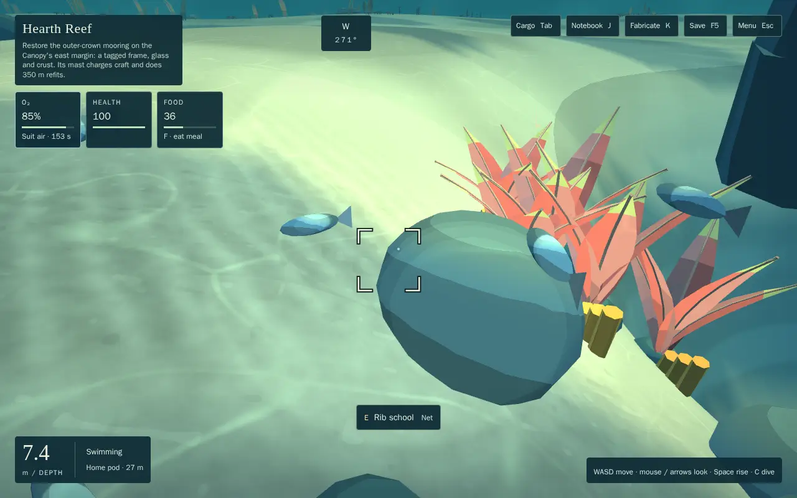 Rib school: "E · Net" | 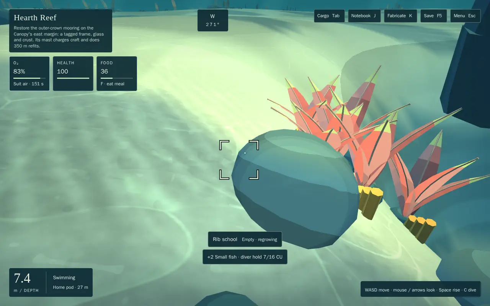 "+2 Small fish" twice with the net |
| 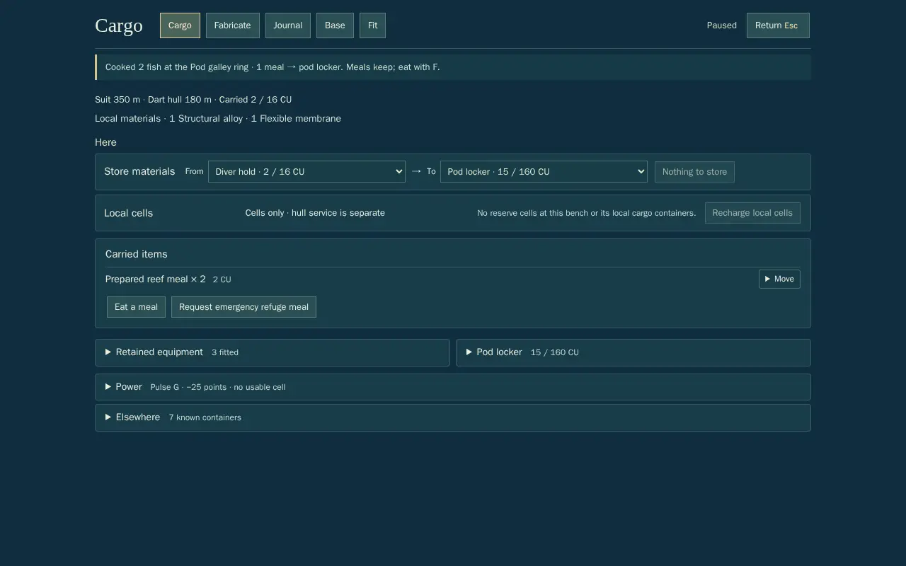 Pod galley: "Cooked 2 fish · 1 meal → pod locker" |  Base: the pod's fish trap at "2/4 fish · next in 4 min" |
| 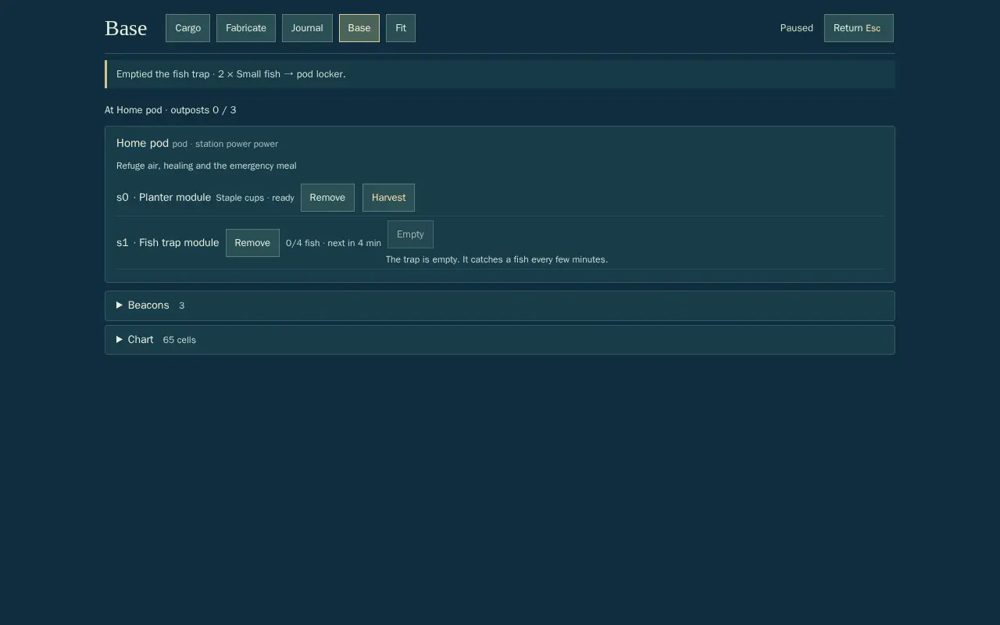 Emptied: "2 × Small fish → pod locker" | 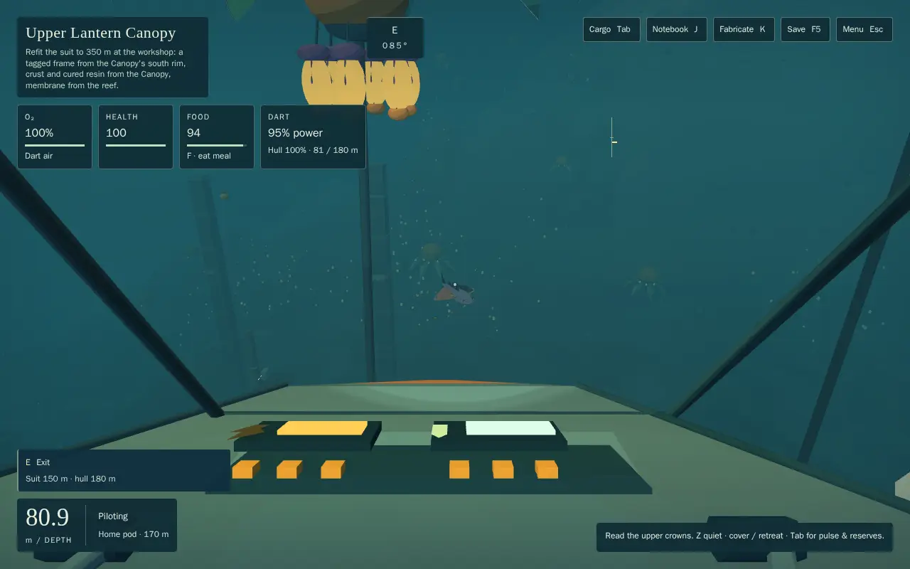 The Dart loud and lit; the hunter away feeding east |
| 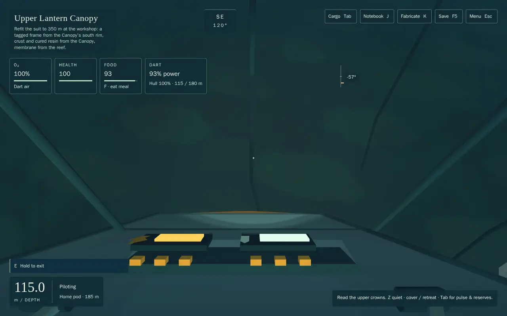 Lab reached, no warning, hull 100% | 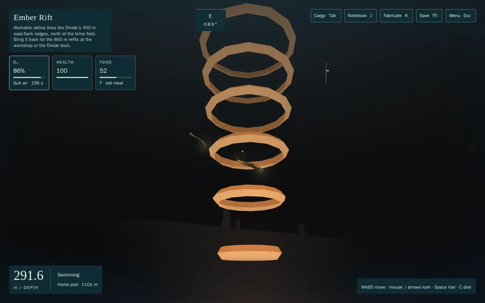 Both stalkers up in the venting plume |
| 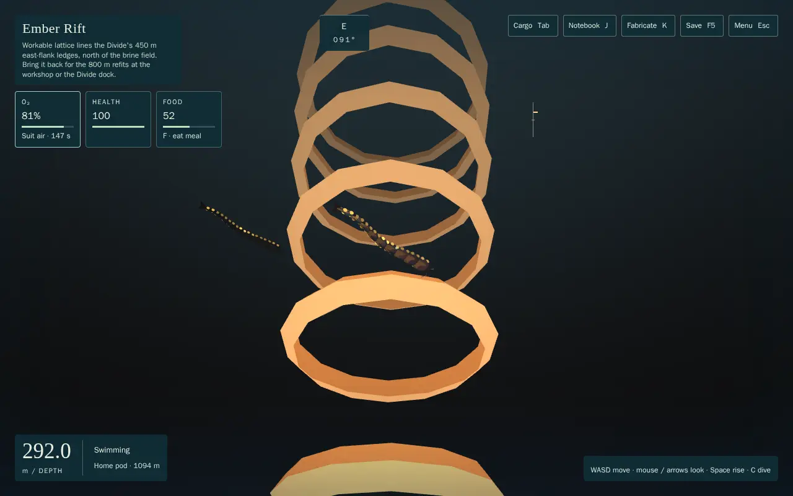 The diver in the passage, lit and sprinting; health 100 | 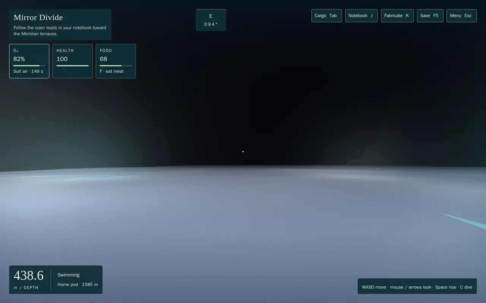 Across the mirror in slack water; health 100 |
| 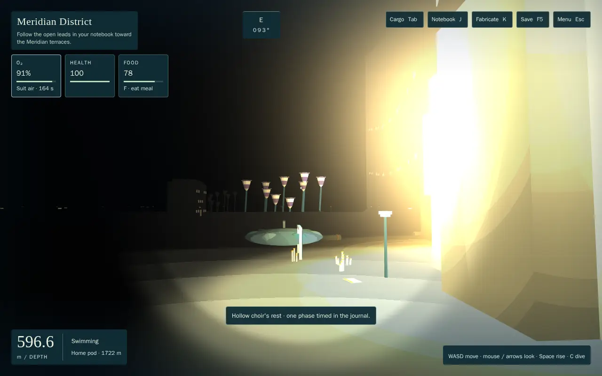 The choir closed and resting | 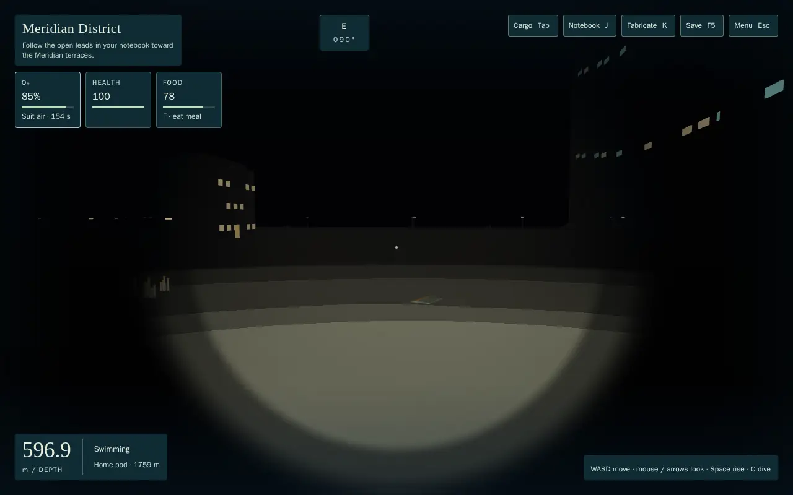 Through the bells' reach, sprinting; health 100 |

- **Captions seen:**
  - every scene's first-sight caption (hunter, stalkers, skates, choir);
  - the mites' existing cue;
  - "… · one phase timed in the journal" for each window.
- **No threat banner** in any scene.
- **Not visible:** the skate's sinking can't be seen through the opaque mirror. A faint patrol ripple on the mirror (added after the first run, gone while resting) doesn't show from 30 m at a grazing angle. The rest reads by the crest ribbons, the caption and the absence of any warning.

## Adverse case
S4's real-world adverse case: a diver who lingers lit and loud in the stalkers' passage, then climbs out dark. When I first added windows, the busy branch reset the animal's strike count, so every feeding bout gave the stalkers a fresh engagement. The diver lost **229 HP** against S4's 60 HP bound. Fix: a window never refreshes an encounter, and an animal that breaks off to feed is spent through its refractory, as a lure spends the choir. The bound holds again (`ecology-world`, `ecology-adverse` and `ecology-agents` pass unchanged).

## Known limits and notes
- **Bible conflict:** `meridian.choir_rest` was listed as "existing refractory, don't add a cycle". The owner's 2026-10-22 rule (every threat has a natural window) supersedes it. The owner accepted the choir's natural rest overriding the bible (2026-10-22).
- **Moved from CR-1's draft for CB-2:** none. All datums match CB-2. `rift_crawler_moults` sits on the kiln tube's floor (CA-3).
- Creature log text belongs to CB-2.
- **Tuning hypotheses for the owner's playtests:**
  - fish regather 1 per 240–300 s (cap 3–4);
  - roe 1 per 15 min (cap 2);
  - a trap at most 7.5 meals an hour;
  - no source feeds more than 8 meals an hour.

  Food was already non-scarce (the reef cups can always be tended), so these add options, not a required path.
