# CW-1: every authored cave in the game, streamed without pauses (handoff)

> **Resume note (R5, paused for the host reboot):** R5-2 (GPU credit off, diagnostic only), R5-3 (budgets reverted to 1,024) and R5-5 (deep hazard reference restored) are done in the WIP commit; the handoff text below is still R4's.
> **Next:** R5-1 (warmup after records and admission, readiness for every cave query, pending/slow/failing-pack tests), R5-4 (regenerate the r14 state summaries and prose), reclassify the retained evidence, the composed functional sweep of the seven segments, then the R5 handoff and "done at <sha>".
> **Tickets to resubmit:** none (nothing of mine was queued or running at the pause).

Opus 5.5 high. Branch `t3/enable-authored-cave-streaming`, from root `3650e6b`; root merged at `c649b11` (CA-3, CB-2, POI-1), `0a4539d` (TT-1), `ba7d5fa` (SCHED-1, the shared terrain store), `a536775` (SCHED-2a, CR-1, UX-1) and `91dc1ab` (SCHED-2b, SAVE-1). Root merged again at `21a1652` (SIM-1a, TST-16, SIG-1 stage 0, STEW-1) and, after review R4, at **`9029963e`** (SIM-1b, COL-1 A, SIM-PERF-1; root `732fe59c`). Code after R4: the R4-2/R4-3 fixes `6ee7bff3`, R4-1 and the sampler worker `8ba62f09`, evidence tooling `fc5059ff`, the bake's worker blocks `f9525447`; the evidence commits and this handoff follow. Runs:
- the clean remeasure at `3779f59c` (r10);
- the targeted remeasure of its failures at `6ca73311` (r12);
- R3's single rerun at `64bf2565` (r13), with tour 1 at harness `da1c83b0` on the same build;
- R4's one exclusive rerun of tour 1 and deep 2 on the composed build at `fc5059ff` (r14), after a 4070 rehearsal.

Reviews:
- R1 `review/cw-1-r1` (`docs/build/reviews/CW-1-SOL-XHIGH-R1.md`);
- R2 `review/cw-1-r2` (`docs/build/reviews/CW-1-SOL-XHIGH-R2.md`);
- R3 `review/cw-1-r3` (`docs/build/reviews/CW-1-SOL-XHIGH-R3.md`);
- R4 `review/cw-1-r4` (REQUEST CHANGES on `a431d253`; *R4 response*).

## Outcome
All **55** authored small and medium caves are in the real game: the Fanvault and W2's four hub caves, CA-1's 18 Reef and Isles caves, CA-2's 12 Canopy and Basin groups, and CA-3's 20 Rift, Divide and Meridian sources. The browser never generates a cave: collision and light are baked, streamed ahead by proximity and heading, built in time slices and evicted behind and far first. At 1920×1080 on the RTX 3090, the driving ran from earned library saves by ordinary keys: an 8-segment Dart tour from `tour-ready`, and the 800 m Creel from `canopy-over-geared`, with service calls and reserve cells.

**Clean remeasure after R2 (r10, `3779f59c`, TST-16 installed):** 16 segments, 167 minutes, 602k frames.
- 83 of 84 cave stops, every Meridian east cave included, and the Isles surf cave once.
- **Never held, never built a cave unsliced, never drew a cave dark.**
- 8 segments failed the streaming gate.

**Why those frames ran long:** a diagnostic run found every long frame inside host pauses of the VM (*Traversal*). So the gate now subtracts the time stolen from our main threads and judges what remains. The remainder showed real costs of ours: chunk disposal over the byte budget, per-mesh light budgets, and planning time we didn't measure. They're fixed at the root.

**Targeted remeasure of every failed segment on the fixes (r12, `6ca73311`):** 41 of 41 stops, 0 holds, 0 unsliced builds, 0 dark cave frames.
- Light placement p99 0.2 ms, worst 4.8 ms outside host frames.
- No moving light ever lagged.
- **Under the provable gate (R3-1): 3 of 8 proven** (tours 0 and 5, hop 2, which had no streaming frame to excuse). The other five passed only by excuses the provable rule can't make from aggregates, so they were unresolved and were rerun.

**R3's rerun (r13, `64bf2565`), judged by the provable gate:**
- **Pass, nothing excused:** tours 3, 4 and 7 (the Isles surf cave included) and the surf hop. Each had 0 streaming frames over 34 ms.
- **Deep 2: fail.** All 7 Meridian caves reached, but two light-selection frames (63.7 and 102.4 ms) have no provable credit (one migrated between vCPUs, the other's sample intervals exceed the bound). A quiet headless replay of selection at those poses measures 0.06–0.17 ms (`runs/r13/select-replay.txt`), which argues against a persistent selection cost but doesn't exclude first-use work; they stay measured failures (Sol R4's correction, *Traversal*).
- **Tour 1 (the R3-2 and R3-3 segment): fail on one frame.** It reached 12/12 caves through the hub caves of R3-2's probe, with no frame in a cave with its light unbound. All three re-entries (F5, Escape, Export, Import) revealed with the cave's own light bound after about 0.4 s. It fails on one unsampled streaming frame: 95.2 ms of region activation. The same route at r10 never exceeded 0.8 ms there, and the sampler itself froze for 84 ms in that frame.

**R4's rerun (r14, the composed build `fc5059ff`, bake `ca0b7fb1`), judged by the R4 rule:**
- **Tour 1: pass, nothing excused.** 12/12 caves, 0 streaming frames over 34 ms, all three re-entries revealed with the cave's own light bound (0.39–0.40 s cover, 0 pending frames behind it), 0 terrain or shell fallbacks; not DISTURBED. Region activation peaked at 1.0 ms: r13's 95.2 ms frame didn't recur, and stays open as possible game work (*R4 response*).
- **Deep 2: fail on one frame.** 7/7 caves; one 49.9 ms streaming frame (`lightPlace` 52.2 ms by the page clock) has no provable credit: the renderer moved vCPU 5 → 1 inside it and part of its state is unobserved. Carried as a **failed/open measurement** (*Compromises*).

**Proven per segment, the strict rule throughout:** 8 of the 9 judged segments pass (tours 0, 1, 3, 4, 5 and 7, hop 2, the surf hop); deep 2 fails. The other seven passes were measured on CW-1's own builds (r12, r13) before the root composition; on the composed build, tour 1 and deep 2 were run (the coordinator's one rerun). This handoff asks for **provisional integration** with deep 2 recorded as an explicit failed/open measurement, not acceptance or a performance waiver.

## R4 response

Review R4 (`review/cw-1-r4`, Sol 6.1 xhigh on `a431d253`): REQUEST CHANGES, three P2 findings, the root composition, and two failed segments. Commits: root merge `9029963e`; R4-2 and R4-3 `6ee7bff3`; R4-1 and the sampler `8ba62f09`; evidence tooling `fc5059ff`; the bake's worker blocks `f9525447`; r14 evidence `6ea1653d`; this handoff after them.

| Finding | Fix | Evidence |
| --- | --- | --- |
| **R4-1 (P2)** The frame gate cleared frames without causal proof: VM-wide steal plus low CPU time cleared `host-stopped` frames; a thread's last observed state was extended across an observer outage; any futex wait credited the GPU process's vCPU. | **`host-stopped` is a diagnostic label, judged ours.** It's in `OURS`, and the evidence table counts it as ours. **Thread states count only where observed.** Each thread's states come with coverage spans of polls no more than 6 ms apart. Outside every span (outage, read error, the run's end), the state is unknown, and unknown is ours. A change is placed anywhere between its two polls. Each poll reads the thread's vCPU, so residency is checked every 2 ms rather than only at the 5 ms rows. **GPU credit needs the GPU thread:** the renderer must be in a futex and the GPU main thread observed runnable on the stolen vCPU throughout. **Rows keep acquisition start and end:** an interval is judged at its widest for the outside parts and the 12 ms gap bound, at its narrowest for coverage. No tolerance is widened. | `frame-class.test.mjs` **23/23**: Sol's three R4 controls (VM-wide label stays ours with 0 excused; a stale runnable state across an outage, and r13's coverage-less shape, earn nothing; an unrelated futex with the GPU thread asleep, unobserved or runnable elsewhere earns nothing), a hidden migration, a poll error inside the frame, transition uncertainty, slow acquisitions, zero-steal contention, and the positive renderer and GPU cases. `step-class.test.mjs` 9/9. |
| **R4-2 (P2)** Graphics loss dropped a cold entry's readiness wait; after restoration Resume played with the cave light unbound. | **The entry keeps its wait** (generation, fallback state) while graphics are unavailable; no bound runs then. **Restoration restarts the bound from a fresh present**, so neither the pre-loss present nor stale readiness can reveal it. **A live session restored the same way waits** for a fresh, lit present of its pose before Resume, bounded by the same safe-water outcome and failure menu. | `cw1-entry`: loss before the first present (12 s unavailable, no fallback move, revealed only once lit); loss after it, restored while pending (no reveal or Resume for 120 frames, then success); a live session restored into an unlit cave (never resumed there, moved at the 8 s bound, then plays); a live session restored lit (Resume after one judged present). `app.test`'s reconstruction test now advances two frames before Resume. |
| **R4-3 (P2)** Light recovery sent the current actor to the remembered point without rechecking clearance. | **One recovery-target method** in the cave runtime: the remembered safe pose if it still clears the current actor, else the refuge. Admission's refuge and the app's unlit-cave recovery both use it. | `cw1-entry`: open water remembered as a diver beside a real world solid where a Dart doesn't fit, then a Dart piloted beside a cave whose settle fails unlit. The Dart isn't moved into it; the refuge is used, with the craft left where it was. Plus the runtime-level choice. |
| **Sampler reliability** (Sol on tour 1's frame) | **`sampler-worker.mjs`:** the 5 ms rows and both main threads' 2 ms state polls on a dedicated worker that sleeps with `Atomics.wait`, off the orchestration event loop. Read errors are kept (coalesced) and end the coverage span. Each run reports coverage per thread, row-interval tails and errors. **The canary worker** now only sleeps, timestamps and appends. **No co-located canary** (the coordinator's decision). | Local smoke runs: 0.2 ms acquisition p99; with little steal, no row interval over 12 ms; holes appear only with host steal (240 ms on a vCPU in 3 s), and the coverage spans end there (unknown, ours). On the 3090 (r14): 99.8% state coverage per thread, row p99 5.4 ms, no read errors; 34–41 row intervals over 12 ms per run (max about 105 ms) remain, whole-VM pauses that stall any in-guest observer. On the 4070: 99.97%, at most 2 over 12 ms. |

**r13 re-judged under the R4 rule:** unchanged. Tours 3, 4 and 7 and the surf hop pass with nothing excused; deep 2 (2 frames) and tour 1 (1 frame) fail. No r13 streaming frame had any host credit. r13's raw states have no coverage, so they're now "states unobserved".

**Deep 2's explanation, corrected (Sol R4):**
- The 63.7 ms selection is in an **83.3 ms** gap, the renderer on vCPU **6 → 0** (a migration), with 19.81 ms of canary-capped credit and 63.49 ms remaining.
- The 102.4 ms selection is in a 100 ms gap on vCPU 3, but its row intervals are **24.7 and 81.8 ms**, both over the 12 ms bound: no provable credit.
- The handoff's earlier "runnable on vCPU 3 throughout" doesn't hold for both frames.
- The quiet replay (0.06–0.17 ms, after 50 JIT warmups, with fewer real candidates) argues against a persistent selection-algorithm cost. It can't exclude first-use compilation, GC or a scheduling interruption, so **both stay measured failures**.

**Tour 1's frame stays open as possible game work.** `regions` wraps all of `art.update()`: owner retire/resume (synchronous mesh and geometry detach/reattach), the owners' expedition and ecology updates, and navigation and expedition actors. First-use JS compilation, deoptimisation or work in those updates isn't excluded. It's **not** blamed on the host.

### Root composition
Root `732fe59c` merged at `9029963e`, resolved per Sol R4's "Root integration":
- **Hazards:** CW-1's deep-cave semantics (max brine, cave heat core/burst/ambient, no second `sampleHazards` pass) carried into SIM-PERF-1's one-pass samplers. The cave shapes join root's fixed, ledger-registered centre table; the ledger test counts world and cave shapes. The result is identical to Sol's review-only resolution apart from comments.
- **App:** SIM-1b's lifecycle (incremental timeline, writer lock, recovery, the timeline notice after the presentation reset), SIM-PERF-1's meter and warmup, and CW-1's admission, pause and readiness. There's one step function, SIM-PERF-1's metered one, with CW-1's autosave timing; the meter's open/close and CW-1's frame timing both wrap each step.
- **World:** CW-1's indexed scratch and prebuilt index, plus SIM-PERF-1's cached invalid-roster check.
- **Test support:** both presentation fields (menu busy, timeline repair); the deep support keeps COL-1's shell helpers.

### Bake, composed
One queued job at `fc5059ff` (`261024-201821-f8c1`, a snapshot):
- **Rebaked from the composed source:** `bake-terrain --force` (no shared-store restore), 220 chunks and 55 caves in 84.5 s; terrain 39.07 MiB, caves 2.46 MiB compressed.
- **Verified:** `--verify` **276/276** files equal the live bytes (220 chunks, 1 collision pack, 55 light fields).
- **Built and checked:** `npm run build` (its bake found the fresh one current), then `check-provenance.mjs`. The terrain and cave manifests, the KCP1 collision pack's header and the built bundle all carry the composed source hash **`ca0b7fb1…`**, and all 276 listed files are present with their sha-256. Checked negative first on r13's dist: all four carry the old `866d9186…` and fail.
- **No production fallbacks on ordinary composed routes:** the traversal now reads COL-1 R8-2's counter (pulled through `siltwakeCaveStream`) and fails on any live terrain or shell build, at load or in travel. r14 tour 1 and deep 2, and both 4070 rehearsal segments: **0**.
- **Bake memory, fixed at the root:** with COL-1's shells and all 55 caves, each of the bake's four workers had built nearly every cave's shell (round-robin chunks, a per-worker memo): 1,088 / 1,490 / 2,233 MiB at 1 / 2 / 4 workers. Each worker now takes a contiguous block of the grid (`f9525447`): **1,365 MiB** at 4 workers (83 s, was 65 s), verify 276/276 byte-identical. The bake's inputs, and so its source hash, are unchanged.

### Checks (composed, through the queue)
Each step ran as its own ticket at `fc5059ff` (the composed code; later commits change the bake's worker split, budgets, evidence and this handoff). Receipts are in `runs/r14/receipts/`.
- **Fast tier** (`261024-201821-7e9f`, 4070, bound): **pass**. It includes:
  - `cw1-entry` with the R4-2 and R4-3 cases;
  - `sim-caches`, whose ledger counts the cave field shapes;
  - `app.test`, with its reconstruction test advanced two frames before Resume.
- **Harness unit tests:** `frame-class.test.mjs` **23/23** (the R4-1 controls), `step-class.test.mjs` 9/9.
- **Economy, the root gate's six steps** (`261024-201821-6379`, 4070, bound): campaign, m1, m2-a, m2-b1, progression curve and upgrade economy all pass.
- **Playthrough** (`261024-201822-b213`, 4070, bound): all 8 scenarios, no blockers, every milestone reload matched (15 saves).
- **Bake and build** (`261024-201821-f8c1`): see *Bake, composed*.
- **Heavy tier: every file passes its assertions, on both machines** (`261024-221734-f6fb` on the 3090, `261024-221730-60b0` on the 4070, at `f9525447`; budgets overridden so every file ran to the end; tables in `runs/r14/heavy/`). **Memory budgets** (MiB, whole process tree), attributed by an A/B in one job on the 3090, root `732fe59c` exported against the composed snapshot (`261024-224855-ce36`):

| File (owner) | Root | Composed | Budget | Attribution and action |
|---|---:|---:|---:|---|
| `regions-bake` (TT-1) | 1,530 | 1,788 | 1,920 | Composition. Under budget on the 3090 after the bake's worker-block fix (`f9525447`; the bake alone went from 2,233 to 1,365 MiB). **Still over on the 4070: 2,732** (2,940 before the fix). The 4070's containment counts this file's tree much higher than the 3090's does; root's own 4070 peak is unmeasured. **Open, for TT-1.** |
| `col1-art` (COL-1) | **1,213** | 1,388 | 1,024 | **Already over at root.** The composition adds 175. COL-1's own note says to split it by registry rather than raise the budget, so it's left to COL-1. |
| `timeline-model` (SIM-1b) | **1,197** | 1,299 | 1,024 | **Already over at root**; the composition adds 102. Left to SIM-1b. |
| `terrain-borders` | 475 | 1,023 (1,166 in the full run) | 1,024 → **1,536** | Composition: all 55 caves' COL-1 shells. Budget set by the file's rule (about 1.25× peak). |
| `regions-stream` | 822 | 982 (1,025 in the full run) | 1,024 → **1,280** | Composition, the same way. |

  The first composed heavy run (`261024-201821-e7d6`, real budgets, 4070) failed only on `regions-bake`'s budget, as listed. Its log was cut over the lane, which is why the later runs write an artifact file. **Root's gate doesn't run the heavy tier**, so root's two overruns weren't visible there; they're reported to the coordinator. (The coordinator notes an efficiency study on cheaper ways to make such A/B comparisons, for example stored baselines; this run wasn't changed for it.)
- **Not rerun after `f9525447`:** the bake's worker split changes no output (verify byte-identical) and no game code, so fast, economy, playthrough and the r14 build stand at `fc5059ff`.

### R4 runs (r14)
- **Plans and saves re-derived at the composed commit** (`261024-201819-5697`, `-201820-b8e4`): SIM-1b's saves are schema 7. Same stops as r13: tour 1's 12 caves, deep 2's 7 Meridian caves. Every leg swept, none without the 2 m margin, none blocked. They're committed under `runs/r14/plans/` so the 4070 can run them.
- **4070 rehearsal** (`261024-203024-2a4b`, `--stall 300`, built in the job; `rehearse-4070.sh`): both segments complete with gate pass, 12/12 and 7/7, the three re-entries lit, 0 fallbacks, sampler errors 0. Frame times are indicative (GPU-bound laptop), never judged.
- **One exclusive rerun each, 3090** (`dist-r14` at `fc5059ff`):

| Segment | Ticket | Caves | Over 34 ms: host / host-stopped label / mixed / clean / unsampled | Streaming over 34 ms (ours) | Steal worst % | Verdict |
|---|---|---|---|---|---|---|
| Tour 1, with re-entry | `261024-210625-812f` | 12/12; 3 re-entries lit (0.39–0.40 s cover, 0 pending frames) | 0 / 0 / 8 / 0 / 3 | 0 | 3.8 | **pass** |
| Deep 2 | `261024-210626-8317` | 7/7 | 0 / 1 / 6 / 0 / 7 | 1 (`lightPlace` 52.2 ms, mixed) | 2.9 | **fail** |

Neither was DISTURBED. Both: 0 holds, 0 unsliced builds, 0 frames in a cave with its light unbound, 0 moving-light lag, 0 terrain/shell fallbacks. Tables: `runs/r14/summary.md`, `runs/r14/evidence.md`; receipts in `runs/r14/receipts/`.

**This is the coordinator's one rerun.** Deep 2 is not rerun again: it goes to the provisional-integration record as a failed/open measurement (*Compromises*).

## What changed
- **Registration (`caves.ts`).** `CAVE_SOURCES` lists every cave. CA-2's groups build through `groupDef` (their edge-shelf floor, one memo) and draw in their own style (`caveShellOf`). CA-3's join through a data-only `caves/deepCaves.ts` (no simulation import, so no cycle). `caves/authored.ts` no longer imports values from `caves.ts` (the cycle would have put `EXTERIOR` in its dead zone); `assertDisjointFootprints` moved to `caveGeometry.ts` and is re-exported.
- **Region palettes.** The kit's `STYLE_PALETTES` gain lava glass (Rift), brine stone (Divide) and cut masonry (Meridian), applied by region when a source sets no style; Reef, Isles, hub and Canopy/Basin keep their looks.
- **Uphill edges (CA-2's kit change).** `buildCave(..., { edgeRock })`: a 2 m cube may lean on the exterior ground in the pad, so edge rock no longer sinks under the shell's snapped edge; boxes are clipped back to the footprint. On for CA-3, whose terrace and tube walls sank up to **16.9 m** (Meridian culvert north; 7.5 m terrace crack, 4.2 m escarp pocket, 3.5 m fissure window); after it every CA-3 edge is within 0.7 m. CA-2 keeps its tested edge-shelf floor; CA-1 and the hub sink at most 1.4 m and keep their accepted build (limit).
- **World queries (`sim/world.ts`).** Same W1 contract, composed per **cluster** (caves within two bands of each other; 55 caves make 44). A cluster's composite holds its rock, collar columns and the exterior solids round it, and is built on first use or ahead by the streamer, in slices (`buildSpatialIndex` is sliced too); eviction drops it, and a rebuild is identical, so the simulation never depends on streaming. Sight lines touching caves test every exterior solid, then each touched cluster.
  - **Vertical test (CA-2).** A shape over a footprint but wholly above the cave's `topY` is the exterior's: the carrier passes over caves. A fast test pins that every cave's ground and terraces sit at least 0.5 m under `topY`.
  - **Ground read (CA-1).** Outside every footprint `supportHeight` is the exterior's own; the collar's 0.5 m steps no longer stall a walker.
  - **Records.** `world/caves/kitCollision.ts`: rock boxes, collar columns (heights rounded outward to 1/1024 m) and 1 m inside-water bits per cave, built live (Node, the oracle) or decoded from the bake (browser, `setKitCaveRecords`).
- **Bake (`scripts/bake-terrain.mjs`).** One command bakes and verifies terrain and caves: `public/caves/collision.bin` (every record) and one light field per cave, **2.5 MiB** compressed (62.7 MiB raw, mostly light fields). Terrain grows **15.4 → 38.9 MiB** compressed with every cave's shell (fetched per chunk, never all at once). The terrain manifest lists the cave files, so SCHED-1's shared store restores both, checked by sha256. `--verify`: **276/276** files equal the live bytes (220 chunks, the pack, 55 light fields).
- **Streaming (`world/caves/kitStream.ts`, renderer).** Each frame, from the camera and its velocity: clusters within 360 m of the viewer or of where its heading puts it in 12 s are built in 2 ms slices; ready ones past 520 m behind (or 900 m anywhere, or over 220k boxes) are dropped. Light fields are fetched from 260 m and their textures filled from 140 m, 128 KiB of slabs a frame, three ahead (`CaveLighting` keeps four); terrain files are prefetched toward the heading. The cave whose footprint holds the camera is lit (light switches at a network seam).
- **Far layer (`render/farLayer.ts`).** The landmarks 20 m and taller (Rift chimney, spire, gate towers, works, stack yard, masts) as silhouettes with a lamp each, always resident, shown when their chunk is not drawn.
- **Admission (`world/caves/admission.ts`, `app.ts`).** Before each frame steps: a kit cluster in the actor's reach is built now if its records are decoded, else the frame **holds** (clock paused, "Loading cave…"). Cave biomes run LC's `CaveAdmission` (away, waiting, loading, rescue, admitted). **LC-07:** a hold that lasts 12 s without a rescue relocates to the last safe exterior pose (rechecked clear), else to the refuge base (`relocateForCave` in `step.ts`: the craft waits, inventory and vitals untouched). A save load admits during entry, before the first tick, and builds every legacy region owner into retention there too. One `CaveArbiter` now carries the world budget: regions and cave data reserve, the chunk residency is the opportunistic "world" owner (`externalFor`). No biome is placed yet; placing one registers a `BiomeRuntime`.
- **Currents and hazards (CA-3).** `flowHere` (`step.ts`): carved cave water is still; exterior flow is untouched. `sampleHazards` and SYS-1's `hazardsAt` sample `DEEP_CAVE_HAZARDS` by CA-3's rule (the only ecology edit: two additive loops in the samplers).
- **Content conflicts the registration exposed.** Three rescue tethers (`rescue.ts`) dove through cave rock in the composed world: Basin #4 (dish-lee vault), Divide #5 (fissure window), Meridian #4 (window gallery). Each has one bend moved clear; all 71 routes and tethers now sweep clear (medium hull) in the game world.
- **Stray costs fixed on the way.** The scene lights scanned a streamed mesh in one go (35 ms) and placed thousands of thin-instance lights at once (103 ms): both are sliced now. Cave textures thrashed (more caves in range than cache slots: 9,053 uploads in one run; now 17–59). Chunk retention trimmed several chunks' meshes in one frame (50–93 ms); trims are now one per frame. Legacy region owners are built behind the load screen, not on first entry (a 520 ms frame).
- **Unsliced finishes are logged and gated (STR-10).** Every unsliced cluster build goes through one path, `KitCaveStream.finishNow` (cause `query` or `admission`). It is counted (`syncBuilds`), kept in a 32-entry log (`unsliced`) and warned in the browser with the camera position. The traversal gate fails on any such build during travel; ones at load are reported apart. The safety net stays.
- **Pack provenance (STR-13).** The collision pack carries the bake's source hash in its header (`KCP1`). The build carries the expected hash: vite `define`, computed by `scripts/bake-source-hash.mjs`, the same function the bake uses. A manifest or pack from other sources is refused: logged, and the game stays on the live fallback. The terrain store now reads its manifest too. It fetches only the files the bake lists (the heading prefetch had been asking for legacy-only columns: 404s) and refuses a stale manifest (tessellates live). Regression tests cover a stale pack with the same IDs, a stale manifest, a build without a hash, and terrain.
- **A jump during play settles.** A respawn, refuge or rescue teleport built the near world synchronously in one frame: 800–907 ms measured, when the stalled Dart's diver woke at the island workshop. It now settles. The renderer draws dark frames and builds 12 ms a frame until the near world is drawn (at most 5 s), and the app keeps the clock paused meanwhile (`GameRenderer.settling`; an app test pins the pause).
- **Entry waits for its caves (R1 of the review).** A loaded expedition (New, import, Continue) stays on the menu's loading presentation, busy, no HUD and no tick, until its caves are admitted: the pack's records installed, admission clear, or a rescue or the LC-07 refuge applied there. Only then is it shown, or resumed if the request still holds its permission. Cancel withdraws the automatic resume; Resume is refused until admitted. Admission now runs on the frame clock. App-boundary tests: delayed-pack Continue and import (no hold in play, no tick, no pose change), refuge when the pack never lands, cancellation while waiting (`cw1-entry`).
- **Recovery state belongs to its expedition (R2).** The cave runtime's `reset()` clears the remembered safe pose, any running hold and LC admission's loading timer; the app resets it and its notice latch on every accepted New, import or Continue, not on pause. Counters stay lifetime diagnostics. Test: save C replacing B during a hold after save A remembered open water waits its own 12 s and goes to its own refuge.
- **Costs found by R1's frame audit, fixed at the root.** Per-call attribution inside our own code (the frame's slowest light entry, the longest build step's unit, the cave work by sub-part) and an allocation profile (`cw1/alloc.mjs`: V8's sampling heap profiler, collected objects included) named them:
  - **Tessellation:** one cell's error estimate was a single unit of work (a 37.5 ms build step); it now yields per triangle, with identical output (test).
  - **Light placement:** it checked its budget every 64 instances and re-derived every cluster's parameters per instance. It now budgets by lights placed, resumes mid-instance, and skips non-instanced meshes whose bounds are out of every light's reach. A creature field 1.2 km away had been re-placing 1,201 lights a frame for nothing.
  - **Light selection:** it allocated a score object per light and sorted every candidate (1.15 MiB a frame at 5,000 lights). It now keeps the top K in place: 15 KiB and 0.09 ms, from 3.79 ms, with identical choice and order (tested against the old algorithm).
  - **The sim's world queries:** clearance, support and move gather into reusable arrays through an allocation-free `dataInBox`. A step went from 283 to 99 KiB and from 1.58 to 0.51 ms; the remaining top allocator is SIM-1's whole-state `structuredClone`.
  - **Cave light textures:** a field's whole `texImage3D` (65–84 ms in a frame) became an empty allocation filled by `texSubImage3D` z slabs, 128 KiB a frame; a field binds only when complete.
  - **Kit cave cluster builds:** these still allocate about 18 MiB per cluster (18k boxes as objects). That's COL-1 debt (below).
- **REC-1's findings.**
  - **Cave readiness.** A cave the view stands in, drawn as open water because its light field hasn't landed, is now reported: `caveView.lightPending`, `GameRenderer.caveLightPending`, and the pulled `GameRenderer.stats()` (`caveLight`, and `lights.settled` once every known mesh is scanned and its lights placed). R2 removed the first version's per-frame dataset writes (*Review R2*, below).
    - The load waits for that light behind the loading presentation, 8 s at most.
    - The settle after a jump ends only once the cave there is lit, 5 s at most.
    - App-boundary tests cover the wait and the bound.
  - **Light selection is a pure function of the eye and the candidate set.** Equal scores are ordered by the light itself (`lightOrder`: position, reach, strength, colour), never by mesh arrival order. A test over 30 tied lattices, shuffled 5 ways each, fails with arrival-order ties. The candidate set itself fills in over the frames after a mesh streams in; `stats().lights.settled` says when it is complete.
  - **Simulation cost: routed to SIM.** The traversal data has 6 frames with over 30 ms of simulation in about 3 hours of travel:
    - three near caves (37–50 ms, 3–29 m from a footprint);
    - three far from any cave (63–136 ms, 134–244 m);
    - one of the six with the thread almost off-CPU;
    - none with an unsliced cave build.

    So caves don't explain it. One caveat for SIM: a diver step inside the deep caves' composed collision costs about 380 µs, against 34 µs outside (`caves-deep-perf`), so dense cave collision does raise the sim's query cost near caves.
- **Review R2's five findings** (branch `review/cw-1-r2`, `docs/build/reviews/CW-1-SOL-XHIGH-R2.md`).
  - **Light textures bind only when complete (R2-1).** Activating a cave never uploads its field at once. `setField` binds only a cached, complete field; otherwise the active field's fill continues under the same per-frame budget the prefetch uses (`beginFrame`: one 128 KiB budget shared by `stream` and `update`). The cave draws as open water meanwhile, and that is now counted (R2-2). Tests with a byte-counting texture port cover: activation of an untouched field, of a part-filled one (R2's 1,179,648-byte case), and of one evicted from the four-field cache. In each, no frame writes more than the budget, and the field binds only once complete.
    - **Empty-texture allocation:** the time is measured per allocation and per slab write (`maxAllocMs`, `maxWriteMs`), in the pulled diagnostics and every traversal result. Across r12's 8 runs (248 field uploads): worst allocation 0.3 ms, worst slab write 0.2 ms, at most 0.3 ms of texture upload in any frame, 0 frames in a cave with its light unbound.
    - **Context restore:** a fill in progress starts over (counted, `restarts`; tested). A completed field is marked complete, so Babylon re-uploads it whole. That is at most the four cached fields, up to about 1.25 MiB each, while graphics are coming back (compromise below).
  - **Active cave light readiness (R2-2).**
    - **Where it is reported:** the pulled `GameRenderer.stats()` (`caveLight`: `resident` or `pending`; `caveStream.pendingFrames`) and `#ocean.siltwakeCaveStream()` for drivers.
    - **Where it is waited on:** entry (8 s at most) and the settle after a jump (5 s at most).
    - **Removed:** the per-frame `data-cave-light` and `data-lights-settled` writes, and CW-1's per-frame `caveStream` JSON.
    - **The traversal gate** now fails on any travel frame inside a cave whose light isn't bound, so ordinary approaches must have prefetched it.
  - **Light selection is history-free end to end (R2-3).** Equal scores break by `lightOrder` (position, reach, strength, colour). Reserved lights are sorted the same way before they are cut to the slots. Tests use the real `SceneLights` on a NullEngine with 13 equidistant emissive meshes:
    - forward, reversed and shuffled announcement send the same twelve lights in the same order;
    - eviction and reconstruction send the same set at the same settled pose;
    - so does a second history to that pose.
  - **The stream tick no longer scales with the roster (R2-4):**
    - **Candidates:** the wanted list comes from a 128 m cluster grid (`clustersNear`), eviction scans only resident clusters, and the light lists use a cave grid. Each frame reuses owned buffers, and upload wishes are capped at three.
    - **Moving lights:** their storage is reused, refreshed round-robin, 2,048 a frame.
    - **Out-of-range meshes** are culled before scoring.
    - **The world queries:** move and line of sight gather through owned buffers and the allocation-free box query, like clearance and support.
    - **Test (`cw1-streaming`):** at the same pose, a tick reads as many clusters from a 1,089-cluster roster as from a 121-cluster one, and reuses its frame and arrays. A second test checks that `clustersNear` returns exactly the clusters whose rects meet the box, against the game's own world.
  - **The scanned-cluster cache is owned (R2-5).** Geometries are reference-counted by the live meshes that use them, released when the mesh is disposed, and cleared by `dispose`. The count and bytes are in the lights' stats. A test replaces the emissive geometry five times: nothing outlives its meshes.
  - **A measurement fix found on the way.** Per-frame `cavePasses` had held a reference to the streamer's reused timing object, so every recorded frame would have shown the latest frame's wanted-list, eviction and light-list times. Each frame now records its own copy, so the remeasure attributes those passes separately, as R2 asked.
- **Frame costs the clean remeasure found, fixed at the root (convention 4).**
  - **Chunk residency** (`world/residency.ts`), behind 38–90 ms frames with no build or upload time:
    - **Amortised disposal.** Over the byte budget, an eviction is still decided at once, and the unit leaves the accounting and the decisions at once. Its art is hidden immediately and disposed from a queue, 2 ms a frame, at least one a frame (`DISPOSE_MS_PER_FRAME`). Until then its bytes still count: the frame-end `cpuBytes`/`gpuBytes` include it, the frame reports `overBudget` honestly, and the admission frontier counts it as held, so no new chunk is admitted into unfreed memory. Each chunk's art is many Babylon meshes, and disposing several chunks' meshes had happened in one frame.
    - **One accounting pass per eviction.** `makeRoom`, the eviction pass and the last-resort discard keep a running total, instead of re-summing every unit for each one released (O(units²)).
    - **Every phase is timed:** plan, drop, build, upload, display, evict, dispose (`phaseMs`).
    - **A frame's updates are summed.** `stream()` runs several updates in one frame (catch-up after a jump, plus up to 4 ms of extra construction) but reported only the last; it now sums the frame's work (`frameWork`: updates, build, upload and each phase).
    - **Tests:**
      - An eviction with 5 ms disposals spreads across frames, one a frame, with its bytes counted until freed; `dispose()` still frees everything at once.
      - On the fake clock, the phases add up to the whole update, so no work can go untimed (`world-residency`).
  - **Moving lights** (`render/lighting/sceneLights.ts`), behind 24–67 ms placement frames:
    - **One budget per frame, nearest first.** The 2,048-lights-a-frame cap was per mesh, so many moving meshes added up. It's now one budget for the frame. Moving meshes are refreshed nearest the eye first, each taking what it needs, so far meshes absorb any lag; every mesh still refreshes at least 32 lights a frame (round-robin), and every light stays sent.
    - **Distance, not frustum.** A light behind the camera still lights what's on screen.
    - **Lag is measured where it shows.** Every moving light carries the frame it was last moved. Each frame records the worst lag among the lights selection actually sends (the on-screen lag), the worst of any moving light, and the nearest distance at which any moving mesh lags.
    - **Placement is timed by kind:** cached copy, moving refresh, first placement of a frozen mesh.
    - **Tests:**
      - Sixty moving meshes (6,000 lights) stay within 2,048 + 32 per mesh a frame, and all are made and sent (6,000 moved in one frame before).
      - A moving mesh beside the eye never lags and sent lights are always current, while 60 far meshes absorb the lag (`cw1-scene-lights.heavy`).
    - **Settled allocation** (an earlier fix in this round, from the SAVE-1 alloc profile): a settled scene-lights frame had allocated 62 KiB, growing with the meshes. It's now a constant 3.3 KiB: a dense entry list walked by index, cached lights copied untimed, the frame's candidate array written by index (emptying it each frame had dropped and regrown its storage), closure-free cluster parameters, and uniforms written without `splice`.
- **Review R3's three findings** (branch `review/cw-1-r3`, `docs/build/reviews/CW-1-SOL-XHIGH-R3.md`).
  - **One upload scheduler (R3-2).** `CaveLighting` owns every fill.
    - **Order:** `caveView.update` spends the frame's budget on the active cave's field first, then on the prefetch wishes in order. `stream()` only records the wishes.
    - **Progress is kept:** each partial fill keeps its progress (at most two in progress; the oldest one no longer asked for is dropped first, never one in the current order). Prefetch and activation can no longer cancel each other's work. The review's probe had 120/120 frames pending and 0 completed uploads, with 15.7 MB written and thrown away.
    - **Byte cap:** a slab is written only if it fits what is left of the budget. The one defined allowance: a plane larger than the whole budget is written alone, as a frame's first write; otherwise such a field could never progress.
    - **Tests** (`cw1-cave-light-upload`):
      - a cold active field with a different first prefetch wish, non-cubic dimensions and a heading change: it binds within its byte count's worth of frames, no frame is over budget, and no partial is restarted;
      - through the real cave view, a camera in `hub_step_arch` with the streamer's wishes in the review's order;
      - the cap and its allowance.
  - **No cave revealed unlit (R3-3).**
    - **Bound to the pose:** readiness is the presented pose's. Entry counts it only from a frame presented since entry (`GameRenderer.presents`), and keeps presenting the entered pose behind the cover while admission holds. Settle is judged after this pose's cave update (`settleStep`), not the previous pose's.
    - **At their bounds, an explicit safe outcome:**
      - **entry:** it moves to safe water (the remembered open water, else the refuge), with a notice, and waits there; if even that pose stays unlit, it keeps the loading cover with a message, the menu freed (load another save, or Continue to retry), and Resume refused;
      - **settle:** it stays dark (`caveLightFailed`) and the app moves to safe water once.
    - **Tests:**
      - **app boundary** (`cw1-entry`): a ready previous pose then a cold cave; a delayed light (4 s); never ready at the cave (moved, then lit, then plays); never ready anywhere (cover with a message, never plays); a failed settle (back to the remembered open water, once);
      - **view and renderer:** a jump from a cached cave to an uncached one reads pending for the new pose in the same update; `settleStep` at and inside its bound.
    - **Browser:** `CW1_REENTER` re-enters at chosen caves by ordinary input (F5, Escape, Continue), and the traversal gate fails a reveal with the cave's light pending.
  - **Provable frame attribution (R3-1).** The fix the review asks for, shared with SIM-PERF-1's step classifier (`step-class.mjs`, folded). Its rules are in *What decides a long frame*.
    - **Tests** (`frame-class.test.mjs`, 16): the review's three counterexamples (a sleeping GPU thread's vCPU stolen while the renderer works; a migration inside a delayed interval; a frame inside one long bracket with its steal before it); SIM-PERF-1's two R1 cases; a sleeping thread's last-run vCPU; an internal sampler gap; no thread states; the canary required; the GPU-wait path; host-stopped needing the VM provably stopped and our threads idle; and r12 tours 3 and 7's boundary arithmetic, neither of which survives the lower bound. `step-class.test.mjs` (9) for steps.
- **Light placement resumes.** One streamed scatter mesh's thousands of thin-instance lights were placed in one go (37–111 ms). Placement now resumes across frames: 64 instances per budget check, no per-instance matrix allocation.
- **Tests.** New `cw1-streaming` (fast, 13), `cw1-caves.heavy` (whole world, sheltered caves, every lane near a cave), `cw1-bake.heavy` (CA-1's bake probe over every cave chunk: borders at all LOD pairs, shells, scatter, codec). Tests that assumed one registered cave, or composed CA-2's groups beside the registry, now use the registry once (CA-2 and CA-3 suites compose the game's own world); CA-3's thickness rule allows edge-clipped boxes; the shelf-race escape reads the masked flow; `regions-art` allows pit-cut coarse chunks up to 3,000 vertices (worst 2,529).

## Traversal (STR-11)
Task-owned headless Chrome, ANGLE GL-EGL, **1920×1080**, the built game (`dist`, baked caves and terrain), ordinary keys only (`docs/build/streams/cw1/traverse.mjs`, one `exclusive` ticket per run).

**Saves are earned, not edited (SAVE-1).** Every segment starts from a library save and first flies from its berth to its first stop, so each one opens with a cold approach at travel speed:
- **Dart tour:** 8 segments from `tour-ready`, the 350 m Dart at its cradle; 25.7 km.
- **Deep caves:** the 800 m Creel from `canopy-over-geared`, for the 15 caves whose mouths lie below the Dart's rating.

**The plan** (`derive.mjs`):
- Every leg is swept against the game world's solids, and keeps the keel a metre over the floor under the hull's whole footprint (`hullFloor`, as the game's movement does).
- A* replans any leg that fails.
- An independent re-sweep of all 10 segments found 0 blocked legs.

**The driver** follows each leg's depth line by horizontal progress.

**Each long gap records:**
- the frame's work by part, with the slowest light entry, the longest build unit and the cave sub-parts;
- V8 GC pauses, from a Chrome trace;
- the renderer and GPU-process main threads' kernel scheduler stats (on CPU, runnable but waiting, faults);
- the camera, with any jump;
- every hold change and HUD notice.

**What decides a long frame (R3-1, provable).** A frame is excused only by stolen time that provably fell inside it, on a thread that could be delayed by it (`frame-class.mjs`, shared by the traversal, the summaries and the evidence table; the same proof rules as SIM-PERF-1's `step-class.mjs` for simulation steps).
- **What's sampled:**
  - every 5 ms: the renderer's and GPU process main threads' CPU time and vCPU, and every vCPU's steal from `/proc/stat` (10 ms jiffies);
  - always on: a canary thread waking every 1 ms, and the renderer thread's state and syscall every 2 ms (`simperf-host-worker.mjs`).

  Every long frame keeps these raw rows (±20 ms), so any verdict can be re-judged from the JSON.
- **What counts:**
  - an interval wholly inside the frame counts in full; a boundary interval counts only the steal that can't fit in its outside part;
  - the renderer's vCPU counts only while it was runnable throughout; the GPU process's vCPU counts only while the renderer waited in a futex throughout;
  - one jiffy off the total;
  - capped at the canary's own stall in the frame (a VM pause stalls it too).
- **Uncertain, never cleared** (counted as ours): a migration, a sampler gap over 12 ms, samples further than 12 ms from an edge (unsampled), a sleeping thread's last vCPU, and no thread states.
- **Classes:**
  - **host:** excused time brings the frame within 34 ms;
  - **host-stopped:** most of the VM provably stopped (per-vCPU inside steal, a jiffy off each, at least half of span × vCPUs), the canary stalled for half the frame, our threads within budget on CPU, and no GPU busy evidence ("GPU unknown");
  - **mixed, clean, unsampled:** ours.
- **The gate fails on any streaming frame that is ours.** Recorded r10 and r12 frames have no raw rows. They're judged only by the labelled legacy rule (an upper bound), and a pass that rests on a legacy excuse is reported **unresolved**.
- **The kernel point (correction).** Review notes said the off-CPU frames weren't steal because `PARAVIRT_TIME_ACCOUNTING` is off. That was wrong: here stolen time sometimes appears as the thread's run time and sometimes not, so only per-vCPU sampling can tell.
- **A consequence:** a host pause stalls the 5 ms sampler too. So under this rule many long frames are unsampled or mixed, and a segment passes only when its streaming work never runs long. Tours 3, 4 and 7 and the surf hop did.

**Why: the host pauses the whole VM.** A diagnostic run of tour 3's route (`CW1_PROFILE=1` plus per-vCPU steal, `runs/diag/d1`) found:
- **every sampled long frame was inside a host pause:** all 20 sampled frames over 34 ms (3 more were unsampled) coincided with 410–670 ms of steal across the 8 vCPUs in a 100 ms gap, most of the VM paused for about the length of the frame. The host's average is 2–16 ms per 100 ms;
- **none came without steal**, and five had the renderer's own vCPU stolen for at least half the gap;
- **the profiler saw no JS in them:** mostly `(idle)`, because the thread wasn't running.

A 70–120 ms pause averages to about 2% over a 5 s context window, which is why receipts read nearly clean and DISTURBED fires only when several stack up.

The pauses land in whichever part of our frame is running. That is why R1's and this series' long frames looked like render, cave view, selection, placement or residency in turn, and why some weren't proportional to their work. What pauses the VM is a fleet question; the coordinator has raised it with the owner.

**Other harness changes:**
- **Pass timings copied per frame.** `cavePasses` had held a reference to the streamer's reused timing object, so every frame recorded the latest frame's times. Each frame now keeps a copy. The wanted list, builds, eviction and light lists are timed separately, as are the texture upload, cave view, optics, light scan, placement (by kind) and selection, plus chunk residency by phase.
- **Light readiness gated.** The gate fails on any travel frame inside a cave whose light isn't bound (R2-2).
- **Power planned by ordinary input.** Power is planned from the save's own drain and restored sites. The driver services through the inventory panel (Tab, Service or Charge, Escape) and swaps a reserve cell in below 20%. Each segment carries a home ledger.
- **Craft state logged** every 15 s (air source, O₂, health, charge, hull), and every stall with its pose, target, heading error, held keys and vitals.
- **Legs swept against cave solids.** The planner sweeps legs with every kit cave resident, holds no leg over 150 m, and keeps the keel rule 2 m either side of transit legs: the keyboard driver drifts, and a surf-cave stall was the hull running onto a −2.2 m bump beside the planned line. The margin is a preference: a leg no margined path reaches is planned by the keel rule alone and counted (3 legs on the tour).
- **Tracing streamed.** `stream-trace.mjs` (by SIM-PERF-1) uses CDP `ReturnAsStream`, incremental parsing, and a 90 s rotation. A traced 6-minute run had exceeded Node's 512 MiB string limit. `CW1_TRACE=1` adds the toplevel, gpu and devtools.timeline slices to each long gap.
- **SIM-PERF-1's opt-ins** are folded too, inert unless `SIMPERF_HOST=1`, so its evidence binds to a committed harness.
- **Diagnostics pulled.** The game's cave diagnostics are pulled (`#ocean.siltwakeCaveStream()`), not written as JSON every frame.

**Clean remeasure after R2, 3090, `3779f59c` (r10)** (`runs/r10`; per-segment evidence `runs/r10/evidence.md`, tables `runs/r10/summary.md`, receipts with TST-16 context in `runs/r10/receipts/`).
- **Scale:** 16 segments, one exclusive ticket each, at boost unless the power plan said cruise: 167 min, 601,967 frames.
- **Gate's other conditions:** 0 holds, 0 unsliced builds in travel, 0 frames in a cave with its light unbound, p50 / p99 16.7 / 16.8 ms in every run. The gate (the pre-stolen-time rule) failed on 8.
- **Window rule:** two segments ran DISTURBED in the 08:30–09:45 backup window and were rerun after it, keeping both results:
  - tour 4's rerun passes;
  - tour 7's rerun was worse: 189 major faults and 6.8% steal, and it stalled short of the surf cave.
- **Outside the window too:** steal stayed high, and five later runs were DISTURBED as well.

| Segment | Admitted UTC | Caves | Gate (streaming frames over 34 ms) | Worst streaming part | Steal p95 / max % | Major faults | DISTURBED |
|---|---|---|---|---|---|---|---|
| Tour 0 | 07:14 | 6/6 | **fail** (1) | cave view 79 | 2.2 / 3.4 | 0 | no |
| Tour 1 | 07:38 | 12/12 | pass | – | 1.5 / 4.0 | 0 | no |
| Tour 2 | 07:49 | 9/9 | pass | – | 1.6 / 3.6 | 0 | no |
| Tour 3 | 08:11 | 5/5 | **fail** (3) | placement 31, chunk residency 72, placement 24 | 1.4 / 3.6 | 0 | no |
| Tour 4 | 08:29 (window) | 4/4 | **fail** (1) | chunk residency 38 | 2.7 / 5.3 | 0 | yes (steal 5.33%) |
| Tour 5 | 08:47 (window) | 13/13 | **fail** (1) | selection 73 | 1.4 / 3.4 | 0 | no |
| Tour 6 | 09:16 (window) | 9/9 | pass | – | 1.6 / 3.1 | 0 | no |
| Tour 7 | 09:29 (window) | 4/4 | **fail** (3) | optics 74, placement 53, selection 27 | 4.0 / 8.5 | 0 | yes (steal 8.5%) |
| Deep 0 | 09:47 | 2/2 | pass | – | 0.4 / 4.8 | 0 | no |
| Deep 1 | 09:56 | 8/8 | pass | – | 0.4 / 4.6 | 0 | no |
| Deep 2 | 10:11 | 7/7 | **fail** (1) | placement 67 | 0.7 / 4.7 | 0 | no |
| Hop 0 | 10:25 | 1/1 | pass | – | 1.7 / 5.2 | 0 | yes (steal 5.16%) |
| Hop 1 | 10:33 | 1/1 | pass | – | 1.1 / 3.6 | 0 | no |
| Hop 2 | 10:41 | 1/1 | **fail** (1) | chunk residency 90 | 1.3 / 6.1 | 0 | yes (steal 6.14%) |
| Hop 3 | 10:50 | 1/1 | pass | – | 2.0 / 7.3 | 0 | yes (steal 7.27%) |
| Surf hop | 10:59 | 0/1 | **fail** (1) | cave view 52 | 1.1 / 7.4 | 0 | yes (steal 7.36%) |
| Tour 4 (rerun) | 11:08 | 4/4 | pass | – | 1.4 / 5.1 | 0 | yes (steal 5.12%) |
| Tour 7 (rerun) | 11:53 | 3/4 | **fail** (2) | chunk residency 49, cave view 50 | 1.3 / 6.8 | 189 | yes (189 major faults; steal 6.76%) |

**Coverage.**
- **Meridian east, reached cold:** deep 2, hops 0–3 and every later deep run reached them by ordinary input, using the power plan (cell swaps and service calls by the panel). The stall that ended R1's deep run was a flat battery.
- **Isles surf cave:** reached by driving in r10's tour 7 and in r12. It stalled in three runs because the legs passed within a hull's width of a −2.2 m bump. Fixed by the planner's lateral margin.

**Diagnosis runs** (`runs/diag`, not frame evidence):
- **D1:** tour 3's route with the CPU profile and per-vCPU steal. It found the host pauses above. Its profiler overhead cost the driver three caves.
- **D2:** tour 0's route with the full trace. The drive completed, but the trace overflowed Node's string limit, which is why tracing is now streamed.

**Targeted remeasure on the fixes, 3090, `6ca73311` (r12)** (`runs/r12`, the same layout). Judged then by the stolen-time rule, which R3-1 showed is an upper bound: this table's excuses are **legacy**. Under the provable rule, tours 0 and 5 and hop 2 pass (nothing to excuse); tours 3, 4 and 7, deep 2 and the surf hop were **unresolved** and are rerun in r13.
- **What ran:** every segment that failed in r10 (tours 0, 3, 4, 5 and 7, deep 2, hop 2, the surf hop), on plans re-derived with the lateral margin (the tour segments cover the same caves).
- **Totals:** 80 min, 286,493 frames, **41 of 41 stops**, 0 holds, 0 unsliced builds, 0 dark cave frames.
- **Streaming frames over 34 ms:** 5 in all. Host removes 4. Host-stopped (GPU unknown) removes 1, tour 7's. **0 are ours.**
- **Large maxima are excused frames:** the placement, selection and chunk build maxima over 25 ms (tour 4's 81 ms selection, deep 2's 88 ms, tour 7's 92 ms placement, the surf hop's 25.6 ms build) all sit in host or host-stopped frames.
- **Elsewhere:** placement and selection p99 are 0.2–0.4 ms, and chunk eviction ≤ 0.9 ms and disposal ≤ 0.7 ms a frame.
- **Moving lights:** no moving light lagged in any frame of any segment (sent-light lag 0, no lagging mesh at any distance).

| Segment | Admitted UTC | Caves | Streaming > 34 ms: raw → removed by host, host-stopped → ours | Long frames: host / host-stopped / mixed / clean | Placement / selection max ms | Sent-light lag | Steal p95 / max % | DISTURBED | Gate |
|---|---|---|---|---|---|---|---|---|---|
| Tour 0 | 13:38 | 6/6 | 0 → −0, −0 → 0 | 10 / 0 / 0 / 1 | 0.3 / 0.3 | 0 | 1.8 / 7.6 | yes (steal 7.6%) | pass |
| Tour 3 | 13:46 | 5/5 | 1 → −1, −0 → 0 | 12 / 1 / 1 / 1 | 4.8 / 2.4 | 0 | 1.5 / 6.1 | yes (steal 6.1%) | pass |
| Tour 4 | 13:58 | 4/4 | 1 → −1, −0 → 0 | 12 / 0 / 2 / 2 | 0.5 / 81 | 0 | 1.5 / 5.7 | yes (steal 5.69%) | pass |
| Tour 5 | 14:13 | 13/13 | 0 → −0, −0 → 0 | 11 / 0 / 1 / 0 | 1.5 / 1 | 0 | 1.0 / 6.2 | yes (steal 6.2%) | pass |
| Tour 7 | 14:26 | 4/4 | 1 → −0, −1 → 0 | 6 / 1 / 1 / 0 | 92.4 / 0.6 | 0 | 0.5 / 6.4 | yes (steal 6.37%) | pass (host-stopped, GPU unknown) |
| Deep 2 | 14:38 | 7/7 | 1 → −1, −0 → 0 | 20 / 1 / 1 / 0 | 0.6 / 88.4 | 0 | 1.6 / 4.6 | yes (13 major faults) | pass |
| Hop 2 | 14:53 | 1/1 | 0 → −0, −0 → 0 | 2 / 0 / 0 / 0 | 0.4 / 0.6 | 0 | 0.4 / 2.0 | no | pass |
| Surf hop | 15:01 | 1/1 | 1 → −1, −0 → 0 | 5 / 1 / 0 / 1 | 0.3 / 1.1 | 0 | 1.6 / 5.5 | yes (steal 5.52%) | pass |

**Functional check of the streamed trace** (surf hop, `gpu` class, `CW1_TRACE=1`, `runs/r12/func`): 2 rotations, 0 chunks with data loss, 2.6 M events, 484 MB read without materialising the trace. The GC slices aligned on `Renderer/CrRendererMain`, and it reached the surf cave.

**R3's single rerun, 3090, `64bf2565` (r13)** (`runs/r13`: results, logs, receipts with TST-16 context, evidence and summary tables, re-entry screenshots). Every frame is judged by the provable gate from its raw rows. Six exclusive tickets were submitted at 16:13 UTC, plus one more for tour 1 at 18:36 UTC after a harness fix:
- **The extra tour 1 ticket:** the first tour 1 attempt failed on two harness bugs. Its re-entry clicked Continue, which the menu hides while a session runs, and the always-on canary worker then kept the errored run from exiting. Fixed at `da1c83b0`; the same build was used.
- **Checks first:** `caves-deep-perf` exceeded its bound under three-way test concurrency (437.6 µs) and passes alone at the same commit (380.9 µs). The bound is unchanged.

| Segment | Admitted UTC | Caves | Long frames: host / host-stopped / mixed / clean / unsampled | Streaming over 34 ms, ours | Steal max % (5 s) | Gate |
|---|---|---|---|---|---|---|
| Tour 3 | 17:31 | 5/5 | 0 / 0 / 7 / 0 / 10 | 0 | 3.8 | **pass** |
| Tour 4 | 17:47 | 4/4 | 0 / 1 / 10 / 0 / 8 | 0 | 3.8 | **pass** |
| Tour 7 | 18:02 | 4/4 (surf cave included) | 0 / 2 / 8 / 0 / 3 | 0 | 4.0 | **pass** |
| Deep 2 | 18:16 | 7/7 | 0 / 2 / 12 / 0 / 3 | 2 (light selection 63.7 and 102.4 ms, mixed) | 3.3 | **fail** |
| Surf hop | 18:31 | 1/1 | no frame over 34 ms | 0 | 3.9 | **pass** |
| Tour 1, with re-entry (`r13b`) | 19:04 | 12/12; 3 re-entries revealed lit (0.4 s cover each) | 0 / 2 / 9 / 0 / 4 | 1 (region activation 95.2 ms, unsampled) | 5.7 (DISTURBED) | **fail** |
| Tour 1, first attempt | 17:05 | 3/3 before the harness error | – | – | 3.7 | harness failure, superseded |

**Across the rerun:**
- No moving light lagged in any segment.
- No frame was drawn in a cave with its light unbound: R3-2's hub caves included, and the frames behind each re-entry's cover counted apart (0).

**Deep 2's r13 frames, as Sol R4 corrected them:**
- **The 63.7 ms selection** sits in an **83.3 ms** gap. The renderer's row endpoints are on vCPU **6 → 0** (a migration). It earns 19.81 ms of canary-capped credit and keeps 63.49 ms.
- **The 102.4 ms selection** sits in a 100 ms gap on vCPU 3. Its row intervals are **24.7 and 81.8 ms**, both over the 12 ms bound, so it earns no provable credit. The earlier "runnable on vCPU 3 throughout" claim doesn't hold for both frames.
- **The quiet replay** (headless, at the same commit; `select-replay.mjs`, `runs/r13/select-replay.txt`): selection costs p99 0.085 ms, max 0.17 ms, at each recorded pose after 50 JIT warmups, with 2,088 fewer real candidates (topped up synthetically). That argues against a persistent selection-algorithm cost. It can't exclude browser first-use compilation, GC or the original scheduling interruption, so both frames stay measured failures.

**Tour 1's r13 frame:** 95.2 ms in `regions` (`art.update()`), unsampled, at (−396, −7, −25) on the Reef approach, before any re-entry. It stands as a failure, and stays **open as possible game work**: `regions` wraps owner retire/resume (synchronous mesh and geometry detach/reattach), the owners' expedition and ecology updates, and navigation and expedition actors; first-use compilation or deoptimisation there isn't excluded. It's not blamed on the host. It didn't recur in r14 (`regions` max 1.0 ms on the same route).

**The renderer-vCPU canary** proposed at R3 was reviewed (Sol R4: amend; a bounded diagnostic only) and, by the coordinator's decision, **not built**. R4 moved sampling off the orchestration loop instead (*R4 response*).

**Not ours, but noted:**
- **A real render hitch, outside the streaming gate (r14 deep 2):** at 662,355 ms, near (1168, −580, −1406) in the Meridian deep, `scene.render` took 93.1 ms in a 100 ms frame with the renderer **93.5 ms on CPU** (observed runnable 83.9 ms). That's game work, not host time, and not streaming's (no streaming part over 1 ms). Its likely cause, first-use shader or pipeline compilation on a newly visible material, isn't proven (no retained trace). It's for the render owner's warm-up work (ATM-2 / render).
- **Presentation-side gaps:** the remaining mixed and clean long frames are non-streaming. Each had 3–8 ms of frame work and no steal on our two sampled threads, but large steal elsewhere in the VM. That points to presentation-side gaps (compositor) outside the threads the harness samples.
- **Host steal outside the window:** most r12 segments ran DISTURBED with no backup running (steal up to 7.6% in a 5 s window). That's for the fleet owner's comparison.

**History: after R1, 3090, `fd457d3`.**
(`runs/r1-tour`, `runs/r1-deep`; tables: `node docs/build/streams/cw1/summarize.mjs docs/build/streams/cw1/runs/r1-tour docs/build/streams/cw1/runs/r1-deep`):

| | Result |
|---|---|
| Runs | 8 tour segments and the first deep segment: 393,746 frames, 109 min of travel |
| Holds | **0** |
| Unsliced cave builds in travel | **0** (at load: 0) |
| p50 / p99 frame | 16.7 / 16.8 ms in every run |
| Frames over 34 ms in streaming parts | **18** (gate: 0); before R1, 24 in 56 min |
| Cave stops reached | tour 66 of 67 (Isles surf cave stopped 78 m short); deep: 11 of 15, below |
| Queue context | 8 of the 9 runs were labelled `DISTURBED` (CPU PSI up to 7–80%) despite the exclusive window; segment 6 ran quiet (PSI ≤0.56%) |
| Known overlaps | REC-1's local work overlapped tour segment 0 (`npm test` and reruns, about 22:40–22:44 UTC) and segment 4 (a typecheck and test build, about 23:33–23:35 UTC). Both are `DISTURBED` and are rerun in the clean remeasure. The TST-16 builder's unit tests (about 1 s of CPU at 00:10:23 UTC) overlapped segment 7's load; there was no long frame within 15 s of it, so the segment is kept |

**Deep caves, cold approaches (R1 runs).** The Creel's runs flew 1–2 km from the hub at travel speed and reached the Basin buried hut, all seven Divide caves, and the Meridian footing void, window gallery and spire footing: 11 of 15. The Meridian east four (culvert north, escarp pocket, terrace crack, escarp culvert) were not reached, for two reasons:
- **Power (corrected).** The handoff had said "the Creel's air ran out". The game's rule: a powered craft supplies air, and its 120 s of emergency air starts only when power is lost or the craft is disabled. At boost the Creel draws 0.23 % a second (`motion`, the save's own profile), so its 95.7 % lasts about 7 minutes, or 2.6 km. The run boosted to the Meridian with no service call and no reserve cell.
  - The stall's own pose was re-driven by the game's step from the save (`/work/tmp/cw1/deep-stall.mjs`). At 95 % or at 5 % charge, the Creel climbs from there to the terrace crack stop and ends 1.4 m from it. At 0 % it doesn't move and ends 20.6 m short, which is the log's "20.7 m short", while emergency air counts down from 120 s.
  - So the stall was a flat battery, then the 120 s of emergency air, then "Oxygen exhausted" and recovery at the workshop. It was not geometry and not a hold.
- **Memory:** the later two runs exceeded the `gpu` class's 3 GiB, mostly from the harness's own 5 ms samples (now typed arrays).

**The fix is in the plan, not the game:** power planning and the panel-driven service and cell swaps (*Other harness changes*, above).

The recovery teleport ran through the new settle path.

**R1's attribution of its 18 frames: since resolved as host pauses** (see *What decides a long frame*, above). What R1's measurements showed:
- **Not GC** (none traced inside them), **not swap** (0 major faults), and not a hold or an unsliced build.
- **Not proportional to the work in them:**
  - selection over 657 lights took 22.5 ms (the allocation profile puts 5,000 at 0.09 ms);
  - a 98.8 ms `lights` frame has no measured sub-part over 3 ms;
  - a frond mesh's 92 lights took 89 ms to place.
- **Off-CPU while JS ran:** in two frames a pure-JS section took 90+ ms while the renderer thread had about 1 ms of CPU and never waited for one.
- **On CPU, no runnable wait:** the other 16 are like this. That fits host steal invisible to the guest (TST-16's per-job steal found 3–8% at such spikes), and it fits work we don't measure. These measurements can't tell them apart.
- **One frame from the quiet run:** 53 ms in the kit cave streamer's step, on CPU, with no build slice long. It may be game work; the next step is to time the streamer's own wanted-list and eviction passes.

**Allocation** (`node --expose-gc docs/build/streams/cw1/alloc.mjs . tour-ready`). V8's sampling heap profiler, collected objects included, per operation in Node. It's bound to its commit and a SAVE-1 save: the saved craft's world and pose, with the baked collision pack installed as the browser does. Now: `3652c703` on `tour-ready` (`runs/r12/alloc.txt`, heavy-check receipt "evidence for 3652c703").

| Path | Before R1 | After R1 | Now | Biggest allocators now | Owner |
|---|---|---|---|---|---|
| Cave streamer tick, clusters resident (a pass from the save's craft through three caves) | – | – | 3.6 KiB a tick, 0.009 ms; 24.7 KiB with its sliced builds | the frame's timing fields, collar rebuilds | ours |
| Scene lights, settled, 400 emissive meshes, viewer moving | – | 68 KiB a frame (62 KiB with the eye still), growing with the meshes | 16.4 KiB, 0.064 ms (3.3 KiB with the eye still), constant | selection's faded copies, the uniform arrays | ours |
| Light selection and uniforms, 5,000 lights | 1,153 KiB a frame, 3.79 ms | 15 KiB, 0.09 ms | 14.3 KiB, 0.078 ms | the same | ours |
| Simulation step, the save's Dart driven forward (in place, SIM-1a) | 283 KiB a tick, 1.58 ms (a fresh game, diver) | 99 KiB, 0.51 ms (diver) | 124 KiB, 0.48 ms (driven Dart: a heavier step) | `craftProfile` 17 KiB, hazard `shapeWeight` 13 KiB | the sim's (SIM) |
| Kit cave cluster build | 18 MiB a cluster | unchanged | unchanged | spatial index, collar `Solid` objects, generator frames | ours: COL-1 debt |
| Chunk terrain decode, fine | 638 KiB a chunk | unchanged | 674 KiB, 1.9 ms | `octDecode`, `Math.hypot` | ours (one chunk at a time) |

**Before R1, 3090, `cb8ae86`** (`runs/1080p-tour`, `runs/1080p-deep`; saves edited to place the craft): 23 runs, 200,681 frames over 55.6 min, 0 holds, 0 unsliced builds in travel, 24 streaming frames over 34 ms, 50 of 55 caves reached. Review R1 found 22 of those 24 on CPU at PSI ≤1%. The handoff's earlier claim that they were "this machine's, not streaming's" is **retracted**: it was not established.

**RTX 4070 Laptop (alickers, shared desktop host; indicative), before R1 (`cb8ae86`):** segments 1 and 5 (22 caves) and 4 hops, all gate passes, 0 holds, 0 unsliced. Its whole-frame times are GPU-bound at 1080p (p95 33.4 ms), and its CPU (an i9-14900HX) is much faster than this VM's vCPUs, so it is a control for the game's logic, not proof the 3090 frames are the host's.

Screenshots (`docs/build/streams/cw1/shots/`):
- Canopy lantern hall: 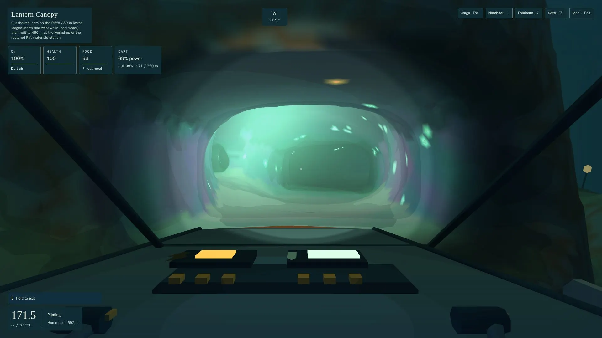
- Rift kiln tube: 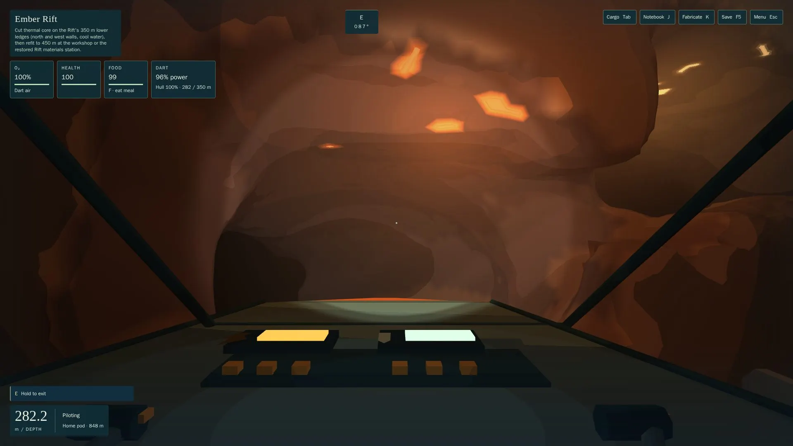
- Isles storm arch: 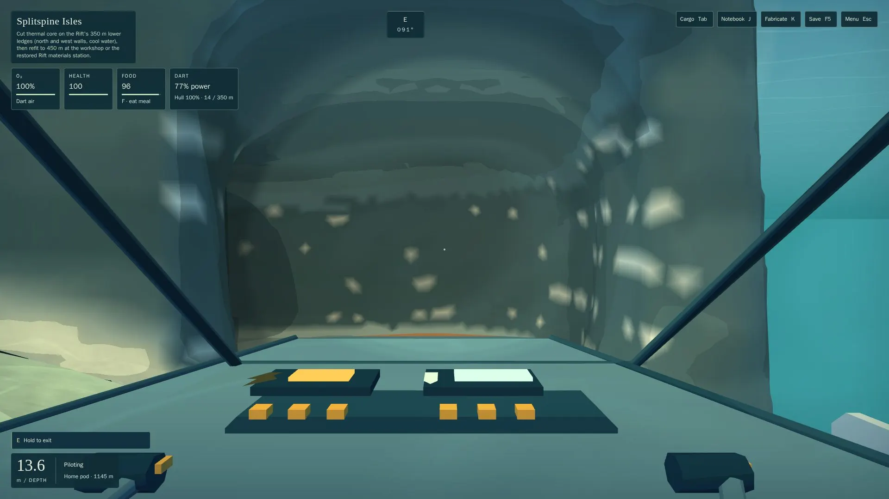
- Basin buried hut: 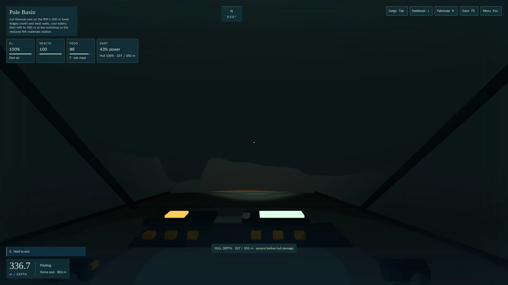
- Divide fissure window (Creel, 427 m): 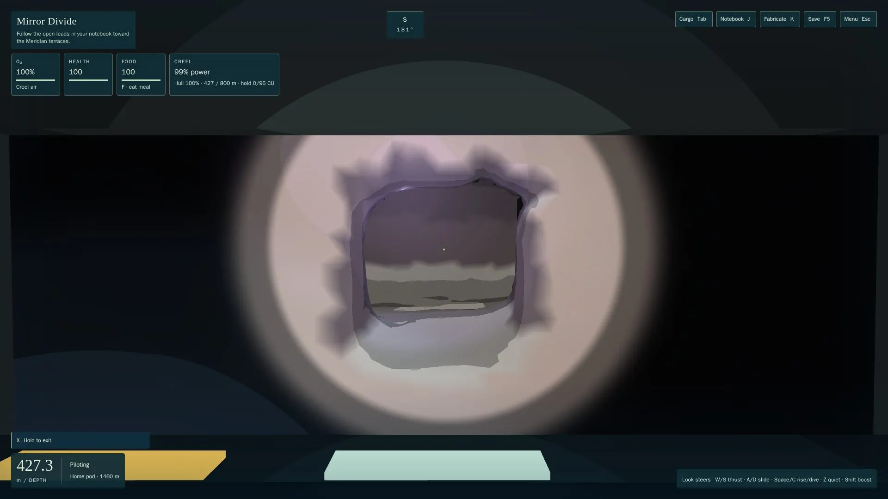
- Meridian window gallery (Creel, 518 m): 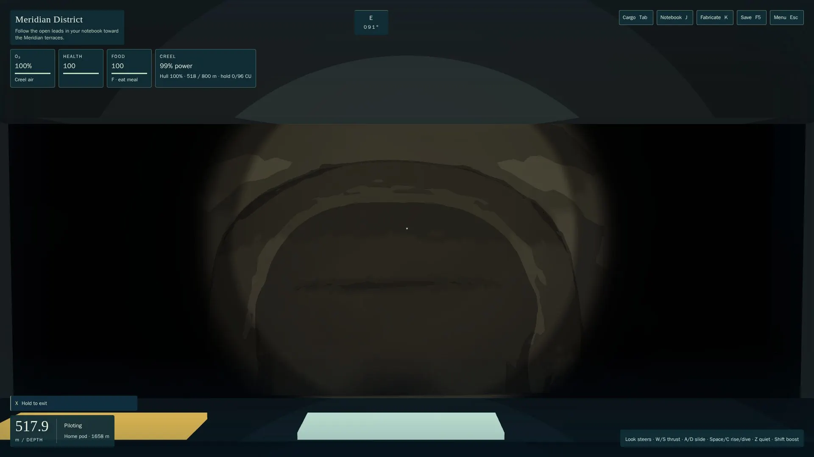

**Views (TST-08, ART-06, CAV-07; `views.mjs`, `gpu` class, `7967893`, so functional evidence only).** The crown mast line runs at bearing 134° from the island lookout.
- **Surfaced:** the mast lamp reads on the horizon from 400 m (lamp and mast), from the lookout at 765 m (a bright point, with the starting island beside it) and from 1 km (a faint point).
  - 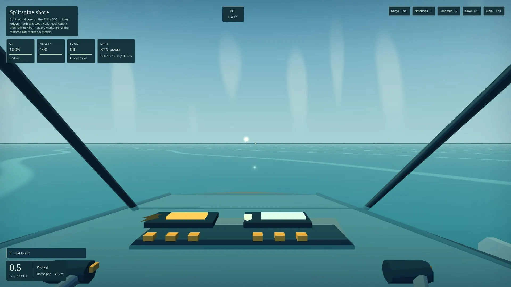
  - 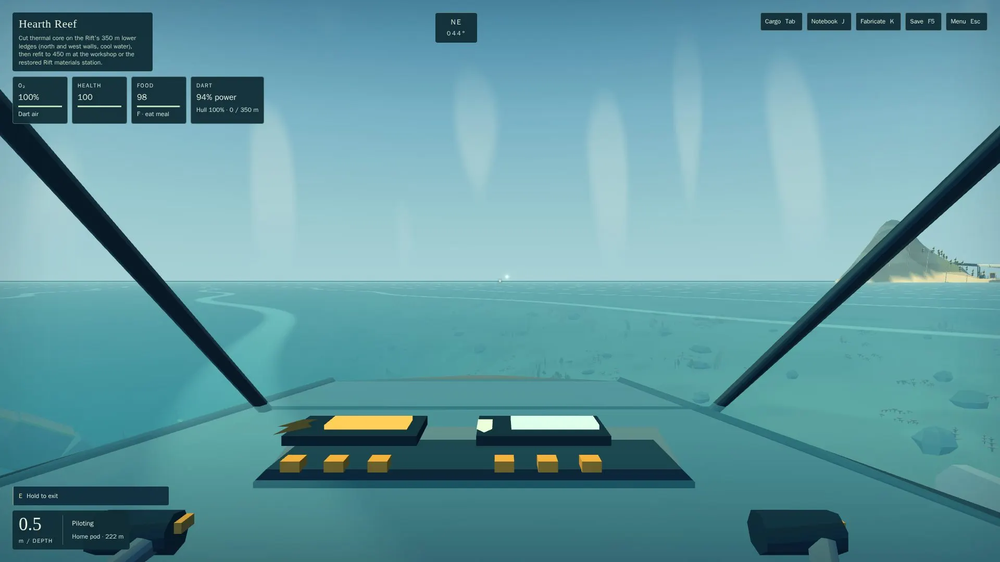
  - 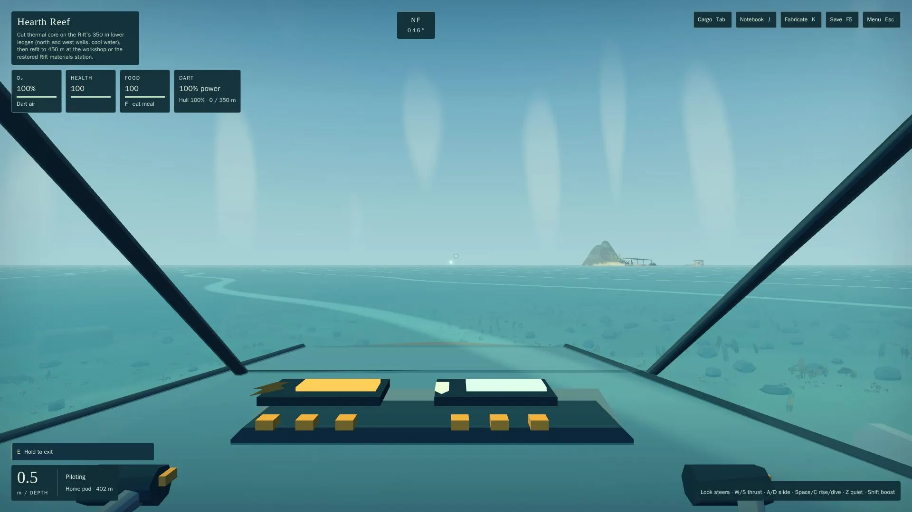
- **Submerged:** the far layer draws the mast's silhouette (11 landmarks shown) but underwater fog hides it at both 400 m and 1 km; only the lamp dot shows at 400 m (ART-06, below).
  - 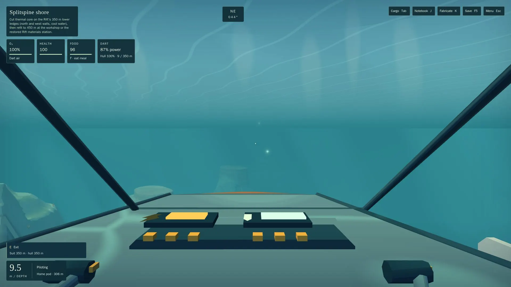
  - 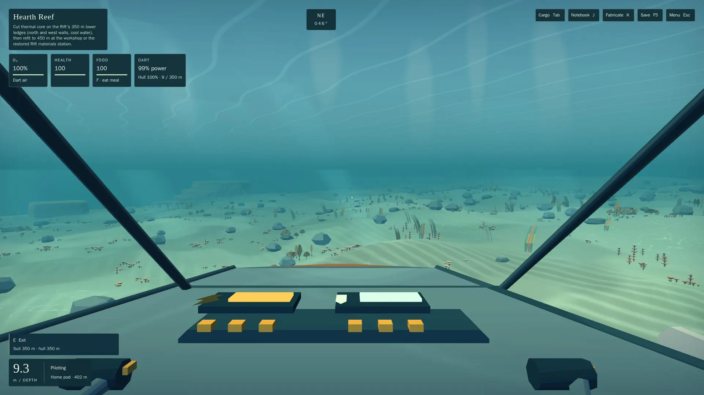
- **Network seam (Bellhole crawl into the Archlet, shared edge z = 84):** before the edge, the Archlet beyond is lit as open water; past it, the light switches to the Archlet's (CAV-07, below).
  - 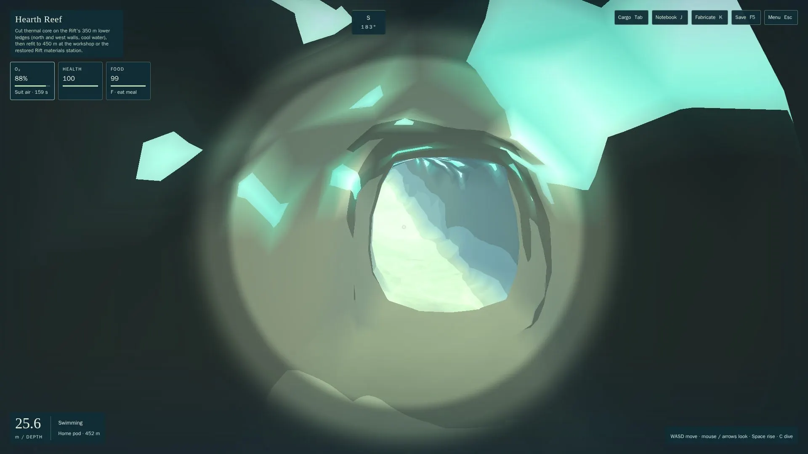
  - 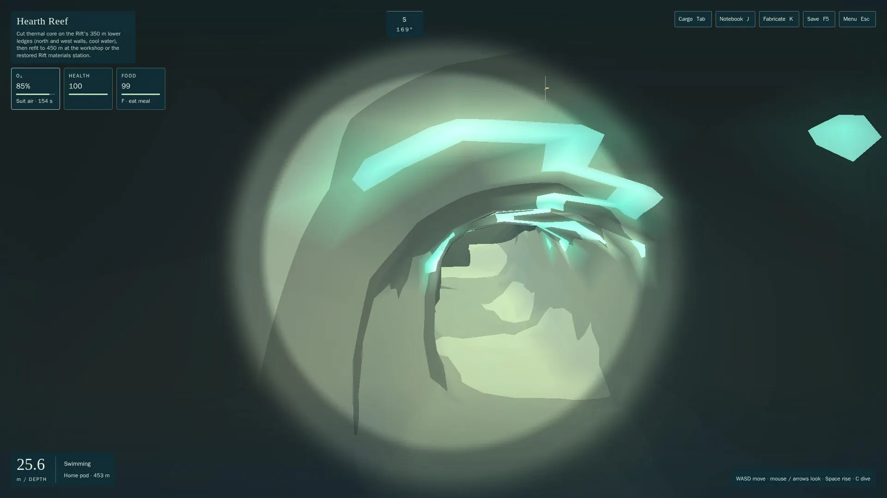

## Checks
**The composed checks are under *R4 response*.** History, at `64bf2565` (R3), through heavy-check with `--machine any` (receipts bound to the commit); the build ran on the second worker. Later commits touch only `docs/build/streams/cw1/` (the harness, its evidence) and this handoff.
- **Fast tier:** 1,492/1,492, including:
  - `cw1-entry`: R1 and R2, plus R3-3's ready-previous-pose, delayed, never-ready-at-the-cave, never-ready-anywhere and failed-settle cases;
  - `cw1-slicing`, `cw1-streaming`, `world-residency`, `world-budget`.
- **Heavy tier:** every file passes, including `cw1-cave-light-upload` (R2-1 and R3-2's scheduler, view, cap and jump cases, `settleStep`), `cw1-scene-lights` and `cave-light`.
  - CA-3's `caves-deep-perf` exceeded its 400 µs bound only under three-way test concurrency (437.6 µs). Alone at the same commit it passes at 380.9 µs, matching R1's 378–390 µs alone. The bound is not loosened. It's flaky under concurrency, for CA-3.
- **Harness unit tests:** `frame-class.test.mjs` 16/16 (R3-1's controls), `step-class.test.mjs` 9/9.
- **Economy, the root gate's six steps:** campaign, m1, m2-a, m2-b1, progression curve and upgrade economy pass.
- **Playthrough:** all eight scenarios complete with no blockers.
- **Bake:** `bake-terrain --verify` at `686e19d5`: **276/276** files equal the live bytes (220 chunks, 1 collision pack, 55 light fields). The bake's sources are unchanged since.
- **Build and provenance:** `npm run build` at `64bf2565` (the second worker). The bundle carries the bake's source hash `866d9186…`, equal to the bake's.
- **Root gate:** `npm run gate` on root after merging is the coordinator's.

**Merge notes:**
- **Root is composed** at `9029963e` (*R4 response*); the hazard resolution carries `74f51bc6`'s semantics into root's optimised samplers.
- **Rebaked and verified from the composed source** (*Bake, composed*). On merging to root, `npm run gate` rebakes or restores by source hash. No old pack is carried: the built hash must equal the fresh manifest's, which `check-provenance.mjs` checks.

## Adverse cases
- **Resting in a sheltered cave (CA-3 R1).** A diver idle 15 s in the crest hollow shelter at cycle 40 s, and in the lintel galleries: moved under 0.6 m, health 100, brine 0. Unmasked control: carried over 2 m (`cw1-caves.heavy`).
- **A cave that cannot load.** Records missing: held, then admitted the frame they land. Never clearing: relocated to the remembered open water at 12 s, or the refuge if that is no longer clear. A biome reload below its budget: paused, rescued at 4 s; with no verified rescue, the refuge at 12 s (`cw1-streaming`).

## Compromises (each with its root fix and cost)
- **Deep 2: a failed/open measurement** (for the provisional-integration record; not acceptance, not a performance waiver).
  - **What happened:** on the composed build (r14, `261024-210626-8317`, not DISTURBED) one streaming frame at 364,500 ms ran 49.9 ms. The page clock measured 52.2 ms in `lightPlace`, but the renderer's main thread accumulated 0.2 ms on CPU across the bracketing rows, while observed runnable for 48.5 ms. The canary stalled 48.9 ms. The renderer moved vCPU 5 → 1 inside the frame and part of its state is unobserved, so provable credit is 0, and the gate fails. Those CPU-time facts are reported, never used to clear it. At r13 the same segment failed on two light-selection frames (*Traversal*).
  - **Root fix (infrastructure):** the fleet's host-pinning change, **owned by Fleet**, pending a reboot window. That cannot by itself show the game's work is under budget: the composed measurement after it must.
  - **Root fix (measurement):** the sampler worker's remaining holes are whole-VM pauses (34–41 row intervals over 12 ms per 3090 run, max about 105 ms), which no in-guest observer can fill; **owned by the harness (CW-1's `traverse.mjs` and its successor owner)**. Optional, diagnostic only: Sol R4's amended co-located canary.
  - **Cost of carrying it:** a light placement or selection hitch in the deep Meridian approach can't be ruled out from this evidence.
- **Tour 1's r13 region frame: open as possible game work.**
  - **What happened:** 95.2 ms in `regions` (`art.update()`) at r13, unsampled; it didn't recur at r14 (pass, `regions` max 1.0 ms).
  - **Root fix:** a focused retained trace of `art.update()` on a run that shows it (owner retire/resume, owner updates, actors) to tell reattachment or first-use compilation from host delay (S, harness and regional art). Not blamed on the host.
- **The frame gate depends on attributing host pauses.**
  - **What the gate does:** it excuses only provable steal on a thread observed runnable on that vCPU (*R4 response*); host-stopped is a label, judged ours, and doubt (unobserved state included) counts as ours.
  - **Root fixes:** the host-pinning change (Fleet); GPU timer queries on long frames, so host-stopped needn't say "GPU unknown" (S); sampling the compositor thread, for presentation-side gaps (S).
- **Chunk residency planning, a known over-slice (convention 4).**
  - **What happened:** the residency's plan phase (wanted chunks, frontier and admission) is now timed. Across the targeted remeasure its p99 is 0.2 ms, but single frames reached **6.9 ms** (tour 3) and **4.5 ms** (tour 5). That's over the 2 ms slice, well under the 34 ms frame budget.
  - **Unresolved:** those frames weren't long, so the harness recorded no stolen-time sample for them. Whether they're steal or planning can't be told.
  - **Root fix:** cache the wanted set between frames, re-planning only when the viewer crosses a chunk boundary or the budget or external share changes. Slice the frontier walk if it's still over 2 ms (S).
  - **Owner:** WK-1, which owns streaming scale. Not done in CW-1, by the coordinator's decision.
- **Kit collision as boxes: COL-1 debt.**
  - **What happened:** the composites hold up to 149k boxes as objects, about 650k small objects in total, so the JS heap runs at 228–352 MiB, and a cluster build allocates about 18 MiB (18k boxes; `cw1/alloc.mjs`).
  - **Uphill edges:** CA-1 and hub caves sink at most 1.4 m and keep their accepted build. CA-2 keeps its edge-shelf floor. `rift_kiln_tube` and `meridian_culvert_north` keep their sunk edges, because edge rock broke their content and retreat.
  - **Root fix:** COL-1's unified triangle collider with compact typed storage (M/L). Art is not reshaped to fit boxes.
- **One active cave light field (CAV-07).**
  - **What happened:** at a network seam the next cave draws as open water until the camera crosses, then the light switches (seam shots).
  - **Root fix:** portal-aware lookup over several fields in the material (ATM-2, M/L).
- **The far layer is lost in underwater fog (ART-06).**
  - **What happened:** the silhouettes draw beyond the chunk band, but submerged at 400 m and 1 km the fog hides them.
  - **Root fix:** separate landmark and beacon visibility from near fog (ATM-2, M).
- **The island lookout is not built yet.**
  - **What happened:** the "lookout" shots are taken from its planned coordinate (`ISLAND_LOOKOUT`) at the surface, not from a standing point on land. Pending OP-1.
- **Coverage by keyboard driver.**
  - **What happened:** every cave stop is now reached by ordinary input from earned saves. The surf cave approach is narrow: before the planner's lateral margin, the keyboard driver's drift put the Dart on a −2.2 m bump beside the planned leg in three runs (reproduced headless). Three tour legs have no path with the margin and are planned on the keel rule alone (counted by the planner).
  - **Root fix, if a stop stalls again:** route the driver along each cave's authored approach route instead of a computed outer point (S).
- **Context restore re-uploads complete cave fields whole.**
  - **What happened:** after a lost context, a fill in progress restarts within the per-frame budget, but completed fields are marked complete so Babylon restores them. That's at most the four cached fields, up to about 1.25 MiB each, uploaded at once while graphics come back.
  - **Root fix:** re-fill restored fields through the sliced path (S), if a restore frame matters.
- **REC-1's 68.8 ms simulation frame stays open.**
  - **What happened:** it's SIM's, for the composed profile (SIM-PERF-1). The SAVE-1 alloc profile has a driven Dart step at 124 KiB a tick: `craftProfile` 17 KiB and hazard sampling 13 KiB, the sim's own.
- **Bake size.**
  - **What happened:** terrain grows 15.4 → 38.9 MiB compressed with every cave's shell, plus 2.46 MiB of caves. Both are fetched per chunk and per cave, never all at once.
  - **Root fix:** shells as per-cave assets shared across LODs (S/M) if download size matters.

## Missing evidence
- **Deep 2 proven under the strict rule:** its r14 frame is reported as a failure (*Compromises*), pending the host's pinning change.
- **Tour 1's r13 region frame explained:** no retained trace distinguishes reattachment, first-use compilation or host delay (*Compromises*).
- **The composed build on the other seven segments:** only tour 1 and deep 2 ran on it (the one rerun); the others' passes are on CW-1's own builds.
- **GPU busy time on long frames:** with none, host-stopped frames say "GPU unknown".
- **A kernel off-CPU stack** for frames where our threads sleep without measured steal (eBPF, root, a fleet question).
- **The sliced chunk plan:** the plan phase's single-frame maxima (6.9 ms) can't yet be told apart from steal (WK-1's follow-up).
- **Rendered-pixel proof of R3-3 from inside a cold cave:**
  - **What the screenshots show** (`runs/r13/rerun/*reenter*.jpg`): each re-entry from its stop just outside the mouth, right after the reveal (the "Imported and saved locally." notice visible). The step arch's passage is shaded with its amber lights, the archlet glows, and the glimmer crack's embers show; none has the exterior look.
  - **What they don't show:** these caves' light was already cached. A cold-cave entry under real GPU upload delay is covered by the app-boundary tests, not by a browser run that forces the delay.
- **Lookout:** a lookout shot from the built lookout (OP-1).
