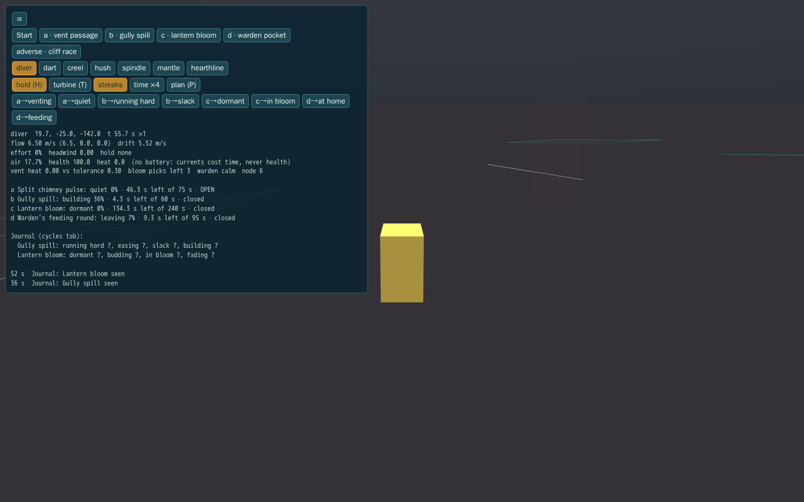
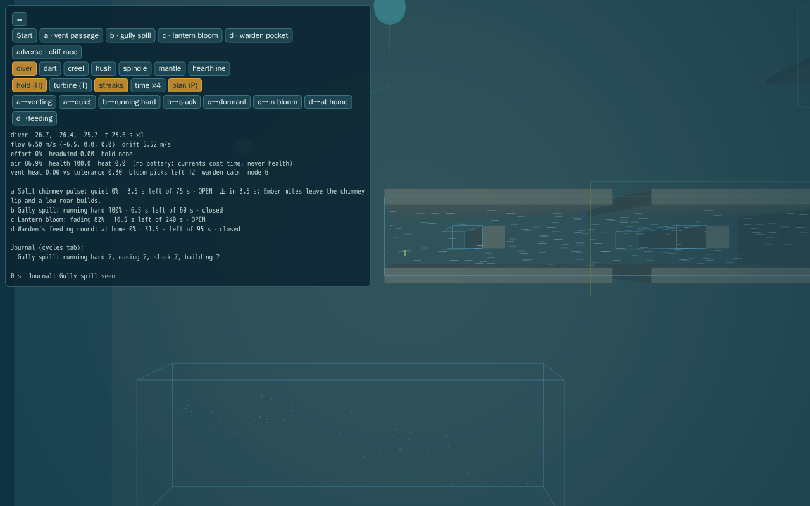
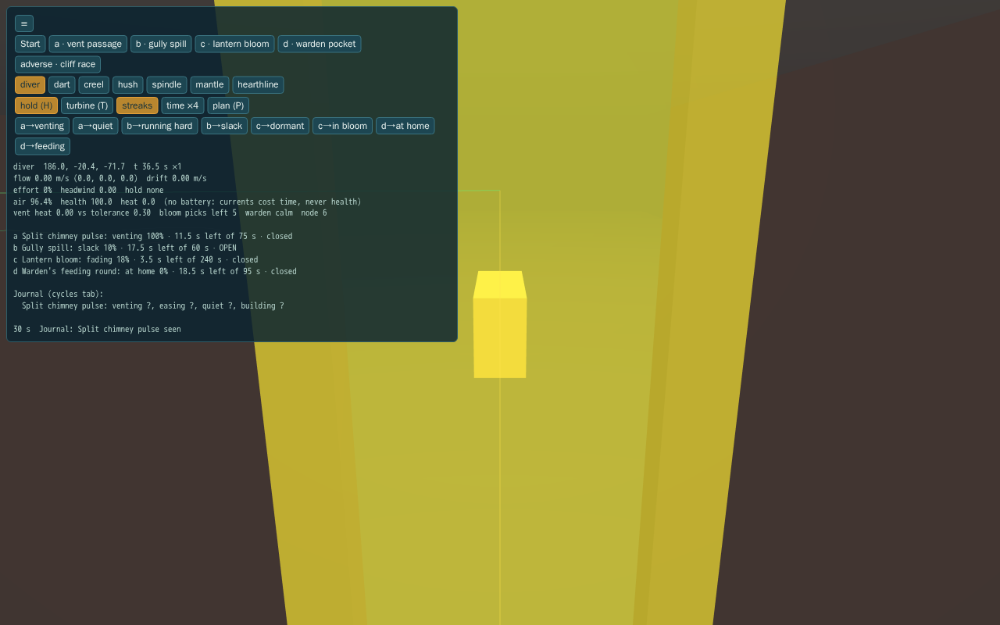

# CY: currents, natural cycles and the cycles lab

Opus 5.5 high · branch `feat/cy-currents-cycles` from `feat/siltwake-first-expedition` at `e40759d` · new files only. This is rules, content, a lab and tests, ready to compose. Nothing here is wired into the game.

## What exists
| Area | Files | What it does |
| --- | --- | --- |
| Cycles | `src/sim/cycles/cycle.ts` | `CycleDef`: phases (held level or linear ramp), offset, warnings. `cycleLevel`, `sampleCycle(At)`, `secondsUntil`, `windows` (worst wait, shortest window, tick-exact), `cycleProblems`, `fromHazardCycle` (S4's shape). A pure function of `tick / 60`, so nothing is saved. |
| Journal record | `src/sim/cycles/observe.ts` | `CycleObservation`, `observeCycle`, `journalEntry`, `validObservation`. |
| Currents | `src/sim/currents/{types,flow,motion}.ts` | Box (yawable) and capsule-tube volumes: direction, strength, edge (`inside` smooth, or S4's linear `outside`), lees, cycle and baseline. `createCurrentField().sample(p, tick)` and `.peak(p)`. `respondToFlow(flow, actor, drive, hold, powered)` returns the drift to add to the drive, plus extra drain, effort, headwind and the hold result. |
| Movement | `src/sim/currents/move.ts` | **The one place a current moves an actor.** `moveDiverWithCurrent` and `moveHullWithCurrent` do one sweep of drive + drift through `moveCapsule` or `moveHull`. Also `supportedDrift`, closing-speed impacts (`impactLoss`) and `dampIntoFace`. |
| Migration | `src/sim/currents/migrate.ts` | `fromHazardField`: an S4 hazard field with `flow` becomes a volume, exact to S4's `sampleHazards().flow`. |
| Turbine stub | `src/sim/currents/turbine.ts` | `turbineRate`, `turbineNet` |
| Sandbox | `src/sim/currents/sandbox.ts` | The lab's Babylon-free stepper and the reference integration. Its movement mirrors step.ts and moves through `move.ts`. |
| Content | `src/content/currents/{actors,cycles,lab}.ts` | Actor table (today's numbers, SYS-1 at composition), the five cycles, lab geometry, the four candidates with direct and alternative routes. |
| Lab | `tools/cycles-lab.{html,ts,tsconfig.json}` | Free swim and all six hulls; toggles for hold, turbine, streaks, ×4 time, plan view and phase jumps; readouts for flow, drift, effort, drain, phases, warnings, gates, impacts and the journal. |

## The motion rules (`motion.ts`, `move.ts`)
1. **Exposure:** drift = flow × (1 − authority). Authority uses S4's and SYS-1's `current` scale (0–0.95), so trim vanes and profiles plug straight in.
2. **No riding (R1, CY-02).** The ground velocity is the physical sum, drive + drift, limited to the actor's *reach set* (`limitToReach`).
   - **The reach set:** the convex hull of still-water travel (a ball of the drive's speed) and letting go (the drift itself).
   - **What that guarantees:** in every direction, progress with input is at most the better of swimming or driving in still water and drifting. A downstream or diagonal heading, or aiming off to let the current carry you, gives no propulsion.
   - **What stays physical:**
     - drift while stopped (involuntary displacement);
     - the whole drift against you (upstream resistance; a stronger current pushes you back by the difference);
     - a downstream push while you cross.
   - **Stronger than your drive:** crossing is slow and you are swept hard. That is what makes the spill a gate.
   - **Pinned by tests:** a reach-set test over every direction (more than 1,500 actor, mode, heading, pitch and strength cases), the same check through the real sweep across volume edges and cycles (13,500 steps), and a crab-to-target test at 0–90°.
3. **Holding** (only while stopped):
   - station keeping cancels up to `cruise` of drift;
   - the grapple cancels up to 4 m/s, at a quarter of the thruster cost;
   - the mooring anchor holds 1.5 m/s for free (SYS-1's numbers);
   - an unpowered hull or the diver holds nothing.
4. **Cost:** while driving in a current, extra drain = cruise drain × 2 × (drift ÷ cruise, capped at 1). While holding, the cost covers what the hold cancels. The diver has no battery: a current costs them time and position, **never health**.
5. **Contact (R1, CY-01).** An impact counts only the drive speed closing into the face the sweep refused, at (closing − 4) × 10 per second, step.ts's rule. Contact made by the current alone, and sliding along a face, are never impacts. A real head-on hit still damages, once: only the drive into the face is halved, so the slide survives and pressing on afterwards doesn't grind the hull down.
6. **Support (R1, CY-03).** `moveHull` refuses a whole horizontal slice that dips into the 5 cm floor margin; that is its cliff and terrain protection. Under downflow, that pinned a resting hull (a Dart moved 0 m against 18.3 m). `supportedDrift` lets drift descend only as far as the margin under the hull's footprint. The drive's own descent and every terrain rule are untouched. A pilot diving into the floor is still refused, a hull still can't climb an upslope it couldn't climb in calm water, and it can always rise.

## One movement owner for every flow (R1, CY-04)
C3 `3200cc7` has two flow contributors: `divide_downwelling` (a current at full intensity) and `basin_sediment_lane` (sediment at 0.45 of its level, with baseline 0.08 and the 100 s clock). Both migrate natively with `fromHazardField`:
- the box shape, S4's linear falloff outside it (`falloff: "outside"`), intensity, baseline, the 0.45 sediment factor and the field's own cycle;
- the cycle is checked: a framework cycle that doesn't match the field's numbers is refused;
- fields without flow (heat, brine, darkness) migrate to nothing.

The composed field then equals S4's flow. In this tree that is tested against S4's code copied verbatim, separately and overlapping. Against C3's real `HAZARD_FIELDS`, `sitePosition` and `sampleHazards`, in an exported `3200cc7` with these modules added (`docs/build/streams/cy/c3-probe.ts`): 113,750 samples, 24,724 of them with flow, worst difference 5.6e-17 for both flow and S4's idle `driftFrom`.

Only movement moves. `sampleHazards` keeps computing visibility, heat and brine exposure and the cue animals' state from the same fields, so ecology's presentation and harm are unchanged.

## Integration plan (for the coordinator; I edited none of these files)
- **The field.** Build `createCurrentField([...worldVolumes, ...migrated], CYCLE_BY_ID)` once, where `migrated` comes from `HAZARD_FIELDS` with `fromHazardField(id, f, sitePosition(f.shape.center), cycleFor[id])` and `cycleFor = { basin_sediment_lane: SEDIMENT_SURGE }`. Sample it once per step, before movement, at the actor.
- **C3 `ecologyLink.ts`:** delete the post-move drift sweep (lines 93–104 at `3200cc7`) and ignore `effects.drift`. Otherwise drift doubles. Keep S4's `flow` fields in `HAZARD_FIELDS`: the migration reads them, and nothing else moves with them any more.
- **`step.ts`, diver branch (swimming only):**
  - after `vx, vy, vz` are clamped: `r = respondToFlow(flow, { authority: protectionFor(null, fitted).current, cruise: speed, drain: 0 }, {vx, vy, vz}, "none")`;
  - add `r.drift` to each slice's delta inside step.ts's own loop, with `slices` from the summed magnitude, so its support, cliff and surface corrections still apply;
  - keep `s.player.velocity` as the drive only, so drift never accumulates.
- **`step.ts`, vehicle branch:**
  - after the velocity response, pick the hold: `grapple` if SYS-1's line is attached, `anchor` if anchored, `station` if powered with no thrust input, else `none`;
  - take `r = respondToFlow(flow, profileActor, v.velocity, hold, powered)`;
  - inside `surfaceMove`'s callback, replace `moveHull(measuredWorld, hullOrigin, d, …)` with `moveHull(measuredWorld, hullOrigin, add(d, supportedDrift(world, hullOrigin, d, r.drift × DT, shape)), …)`. This is exactly what `moveHullWithCurrent` does, so C3's surface rollback, carrier bounds and P1 sweep observations stay as they are.
  - **Then:**
    - **(a) Impact:** charge `impactLoss(closing, DT)`, where `closing` is the drive's component along the refused travel, `requested − achieved` normalised. Do this in place of `previousSpeed > 4`.
    - **(b) Damping:** replace `v.velocity.x *= 0.5; v.velocity.z *= 0.5` with `v.velocity = dampIntoFace(v.velocity, refused)`.
    - **(c) Drain:** classify "moving" by drive speed, not displacement `d > 0.003`, so drifting isn't billed as cruising, and add `r.extraDrain`.
  - Berthed hulls skip all of this. P1's thrust and ascent samples should measure the drive-only request.
- **S4 hazard clocks:** `CHIMNEY_PULSE` and `SEDIMENT_SURGE` match S4's clock functions at every tick. Proposal: `HazardFieldDefinition.cycle` becomes a cycle ID. C3 has already replaced S2's old 90/35 chimney metadata with S4's numbers, so there is nothing more to do there.
- **SYS-1:**
  - `craftProfile` maps to `CurrentActor` (`current`, `speed.cruise`, `drain`);
  - `grappleStep` stays the position constraint after the sweep, re-swept as in the sandbox;
  - `anchoredDrift` and `driftScale` are superseded by hold `anchor` and `exposure`.
- **SYS-2, the journal:**
  - save `knowledge.cycles: Record<cycleId, CycleObservation>`, checked by `validObservation`. That is the only new persisted state;
  - call `observeCycle(def, record, tick, inView)` each step for cycles in view;
  - `cycle-seen` and `cycle-measured` events feed the log; `journalEntry` is the tab row;
  - timings show only once watched from start to end.
- **Content rules** (enforced in the lab's tests; apply them to world volumes):
  - where an `inside`-falloff volume meets rock, extend it 2 m into the rock, so no still boundary layer forms;
  - each gated passage has an always-open alternative, a readable warning, at most 60 s closed and a window at least 1.5× the crossing time;
  - a powerless diver reaches still water within 25 s from anywhere inside. Escape across a current stronger than the diver is slow under rule 2, so keep such volumes narrow or give them lees.

## The four candidates, assessed (the owner and an experience review decide)
Times are for a diver at 3.4 m/s. "Mean wait" assumes arriving at a random moment.

| | Decision it creates | Wait | Alternative | Call |
| --- | --- | --- | --- | --- |
| **a. Vent pulse** (chimney, migrated unchanged) | Dash between pulses, take the cool way, or wear protection. It also times work at the plume-side seam. | Closed 24 of 75 s, worst 24 s, mean 3.8 s; the mites warn 7 s ahead | +22 s round the cool shoulder | **Keep.** It's mostly open and short, and the cue is readable, so watching the mites and timing a dash feels like play. Its real value is a timing beat at a rich resource, not a gate. |
| **b. Slackening current** (gully spill) | Wait for the lull, swim round, or force it in a craft. At surge no diver gets across, even crabbing at sprint, but crosses the 18 s lull in 6.6–10 s. Every hull can crab across at surge, for more power: the Dart 0.76% against 0.53% of charge, the Creel 1.8% against 1.1%. | Worst 41 s, mean 14 s | +41 s round the far end | **Keep, sparingly.** Being swept down the gully is the most vivid thing in the lab, and the first lull crossing is a satisfying beat. Repeated on a commute it becomes a chore, because the alternative takes about as long as the worst wait. Use one or two per region, off routine routes, where there's something to do while it runs. Hull drain changes little on a short crossing, so this is mainly a diver obstacle. |
| **c. Lantern bloom** (big harvest for a while) | Come back during the bloom, or pick the ordinary bed (3 picks always, up to 15 in bloom) | Worst 170 s, mean 60 s; breaks the one-minute rule if anyone waits | Ordinary bed, +7 s | **Cut as a clock.** The reward is more of a material you can get elsewhere, so the only real decision is whether to hover for 3 minutes, which is dead time. A short period would make it a free farm. Rework as renewal or cultivation (SYS-2), or as a one-off "found in bloom" state per visit. |
| **d. Migration** (warden's pocket) | Wait for the warden to feed, take the poorer bed (1 unit per pick against 2), or trespass and get shooed | Worst 53 s, mean 15 s; clicks warn 8 s before it returns | +8.5 s to the open bed | **Keep, as creature behaviour.** Watching an animal leave is a living-world moment, not a gauge, and it teaches cue reading the way S4's animals do. The stand-in is toothless; it needs a real S4 agent with S4's warning rules to judge properly. |

## The current turbine (stub)
- **What it charges:** 0.06 × flow, as a percent of a stock battery per second, saturating at 1.5 m/s. That is 1.8–5.4% per minute gross. A Creel held on its grapple nets +0.7 to +3.9% per minute: +50% takes 13–73 minutes parked.
- **Its catches:**
  - it only works stopped and held (grapple or anchor), in at least 0.4 m/s;
  - it is loud (0.2);
  - it stops at 80% (my limit, so it is never a perpetual generator);
  - winch power eats the gain in strong flow.
- **Verdict: cut it for small craft.** Its only mode is parking and waiting to charge, which is the "idle charging bar" GAME-DIRECTION rules out. It also turns currents, which are meant as obstacles, into places to park. It duplicates solar, thermal, bio-cells and outposts. The only defensible variant is a Hearthline mooring-anchor perk that trickles while the carrier is anchored anyway and the player works elsewhere: background, not waiting.

## Adverse case
A diver with no craft and 20% air (36 s), pinned onto a cliff by an always-on 6.5 m/s race 2 m inside its edge:
- **Pinned:** they stay on the face, never inside it, and take no harm.
- **Sideways:** swimming out leaves the flow in 0.87 s (7.1 s from the race's centre), and they surface with air to spare.
- **Into the lee:** from the middle of the race they reach the notch lee in 6.6 s and rest in still water.
- **Anywhere:** a grid of 40+ start points over every lab current, at surge, each reaches still water within 25 s.

For hulls, pressed along rock by an 8 m/s cross-current at cruise or boost, every hull keeps health 100 with no impact events. A head-on hit at boost still damages, once.

In the browser at R0, with ordinary key input: pinned at x 19.66 with health 100, then out in 0.67 s of sim time.

  

## Checks (R1)
- **`npm test`:** 824/824 (72 files). There are 43 CY tests in `tests/cycles.test.ts`, `tests/currents.test.ts` and `tests/currents-r1.test.ts`, about 4 s.
- **Mutations of the R1 rules:** 8 of 8 caught. They were:
  - no support limit;
  - impact from the whole drive;
  - **no face damping** (it survived R0's tests);
  - no reach limit;
  - the R0 projection rule;
  - baseline dropped;
  - 0.45 sediment factor dropped;
  - inside falloff for migrated fields.

  R0's set, re-run on the new code, is 7 of 7 caught:
  - the hull and diver sweeps replaced by teleports;
  - free station keeping;
  - the chimney shifted;
  - a partly seen phase measured;
  - lees ignored;
  - the diver allowed to hold station.

  R0's "riding" and "drift as impact" mutations are now part of the R1 set above.
- **C3 probe:** as above, against `3200cc7`'s real modules.
- **Lab:** `npx tsc -p tools/cycles-lab.tsconfig.json` is clean, and impacts appear in its log. Browser use is unchanged since R0 (Vite on port 5214, software preview).
- **Not run:** the heavy tier (nothing here reaches Babylon outside the lab) and GPU (not needed).

## Known limits
- **Placement:** no world volumes are placed; CB or the coordinator authors them under the rules above.
- **Sampling:** flow is sampled at the actor's centre, which is coarse for the 17 m Hearthline.
- **Lab stand-ins:** the warden, the heat gauge (S4 owns exposure and harm) and the grapple (SYS-1's rule) are simplified.
- **Presentation:** no current presentation in the game renderer or audio yet; the lab's streaks are placeholders.
- **Diver cost:** the diver pays only time. Extra oxygen use while fighting a current is a possible later knob (survival.ts).
- **Tuning:** every number is a proposal, and no human has played it.
