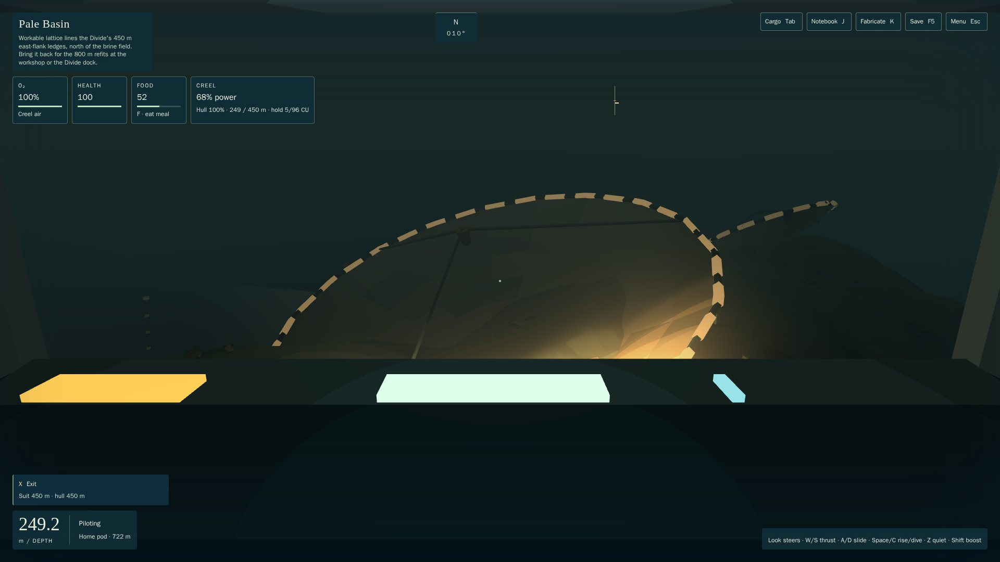
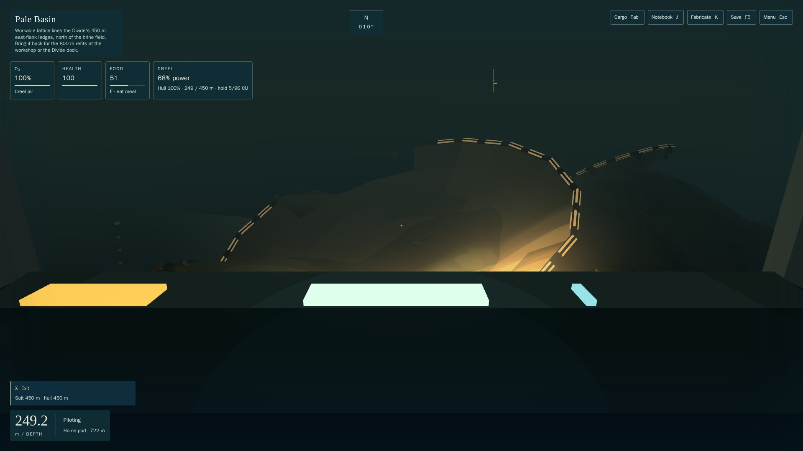
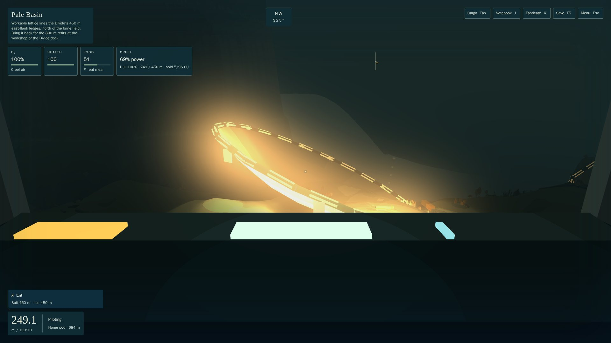
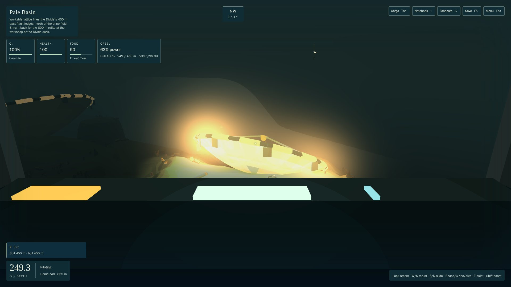
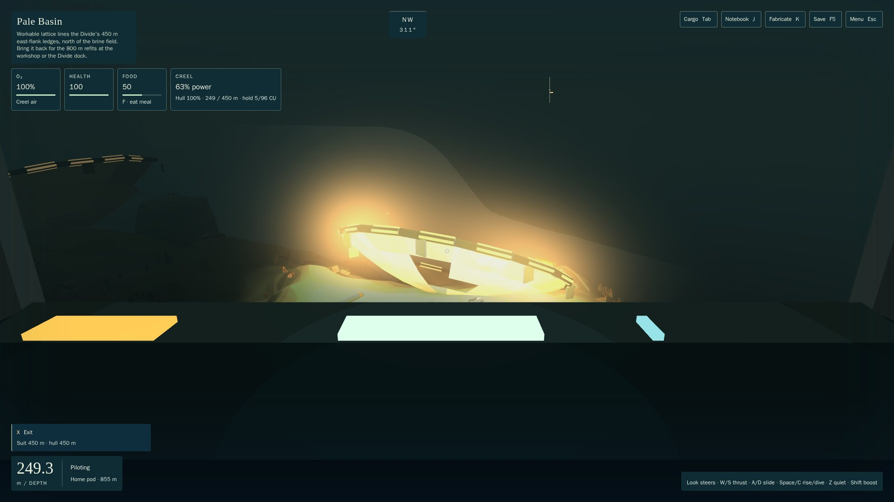
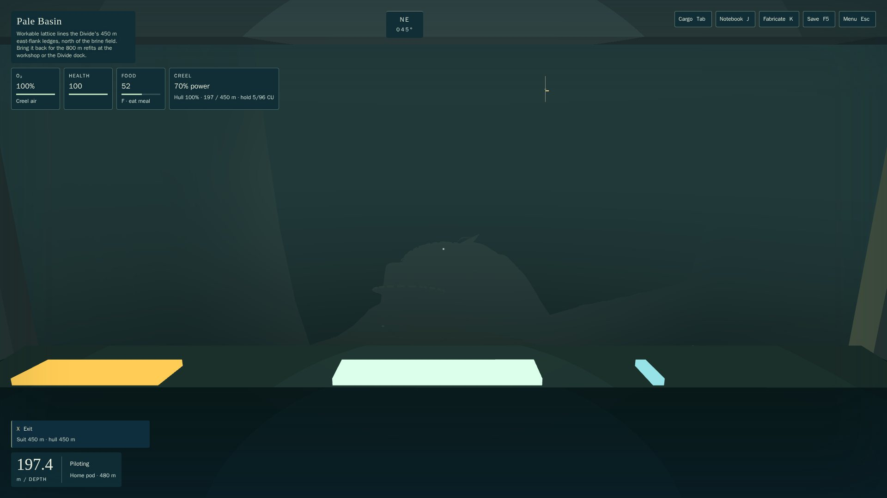
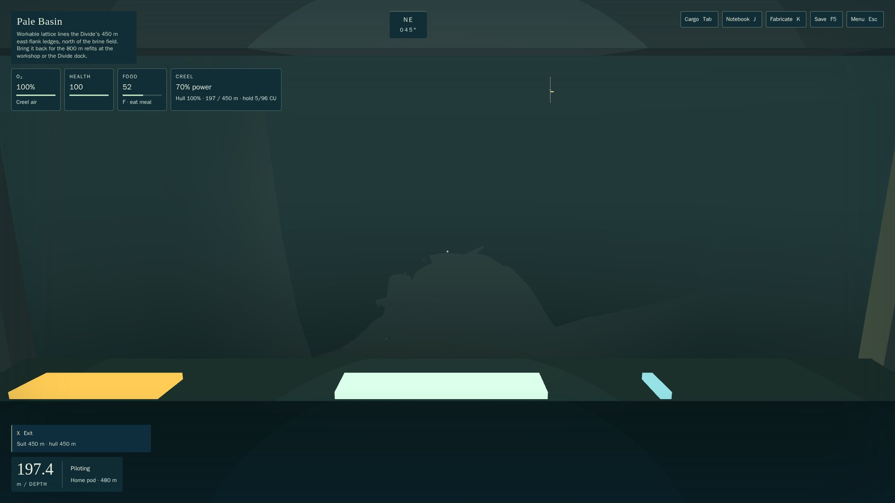

# DISH-1: the Basin dishes collide where they are drawn; POI pacing sees in 3D

Opus 5.5 high. Branch `t3/dish-rim-collision` from root `4dcf3ad`; code `3e5d8b4`, merged with root `d9099e0` (CA-3, CB-2) at `bca41a6`. It answers two findings from Sol's POI-1 review ([report](../reviews/POI-1-SOL-XHIGH-R1.md)):
- **POI-1-02 (P2):** the dish rims stood up to 12.9 m above their collision, and a diver swam through them.
- **POI-1-01 (P3):** the pacing test ignored height and occlusion.

## What changed for a player
- **The dishes are solid where you see them.** Rim, bowl, hub and fins now stop a diver or craft. The bowl's hollow stays open water: every dish site's work and park poses sit inside it, and craft still descend straight into them.
- **The dishes now give way to the game's paths, which ran through drawn art before:**
  - **Passages:** where `route.basin.dish_field` crosses the great dish's rim, three rim segments are broken away.
  - **Rescue tethers and park columns:** the tethers descend into the north and great dishes, and each site parks craft straight down over its bowl. No feed tripod fits on any dish, so each feed now lies fallen in the silt beside its dish: the horn on its side and three broken legs.
  - **Work poses:** a few centre panels are missing under each work pose. The bowls keep 128, 138 and 136 of their 144 panel triangles.
- **The bands** POI-1 put on the rims follow the rim, and stop where it's broken.

| | Before (root) | After |
| --- | --- | --- |
| Great dish, ~65 m |  |  |
| North dish, ~55 m |  |  |
| South dish, ~55 m |  |  |
| Dish field, 300 m |  |  |

## Contracts
- **`content/regions/dishGeometry.ts` (new)** is the one source for each dish's art and collision.
  - **Shapes:** the rim, feed and fallen feed are prisms; the hub and fins are blocks; the bowl is panel triangles. One resolution (16 segments × 5 rings) at every LOD.
  - **Rim, feed, hub and fins:** collided as A1's vistas are, within 0.35 m.
  - **Bowl:** collided by cell boxes within **1.0 m** of the panels (owner's choice, 2026-10-22). Hugging a tilted, curved bowl to 0.35 m needs 10–12k boxes and makes sweeps near a dish 25–90× slower.
  - **Removal rule:** a part is left out if its collision would meet any of these:
    - a passage, swept with its own hull plus 0.5 m;
    - a rescue tether, swept with the medium hull plus 0.5 m;
    - a site's work pose (diver) or park pose (medium craft), plus 0.3 m, with the park column open 50 m above;
    - an authored cave footprint, plus 2 m.
- **`structures.ts`:** `StructureDef` gains `dish?` (the shapes) and `keep?` (where scatter must not grow). The dishes keep S2's rim footings, plus the fallen feed, as their scatter keep-out, so the dressing round them doesn't change.
- **`render/biomes/structures.ts`** draws a dish from those shapes with `drawSolidSet`. **`render/biomes/scatter.ts`** reads `keep ?? solids`. **`vistaKit.ts`** gains the `porcelain` and `shell` tones.
- **`content/poi/legs.ts`:** the pacing measure now works in 3D with line of sight.
  - **How a mark counts:** a mark counts where the route passes nearest to it, among route samples (every 5 m) from which it's within reach and visible over the terrain.
  - **POIs** count at their beacon; two beacons now sit on their actual light (the trench span's middle float, the fall's middle colony).
  - **Landmarks** count once, at their real emitted lights.
- **Dish solids:** 4,855 (1,403 + 2,404 + 1,048), against 39 before.

## Checks
- **`npm run test:fast`:** 1,244/1,244 at `3e5d8b4`; 1,264/1,264 after the root merge. New fast tests in `tests/dishes.test.ts`:
  - **production sweeps:** the world stops a diver at every rim crossing, in and out, and at every bowl panel, from below and from inside;
  - **adverse control:** the old rim blocks let more than 100 crossings straight through;
  - **open bowls:** the dish sites' poses fit, and a craft descends to its park pose;
  - **clear paths:** every route, rescue tether and first access is clear of the dishes.
- **`tests/poi.test.ts`** adds three tests:
  - each POI's beacon lies within 3 m of one of its own lights;
  - pacing in 3D within the 90 s rule;
  - **adverse controls:** beacons dropped 1 km aren't seen, and a lamp behind the Divide ridge isn't seen even at 400 m reach, while the same lamp in the lee is.

  Pacing results (Creel 5 m/s, before → after POI-1): Basin ↔ Rift 55 → 52 s, Basin ↔ Divide 165 → 48 s, Divide ↔ Meridian 105 → 54 s, service ledge 122 → 65 s. These match the reviewer's independent 52.9/47.1/54.1/65.2 s.
- **Heavy (`heavy-check.sh`, about 2 min):**
  - **New `dishes-envelope`** passes, with 2,158,470 samples over every dish solid at both LODs:
    - nothing is drawn outside its collision;
    - the frame is within 0.35 m of its art;
    - the bowl is within 1.0 m of its panels.
  - **`vistas-envelope`, `regions-art`, `render-cache` and `m2-region-render`** all pass.
- **`npm run playthrough -- --jobs 3`:** all five scenarios complete with no blockers. Both creel and carrier reach the ending, and every milestone reload matches. Wall time: 475 s (creel) and 621 s (carrier); I have no same-day root run to compare.
- **3090 shots:** ordinary keys, task-owned headless Chrome on ANGLE GL-EGL, both builds, no page errors, closed after use.

## Cost and limits
- **Sweep cost:** near the great dish, a production `moveCapsule` sweep costs 17–28 µs for a diver (was 1.4–8) and 44–75 µs for a Creel (was 1.5–3.7). Elsewhere it's unchanged.
- **Load time:** building the dishes adds about 0.3 s to loading the content modules.
- **Inside a bowl,** collision can stand up to 1 m above the porcelain (the owner's 1 m bowl rule). A diver lying on the panel floats up to a metre high.
- **No standing feed on any dish.** It returns if the north and great dishes' rescue tethers and the dish sites' park poses move off the bowls.
- **Pacing evidence:** the measure is structural. It assumes a 60 m notice range unlit and 150 m lit, and it doesn't measure discovery or enjoyment.
