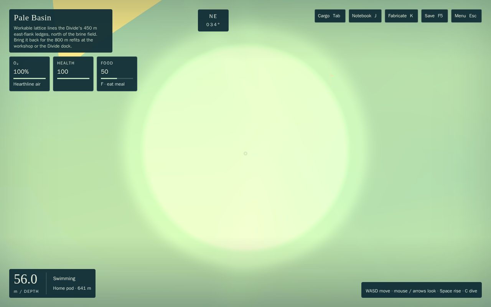
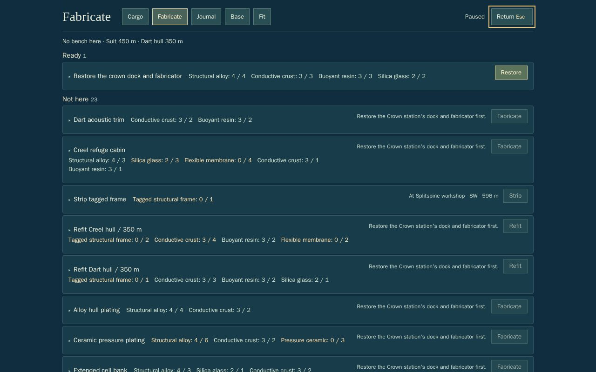
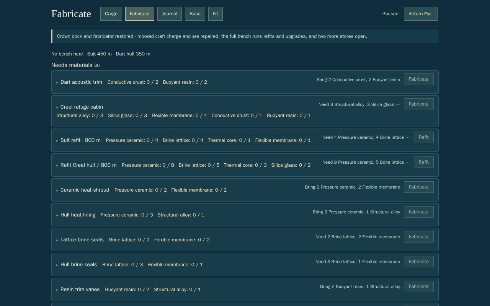
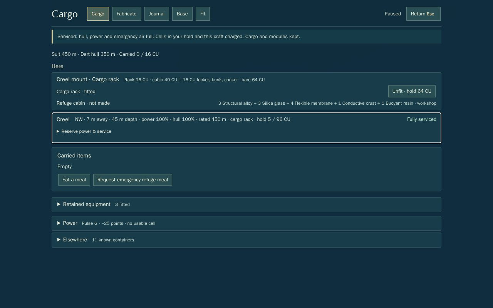

# HUB-2: the crown station, composed (handoff)

Opus 5.5 high. Branch `t3/hub-2-crown-station`, from root `e91a69b` (C4 stage B and LC integrated). Commit: __SHA__. It replaces W2 phase 2's proposal and fixes Sol R1's W2-02, W2-03 and W2-04 ([R1](reviews/W2-SOL-XHIGH-R1.md)).

## Outcome
The crown station on W2's summit is a real restorable stop, built in three stages from a diver load each.
1. **Power and air** (needs the Creel). You get air, a bunk that heals three times faster than any other refuge, and a 48 CU locker. Resting there makes it where you wake.
2. **The dock and fabricator** (needs the 350 m suit).
   - **Dock:** charges and repairs small and medium craft within 14 m, through Cargo's ordinary Service button.
   - **Bench:** a full fabricator with the refit and upgrade bench, plus two more stores (144 CU in all).
3. **Sockets and the survey array** (needs the 450 m suit and Rift ceramic). Six module sockets, and a built-in 300 m survey over the Basin anchorage, the dish field, the Rift head and the Canopy edge, from Base.

The pod stays the fallback: if the crown has no power, you wake at the pod. The beacon is lit from New Game (coordinator call), and restoration does not change it.

On the **carrier route**, the playthrough now restores the first two stages on its way to the Rift. It then makes the 450 m suit at the crown's bench and services the Creel at its dock, instead of the long way home to the island workshop.

## How it composes (C4's interfaces)
- **Stop:** `content/stops.ts` gains a `crown_station` row with `facility: "crown_power"`. New optional `WorkingStop` fields support staged stops; stops without them work whole, as before.
  - `dock`: mooring service needs this facility as well.
  - `bench`: bench work other than the stop's own restorations needs this facility.
  - `stores`: extra lockers that open with `dock`.
- **Service (W2-03):** `inventory.stopServes` gates `supportedServiceSite` on the dock stage. That one gate covers every downstream use:
  - the service command and Cargo's button (`sim/serviceLink.ts` preview);
  - major-mount changes;
  - refit targets;
  - moored holds at the bench.

  C4's berth and docking-transaction exclusions come first, unchanged.
- **Restoration (W2-02):** `STOP_RESTORATIONS` includes the three stages (`isStopRestoration`).
  - `craftingBlock` lets a stop's own restorations through its "restore first" gate, and their `needs` keep them in order.
  - `craft` and `outputPlacement` handle every stop restoration generically, with no hard-coded outputs.
  - The stage recipes live in `content/hub/recipes.ts` (`HUB_RECIPES`), spread by the registry. They use plans the player already has (the Creel's, the 350 m suit's and the Rift's), not new campaign plans.
- **Bench (W2-04):** `progression.crownBenchRecipe` decides which recipes the crown's bench runs.
  - **Included:** every pod-fabricator recipe, and every workshop recipe except `restore_workshop`, `strip_frame` and hull builds.
  - **Excluded:** all of the yard's work, since the carrier cannot moor on the summit.
  - **How it joins:** `recipeSites` appends the crown, so payment runs through C4's `craftSite` and `fabricationContainers`: the diver, the crown's locker and stores, and craft moored at its dock (from the dock stage). Refits need the hull moored at the dock (`supportedServiceSite === "crown_station"`). Bench work waits for the dock stage, with "Restore the Crown station's dock and fabricator first".
- **Host:** `FIXED_HOSTS.crown_station` has 6 sockets on `crown_survey`, plus new optional `builtIn: ["survey"]` and `surveyTier` fields (`surveyTierAt` uses the tier, and Base gains a Survey button for a built-in array).
- **Rest base:** `REST_BASES.crown_station` uses `crown_power`. C4's last-rested-base wake rule then works unchanged, with the pod as fallback. `survival` takes its heal rate from `sim/hub/crownStation.bunkHealRate`.
- **Saves:** `crown_power`, `crown_dock` and `crown_survey` (unrestored), plus the crown's locker and two stores, are additive New Game content. Schema 6 loads them through `addNewContent` with no bump.
  - **Validation:** a stage is repaired exactly when its restoration is in `crafted`.
  - **Fixtures:** the three live named fixtures are re-canonicalised (additive entries only, as C4 did); the archived originals are unchanged.
- **UI:** the Fabricate status line names a working stop's bench, and the HUD's air source names an air stop. Both read "No bench here" and "Hearthline air" at every C3 stop before. The crown's stages fold into "Later" away from the crown, like S9's stops.

## Checks
- `npm test`: __FAST__. `tests/crown-station.test.ts` (6), through `PanelProbe` and `executeCommand`:
  - **Stages:** each stage paid at the door through Fabricate. Exactly the cost leaves, it pays once, a short payment and an unpaid press change nothing, the order holds, and each save round-trips.
  - **Dock:** Cargo's Service is disabled and refused at stage 1, and charges 12% → 100% and repairs 20 → 100 from stage 2. Out of reach, no service. The stores open with the dock.
  - **Bench:** the recipe split holds for every recipe. A paid `glow_lures` comes from a crown store; a paid `creel_450` comes from the moored Creel's hold. The bench is refused at stage 1 and for a hull away from the dock.
  - **Sockets and survey:** six sockets and a 300 m survey through Base, from stage 3 only.
  - **Bunk and waking:** the bunk heals at 5.4/s; you wake at the crown after resting there, and at the pod without power.
  - **Saves:** an old save loads with the crown unrestored, and a forged stage is refused.
- **Pinned-list tests updated** (content legitimately added):
  - plan unlocks (`progression-curve`) and known rows (`preparation-panels`);
  - the bench text;
  - the composed-field helpers (`persistence-support`);
  - the stop-pose exemption (the crown's door and dock are its own);
  - the M1 reason matrix, which now excludes hub recipes.
- Heavy: __HEAVY__.
- `npm run build`: OK; the bake re-ran (220 chunks).
- `npm run playthrough -- --jobs 2`: __PLAY__.
- **3090, ordinary keys and keyboard focus** ([play](hub2/play.mjs), [derive](hub2/derive.mjs), [record](hub2/play.json)). It ran in a task-owned headless Chrome on ANGLE GL-EGL ("NVIDIA GeForce RTX 3090"), through `heavy-check.sh`, closed at the end, with 0 errors.
  - **Save:** derived headlessly. Stage 1 was restored by the harness's commands; the dock stage's materials in the diver hold and the Creel's 30% charge are **staged**.
  - **Session:** K → Tab ×7 → Enter restores the dock; a 15 m swim to the Creel; Tab (Cargo) → Tab ×7 → Enter on Service brings the Creel to 100%.
  - **Frame rate:** 60 fps, p95 16.7 ms, worst 16.8 ms, both while swimming and while holding at the dock.

| | |
|---|---|
|  At the door, stage 1 |  Fabricate: the dock stage ready; bench rows wait for it |
|  Restored |  Cargo: the Creel serviced at the dock |

## Adverse case
A Creel at 12% power and 20 hull, moored at the dock after only power and air are paid for, is refused service. The button is disabled, pressing it changes nothing, and `supportedServiceSite` is null. Its hold is not part of the bench either. Paying the dock stage enables the same button, and pressing it services the Creel in full. With the crown unpowered, a diver who rested there wakes at the pod.

## Known limits
- The beacon does not brighten with restoration (it's allowed, not required).
- The crown's chart beacon appears from stage 3, since C4's `beaconViews` shows a stop once its host's facility works.
- The 3090 check starts from a derived save with staged materials, not from earned play; the playthrough covers the earned path.
- The carrier route's play time rises because it gathers the two stages' materials (31 CU) on the way; see Checks for the root comparison.
- `step.ts`, world, bake and runtime files are not touched (CW-1 owns them).
