# LC: large-cave technology (handoff)

Opus 5.5, branch `t3/large-cave-biome-lab`, rebased on `feat/siltwake-first-expedition` after C4 stage A (`bf892e1`). This revision answers [Sol R3](../reviews/LC-SOL-XHIGH-R3.md) (LC-02 reload, LC-05); see *R3 fix*. The R2 and R1 fixes follow it. New files only: `src/content/caves/*`, `src/world/caves/large/*`, `src/render/caves/large/*`, `tools/large-cave-lab.*`, `tests/large-cave*`. No shared root, save or `package.json` edit. Source SHA: see the commit that adds this page.

## R3 fix: LC-02 reload inside an unadmitted biome, LC-05 one shared remainder
R3 found two problems:
- **Drowning on reload.** A reload inside a biome the budget could not admit (38 MiB: fixed bytes fit, fixed plus safety, 39.0 MiB, do not) held the diver forever, and real survival drowned them at 180 s.
- **Double spending.** Two fine residencies each spent the same budget remainder.

**`CaveAdmission`** (`streaming.ts`) is now the one admission state machine. It is the contract C4 wires:

| State | When | Composition does |
| --- | --- | --- |
| `away` | far from the biome | nothing; its reservations are released |
| `waiting` | near, outside owned space, not admitted | the simulation runs; the gate keeps the player out of the mouth; show "Waiting for room to load the cave" |
| `loading` (`holding: true`) | **in or touching owned space**, not yet admitted (a reload, a teleport, or the safety set still building) | **pause the simulation clock** (no oxygen, exposure, power, damage, AI or cycle ticks), keep rendering, show **"Loading cave…"** |
| `rescue` (`holding: true`, `rescue: Vec3`) | loading has lasted `rescueAfterMs` (4 s) and even a priority reservation cannot fit | **relocate** the player (or craft) to `rescue`, which is exterior water just outside the nearest mouth it fits, clear of the gate's reach and checked by `clear(feet)` against the exterior world. Show the message, then resume. It is a teleport, never travel through undrawn space. |
| `admitted` | fixed plus coarse safety held and built | normal play; the gate guarantees movement |

- **(a) Priority.** In or touching the cave, the biome's fixed and safety reservations are made with `priority`: the arbiter shrinks other owners' revocable grants, newest first, to fit, *before* the clock resumes. Approaching from outside, they are made without priority, and the player waits outside the mouth if denied.
- **(b) Loading.** `update(...).holding` is the flag. On a save load inside a biome, call `update` before the first simulation tick, and keep the clock paused while it holds. A load whose budget fits takes a frame or two (the coarse set is 3.6 MiB).
- **(c) Rescue.** The only way out of a budget that can never admit the biome. It needs `clear(feet)` from the composed exterior world for the actor's shape.
- **LC-05.** Opportunistic owners register with `arbiter.opportunistic(owner, weight)`. Each gets an **exclusive share** of the one remainder (total less every reservation and grant), and sets its residency's external bytes to `arbiter.externalFor(owner)`. S1 then keeps construction reservations and hidden art inside that share. Two fine residencies, or a fine residency and exterior art, never spend the same bytes.
- **Regressions** (`tests/large-cave-streaming.test.ts`):
  - **Denied reload.** A diver reloads in the hall at fixed plus safety minus 1 MiB. It is paused about 4 s, rescued to exterior water outside the nearest mouth, swims up, and **real `updateSurvival` runs for more than 180 s (a full air supply) without incapacitation**. The same reload with no rescue stays paused: survival never ticks and oxygen stays at 100.
  - **Pause mutation.** Ticking survival while holding drowns the held diver, and the test fails.
  - **Priority reload.** Another owner holds every free byte, the diver reloads inside, the reservation preempts the grant, admission happens before the clock resumes, and a craft then retreats from deep in the hall to exterior water under the same pressure.
  - **LC-05.** Two biomes are admitted with both fine residencies active together for hundreds of frames. Their art together never exceeds the free remainder. Giving each the whole remainder, as before, fails the test (16 MiB against 8).
- **On the 3090:** see *Measurements, R3 pressure runs*.

## R2 fix: LC-02, a safety reservation instead of a stranding gate
R2 found that the R1 gate stranded the player. Under sustained pressure, residency evicted chunks of the player's own zone, the gate (which wanted every touched chunk drawn fine) refused even a physically clear reverse move, and the player could not move. Admission was only advisory: a 48 MiB session entered with too small a share and froze. The contract is now (`streaming.ts`):
- **A non-revocable safety reservation.** `CaveArbiter` divides the shared budget:
  - **Reservations** (`reserve`) are all or nothing, and nothing takes them back until their owner releases them.
  - **Requests** (`request`) from other owners are granted only from what reservations leave.

  A biome's fixed bytes are reserved when it loads. At admission, within 160 m, its **coarse safety set** is reserved too: `CaveSafetySet` builds **every chunk at coarse**, mouths and collars included, outside S1, keeps it resident and never evicts it until release (beyond 200 m). For the Canopy that is **3.56 MiB**, from the bake's exact per-chunk costs (`caveSafetyBytes`).
- **The gate requires coverage at any LOD.** A destination is allowed when every chunk its box touches (plus 2 m), and every chunk of its zone, is *drawn*. The safety set guarantees that, so an admitted player can always move in any direction under any pressure. Fine art is opportunistic: an S1 residency over fine-only pins uses whatever no grant holds and shrinks when another owner asks. A chunk's coarse is hidden while its fine is shown. `caveFineShare` (16.0 MiB for the Canopy) is the share that keeps every pin fine. It is a recommendation, not a requirement.
- **Enforced admission.** Until fixed plus safety are reserved *and* the safety set is built, the gate refuses any destination whose box (plus 2 m) reaches the cave's owned space. The player waits outside the mouth, and the HUD says why: "not admitted: the budget cannot reserve this cave's fixed bytes and coarse safety set". A player already inside after a reload holds in place until admitted.
- **Regressions** (`tests/large-cave-streaming.test.ts`, uneven synthetic costs):
  - **Sustained pressure.** Another owner takes every free byte after entry and keeps it. The Dart still goes to the hub and backs out to exterior water, and finishes the full tour, through coarse, never held, 0 m uncovered.
  - **No-safety control.** Without the safety set the same pressure leaves space undrawn. The gate refuses forward into it (held, 0 m uncovered); without the gate the craft drives in. The gate also refuses a destination in a chunk nothing draws.
  - **Cold admission.** Below fixed plus safety the craft waits outside the mouth, never inside. R2's 48 MiB case, just above it with every free byte then taken, enters and finishes on coarse.
  - **Two biomes on one budget.** The second waits outside until the first releases. The first, under full pressure, finishes and exits. The second is then admitted and finishes. Neither strands.
  - **Mutation.** Making the gate require fine coverage again (R2's behaviour) fails all three stranding regressions.

  The heavy test repeats sustained pressure and below-admission with the Canopy's real costs and fixed bytes.
- **On the 3090, on the real loader** ([`lc/gpu-run-r2.json`](lc/gpu-run-r2.json)):
  - **Budget 32 MiB:** the Dart waits above the Crown hollow, never admitted, outside owned space.
  - **Budget 59 MiB, R2's repro:** in for 4.5 s, stop, another owner takes 16 MiB and keeps it, with 38 chunks cut. Holding S moves the Dart back 2.0 m. It then retraces the route out to exterior water with 0 gated frames and 0 unsafe.
  - **Budget 48 MiB, R2's cold case:** admitted. Every free byte is then taken and kept, and the whole craft loop finishes on coarse alone (960 of 960 frames coarse, 0 unsafe).
  - **Ordinary-control drive:** 14 of 14 waypoints, 0 unsafe of 1,433 frames, p50 / p95 16.7 / 16.9 ms, GPU 2.6 ms.

## R1 fixes
- **LC-01: buried collar-straddling poses.**
  - **Cause.** Clearance for a box that touches a cave tested surface crossings plus containment at the box centre, so a box buried wholly in exterior ground, with its centre outside ownership, passed.
  - **Fix.** The composer now checks the whole box against both owners. Each `CaveCollider` reports the Y span it owns per column (`ownedSpan`). The part of the box below a column's exterior floor must lie inside some cave's owned span: deep cave water under an overhead seabed is owned and passes; exterior ground beside a collar is not and fails. The footprint is sampled at most 0.5 m apart, and columns fully covered by a cave need no floor read. The biome collider also checks containment at its owned corners, not only the centre.
  - **Tests.** The R1 repros fail clearance: vault `(21.8, -45, 40)` and the five Canopy collar points, for diver and medium hull. Buried and half-buried poses on both sides of two collar edges fail for diver and Dart. Controls above the seabed and in deep water pass.
- **LC-02: safety after entry under byte pressure** (superseded by *R2 fix*: the minimum share and the fine-coverage gate below were replaced). The R1 contract was:
  - **Bounded pins.** While active, *exactly* the pinned chunks are wanted fine: the viewer's zone, its portal neighbours, and the chunks round the actor's look-ahead box (half a second, at most 8 m). Every other chunk is wanted exactly coarse. That bounds the art the cave can need.
  - **A minimum share.** `caveArtMinimum(cm, cost)` is every chunk coarse, plus the costliest pinned zone set's fine increment, plus 8 look-ahead chunks. It comes from the bake's real per-chunk art bytes. The world must reserve `fixed + minimum` for the cave before the player may enter.
  - **The gate.** `CaveGate` is the safe response whenever coverage cannot be kept: cold entry, a zone change before its chunks arrive, a turn, or a share that shrinks after entry. Each frame runs residency first, then the gated move, then the render. A move whose destination box (plus 2 m) touches a chunk not drawn fine, or whose zone has an undrawn chunk, is refused, and the craft stops. It can still retreat into covered space.
  - **In the lab.** It moves `held` from a one-time entry flag to a per-frame gate, and says why it is holding: "cave streaming in", or "cave art share below its minimum".
  - **Tests.** Uneven synthetic costs and the Canopy's *real* chunk costs plus fixed bytes:
    - at the minimum share, the tour is never held and nothing is cut;
    - a share cut after entry holds the craft, moves 0 m uncovered, and resumes when the share returns;
    - a share below the minimum from the start holds;
    - controls without the gate move 5 m+ uncovered.

    The GPU harness repeats R1's 32 MiB budget and a 16 MiB reservation after entry on the real loader.
- **LC-03: retained buffers.**
  - **Exposure.** `LoadedCave.retained` lists every whole buffer the cave keeps: the decompressed bake (art is decoded from it on demand), the seabed lattice, the colliders and the lamp occupancy. The lab counts `retainedBytes` plus two lamp windows (shown and staging) as fixed external CPU bytes, and one window on the GPU, before any art is admitted.
  - **No second copies.** The runtime map is built from the bake's own layout (`createLargeCave(source, floor, loaded.layout)`), so the second ground array and the field-wide recompile (about 1 s of cold entry) are gone.
  - **Test.** A heavy test walks the loaded cave, the runtime map and the cave map, enumerating every reachable ArrayBuffer, and requires the total to equal the accounted bytes.
- **LC-04 (P3).**
  - An exterior wall inside and past a cave sub-sweep's reach must stop a move and block sight. Disabling the composer's exterior-solid sweeps now fails this test.
  - Neighbour-zone pinning is asserted from portal data: hub chunks are pinned from the hall, pool chunks are not. Removing the neighbour pins now fails it.
- **Rebase.** C4 now splices W1's cave light into the production cel fragment. The biome material splices C4's `BASE_CEL_FRAGMENT` instead, with the base eye-lamp pool off. Its own occupancy-walked lamp replaces it.

## The choice: one mesh is the art and the collision
- **Authoring.** `LargeCaveSource` is hand-placed data. Chambers, spline tunnels and shafts carve water; root pillars and fallen blocks add rock back; collars mark the openings; zones, portals, life, sockets and routes are all named. Procedural detail is only wall noise. The Canopy root caves live in `canopyRootCaves.ts`.
- **Field.** `field.ts` compiles the source into a continuous signed-distance estimate: the seabed, smoothly unioned carves, and added rock. Primitives are culled through an 8 m grid.
  - An *evaluation* box is wide enough that culling never steps the field near a surface; a test pins this.
  - A *core* box bounds where a surface can be; sampling skips everything else, and a test pins that skipping changes no vertex.
- **Meshing.** `mesh.ts` runs surface nets per 32 m chunk on a 0.5 m lattice, with a small apron so chunks build alone and their seams match bit for bit. Vertices are snapped to 1/1024 m. Coarse LOD samples every second node at the *most open* of 27 fine values, so coarse water contains fine water: coarse walls sit 0.5–0.9 m behind the collision and a tunnel never closes.
- **Collision.** `collision.ts` and `compose.ts` use the fine mesh itself as the collision mesh, with a BVH per chunk.
  - **Sweeps.** Swept actor boxes are tested against triangles on all 13 separating axes, with a 4 mm skin. A box that starts in contact is blocked only while closing.
  - **Slides** clip against every contact plane, then run along a crease.
  - **Containment** uses vertical-ray parity to the owned top.
  - **Sight and support** use rays against the same triangles.
- **Agreement.** Art and collision are the same Float32 triangles: **0 m** apart at fine, and the bake decodes to the same bits.

**Why not W1's boxes at scale (option A).** Same field and chunks, measured on the 45 chunks along the craft loop (`voxelBoxes.ts`, [`lc/compare.txt`](lc/compare.txt)):

| | A: voxel boxes + `createWorldQueries` | B: triangle BVH (chosen) |
| --- | --- | --- |
| Size | 22.4k boxes, ~1 MiB | 312k triangles, 12.6 MiB |
| Build (same host and run) | 53 s | 16 s |
| Creel step / diver step | 56 µs / 21 µs | 4.8 µs / 1.9 µs |
| Creel sliding along the hall wall at 15° (of 58 m requested) | 11.6 m: snags on the staircase | 38.8 m |
| Diver, same | 36.7 m | 44.7 m |
| Art vs collision | staircase vs smooth shell (W1 clamps it to 0.35 m) | identical |

Boxes cost less memory, but fixed-axis actor boxes catch on every voxel step of a curved wall. For a craft in a 250 m cave that is the dominant feel problem.

## Measurements (RTX 3090, ANGLE GL-EGL, headless 1600×900; `tools/large-cave-lab.gpu.mjs`)
**R3 pressure runs** (real loader; [`lc/gpu-run-r3.json`](lc/gpu-run-r3.json)):
- **Diver reloaded in the Root hall at 38 MiB:** "Loading cave…" is shown with the clock paused, then the diver is rescued to (756.5, −61.5, −76), outside the Crown hollow, with the message. Holding E then rises 2.8 m.
- **Diver reloaded in the hall at 59 MiB after another owner took every free byte:** admitted by priority in 7 paused frames, and the other grant shrinks to 20 MB.
- **R2 cases rerun:**
  - 32 MiB: waits outside;
  - 59 MiB, 16 MiB kept: reverses 2.0 m, then retreats to exterior water with 0 gated and 0 unsafe frames;
  - 48 MiB, full pressure: the craft loop finishes on coarse, 0 unsafe.

These come from the R1-fix pass on the code rebased onto C4 stage A: the production exterior world, the per-frame gate, and fixed bytes counted. Every run drives the lab's real input path at boost with real collision. "Unsafe" means frames that moved while the drawn frame left the actor uncovered.

| Run | Frame p50 / p95 / p99 | GPU | Render CPU p95 | Step (move, support, hull floor) | Unsafe |
| --- | --- | --- | --- | --- | --- |
| Dart, craft loop, hollow to Scarp mouth, 11 m/s | 16.7 / 16.8 / 17.4 ms | 3.3 ms | 0.6 ms | 47 µs (max 0.3 ms) | 0 / 1,361 |
| Dart, west loop through the gallery, 11 m/s | 16.7 / 16.8 / 17.1 ms | 3.6 ms | 0.4 ms | 45 µs | 0 / 1,303 |
| Creel, craft loop, 6.5 m/s | 16.7 / 16.8 / 16.9 ms | 3.4 ms | 0.4 ms | 40 µs | 0 / 2,298 |
| Diver, squeeze, 5.2 m/s | 16.7 / 16.8 / 17.2 ms | 3.7 ms | 0.4 ms | 35 µs | 0 / 832 |
| Dart, pool drop at overdrive, 16 m/s | 16.7 / 16.9 / 18.4 ms | 3.5 ms | 0.3 ms | 70 µs | 0 / 258 |
| **Ordinary control:** real key holds and mouse drags, hollow to Scarp mouth | 16.7 / 16.9 / 17.8 ms | 2.8 ms | 0.8 ms | 100 µs | 0 / 1,396 (14 of 14 waypoints, 23 s) |

**Pressure on the real loader:**
These R1 pressure runs held the craft in place; R2 showed that holding could strand it under sustained pressure. See *R2 fix* for the current runs.

**Other figures:**
- **Frame time.** Frames are vsync-capped at 60 Hz, and the GPU has 4× headroom. The worst single frames were 20–38 ms.
- **Step cost.** Composed with the production world, a step first cost 300–800 µs, because the composer scanned all 5,406 exterior solids. It now uses the shared 32 m index. A fast test guards a diver move at under 150 µs; it measures about 2.5 µs.
- **Lamp-window rebuild:** p95 1.6–1.9 ms per frame, time-sliced.
- **Residency update:** p95 0.3–0.9 ms.
- **Collision query cost per step** (no rendering; [`lc/compare.txt`](lc/compare.txt)): about 5–7 µs for a Creel move and 2–3 µs for a diver move.
- **Fixed CPU bytes** (LC-03; every buffer counted before admission): **37.2 MB (35.4 MiB) per biome**. That is the decompressed bake 13.0 MB, with ground, occupancy and indices as views into it, plus colliders 20.0 MB and two lamp windows 4.2 MB. On the GPU, one window: 2.1 MB.
- **Art.** The coarse safety reservation is **3.56 MiB** (all 90 chunks at coarse). The recommended fine share is **16.0 MiB**. All 90 chunks at fine plus coarse is 17.4 MiB of art.
- **Bake:** 90 chunks; 397k fine, 103k coarse and 4.6k life triangles. 13.0 MB raw, **6.2 MB zlib**. Building from source takes about 1 min offline. `--verify` reports 0 collider mismatches between bake and live.
- **Cold entry,** from page load to control: **2.6 s**. That is fetch 0.08 s, decoding and indexing every collider 0.84 s, and building the map from the bake's layout 0.005 s (no field recompile now), plus shaders and residency to readiness.

## Streaming and light
- **Streaming** (`streaming.ts`). The cave's chunks form their own S1 `WorldLayout`: 32 m columns, one layer per occupied slab. A second `createResidency` runs over it under the shared budget (`setExternalBytes` both ways).
  - **Coarse.** The `CaveSafetySet` holds every chunk at coarse while the biome is admitted, under a non-revocable `CaveArbiter` reservation.
  - **Fine.** `CavePins` wraps `chunksWithin` for an opportunistic fine residency: within 160 m of the domain only the pinned chunks are wanted, namely the viewer's zone, every zone one portal away, and the look-ahead chunks round the actor.
  - **Gate and invariant.** See *R2 fix*: `CaveGate` admits only when fixed plus safety are held, then requires every touched chunk and every chunk of the zone to be drawn at some LOD (`coverageProblems(..., "any")`).
  - **Collision** is outside residency. It is loaded with the cave (from the bake) and never unloads with art.
- **Light** (`light.ts`, `caveShader.ts`) extends W1 to a biome by baking light per vertex, so nothing samples across rock or chunks:
  - **Daylight** is the shortest path through water from exterior water, weighted by each zone's falloff (1 m grid, 26-neighbour Dijkstra).
  - **Glow** is a bounded path from each life group's emitters.
  - **The lamp** is W1's exact unfiltered voxel walk with the pinned skin, over a 64 m R8 window of the fine node signs round the player. It is rebuilt time-sliced every 8 m.
  - **Fog.** The medium darkens with each fragment's own daylight, so exits glow from inside. The zone tints the fog.

## One world-query interface for every cave
`CaveCollider` (`compose.ts`) is what a cave answers for: sweep, blocked, segment, support, `masksGround` and `ownsPoint`. `composeCaveWorld({ exterior, solids, floor, caves })` wraps the original exterior world:
- **Per-sub-sweep ownership**, slides included, in sub-sweeps of 0.5 m.
- **Every exterior solid kept**, swept as a box in cave sub-sweeps and tested in sight lines.
- **The exterior floor** sampled along sight lines wherever no cave owns the point.
- **Legacy guards intact:** a query that touches no cave *is* the exterior world's.

Both kinds of cave implement it:
- `largeCaveCollider` for biomes;
- `boxCaveCollider` for the W1 kit (its rock boxes plus collar columns, as in `sim/caveWorld.ts`).

`tests/large-cave-shared.test.ts` runs W1's straddle and fuzz regressions through the composer and checks legacy equality away from caves. It also puts the Fanvault and a cave biome in one world.

## Placement: CB's Lantern Rootways is the site of record
The content bible (accepted after this brief) places the Canopy cave biome as **Lantern Rootways** (`canopy_rootways`, X 880–1100, Z −300 to −70, 150–222 m deep). The LC blockout is a **sandbox** immediately west of it (X 624–880, Z −224 to −32, 85–187 m). CB puts three small caves inside that sandbox: `canopy_knot_hollow`, `canopy_quiet_crawl` and `canopy_bladder_pocket`. **Do not place both.** Building Lantern Rootways is a content task: a new `LargeCaveSource` at CB's site on these modules, guarded by the same content tests (ownership, portals, routes, continuity). The zones map directly:

| LC sandbox | CB Lantern Rootways |
| --- | --- |
| Crown hollow (craft) | Crown mouth (front) |
| Root hall | Root nave |
| Collapsed gallery and squeeze | Weaver galleries |
| Hub | Knot warren (den with a second way round) |
| Deep pool | Salt-sweat hollow |
| Knoll crawl | Back stair (diver) |
| Scarp mouth | Escarpment exit |

## Integration after C4 (composition obligations)
1. **One authoritative composer (`sim/world.ts`).** C4 now composes the W1 kit inside `gameWorld()` with W1 owners.
   - Build **one** `composeCaveWorld` over the **plain** exterior (`createWorldQueries()` with the original `surfaceHeight`), with a `boxCaveCollider` for every kit cave and a `largeCaveCollider` for every biome.
   - **Never** wrap an already cave-masked world in a second composer: ownership, bands and legacy guards would apply twice.
   - **Keep C4's placement guards:** the legacy-overlap rejection (caves and their bands clear of the legacy preserve) and the overlapping-footprint check. Extend them to biome domains and collars; `composeCaveWorld` does not reproduce them.
   - **Keep C4's finer W1 index:** about 8 m cells for kit rock and collar columns, as a `boxCaveCollider` option.
   - Load each biome's collision from its bake when the world is created.
   - Port `tests/large-cave-shared.test.ts` and C4's cave-world tests to the wired world.
2. **Support-based floors (`step.ts`, `hullFloor`).** `groundHeight(x, z)` has no Y. Over a biome's deep part it is the seabed *above* the cave, so:
   - `hullFloor` must read support under the keel (`hullFloorFromSupport`);
   - the swim cliff guard must read `supportHeight`.

   The lab runs both that way. Collars mask `groundHeight`, as W1's do.
3. **Bake.**
   - Add `tools/large-cave-lab.bake.mjs`'s pipeline to the build (`public/caves/<id>.bin.z`, source-hashed, with `--verify` requiring bit-equal colliders). The bake carries the seabed lattice and the surface-chunk list, and the runtime builds its map from them (`loaded.layout`).
   - Generalise the terrain bake's `hole` to `holes[]` for collars, and draw the heightfield with `seabedColor` so the collar seam disappears.
4. **Renderer and memory.**
   - **Material.** Keep `createLargeCaveMaterial` as a separate material: it splices `BASE_CEL_FRAGMENT`, and exterior meshes have no `caveLight` attribute. Add it to `updateOpticalUniforms`, and call `LampWindow.update` and `apply` each frame.
   - **One arbiter for the whole budget.** Every owner goes through a `CaveArbiter`-style arbiter: exterior art, creatures, fleet, and each biome.
     - **Reservations:** a biome's fixed bytes (`retainedBytes` plus two lamp windows) and its coarse safety set (`caveSafetyBytes`), through `CaveAdmission`. They cannot be revoked; priority applies when the player is inside.
     - **Opportunistic owners:** each biome's fine residency and the exterior art register with `arbiter.opportunistic`, and set `setExternalBytes(arbiter.externalFor(owner))`, so their shares are disjoint (LC-05).
   - **Admission, pause and rescue.** Per frame: `CaveAdmission.update`, then the residencies, then the gated move, then the render.
     - **While `holding`,** pause the simulation clock and show "Loading cave…".
     - **On `rescue`,** relocate the player to the given point and show the message.
     - **On a save load inside a biome,** run admission before the first tick.

     **Never let the player into owned space unadmitted**, and never let a hold run the survival clock.
   - **Distant caves.** **Evict distant cave art:** only the biome the player is in, or about to enter, keeps art resident. Load collision and fixed buffers by proximity too (see the estimate below), not all four at boot.
5. **Persisted state:** none. A cave's IDs are stable; the lamp flag is W1's proposal.

## Memory for four biomes (R1 reviewer's estimate, updated for R2)
CPU per Canopy-sized biome; the GPU holds only art and the lamp window.

| | Per biome | Four biomes |
| --- | --- | --- |
| Collider (triangles, BVH, band) | 19.0 MiB | 76 MiB |
| Fixed: colliders and the decompressed bake, with ground and occupancy inside it | 31.4 MiB (reviewer, before the view change: 35.75) | **about 126 MiB** (reviewer: 143) |
| Plus two lamp windows (reserved with the fixed bytes) | +4 MiB (GPU +2 MiB) | |
| **Coarse safety reservation** (every chunk coarse; non-revocable while admitted) | **3.6 MiB CPU, 3.6 MiB GPU** | 14.3 MiB, only if all four were admitted at once |
| **Admission total** (fixed, windows, coarse safety) | **39.0 MiB CPU** (37.2 MB + 3.7 MB) | one admitted biome plus three loaded: about 136 MiB |
| One biome's fine art fully resident (opportunistic) | +13.9 MiB | about 150 MiB CPU in total |
| Every art set and window resident | | about 212 MiB CPU / 78 MiB GPU |

- **It fits, with discipline.** Four equal biomes fit S1's 256 MiB only with **coordinated eviction and honest accounting**.
  - **Distant cave art must be evicted.** Only the biome the player is in, or about to enter, holds its coarse safety set; fine art anywhere is opportunistic.
  - **Every owner's fixed bytes must be counted** through one arbiter.
  - With all art resident only about 44 MiB CPU is left for the rest of the world, and four 300 m biomes at 1.2× the surface would exceed it.

  This is not a measured full-world memory pass.
- **The safety reservation is cheap.** Coarse is about a fifth of fine (3.6 against 13.9 MiB), so guaranteed safety costs far less than a guaranteed fine share. The fixed bytes are what scale.
- **Valuable, in order of yield, because fixed per-biome CPU is what scales:**
  - **Don't keep the full bake resident.** Keep each chunk's art compressed (about 6 MB instead of 13 MB) and decode it on demand in a worker, or refetch it from the HTTP cache. The coarse safety set needs only the coarse sections.
  - **A lighter collider.** `Uint16` chunk-local indices, positions shared with the art, a coarser band and a smaller BVH node format. This would roughly halve the 19 MiB.
  - **Load by proximity.** Load a biome's collider and bake only within a few hundred metres of its mouths, so four biomes never hold four fixed sets at once.

## Checks (R3 revision; LC-02 and LC-05 details in *R3 fix* and *R2 fix*)
- **Fast tier:** `npm run test:fast` passes **1,123/1,123** (108 files). There are 35 large-cave fast tests in four files:
  - `tests/large-cave.test.ts`, on the fixture biome:
    - ownership and its negative control;
    - chunk-seam closure;
    - brick skipping changes no vertex;
    - art = collision, plus independent dense field probes within 0.35 m;
    - coarse never crosses a route and stays in fine rock;
    - walls, roof and floor at 2–60 m/s, with no tunnelling on a 40 m step;
    - grazing and crease slides; a craft cannot enter the squeeze;
    - collar straddles in both owners;
    - **LC-01:** buried and half-buried poses on both sides of two collar edges, for diver and Dart, with above-seabed and deep-water controls;
    - sight blocked through a pillar, a wall and the roof; support from below;
    - daylight, glow and lamp never cross rock;
    - bake round trip.
  - `tests/large-cave-canopy.test.ts`:
    - ownership and field continuity;
    - exhaustive sampling;
    - portals and routes;
    - **LC-01:** the R1 Canopy repros for diver and medium hull, through the production world;
    - real diver-spur sweeps with a step-cost guard.
  - `tests/large-cave-streaming.test.ts`:
    - the layout;
    - **LC-04:** neighbour pinning asserted from portals, with unpinned chunks wanted only coarse;
    - **LC-02:** the arbiter's reservations; admitted tours at 11 and 16 m/s; sustained pressure in and back out; the no-safety and no-gate controls; cold admission below and just above fixed + safety; two competing biomes. **R3:** a denied inside reload paused, rescued, and alive through real survival for more than 180 s; a priority inside reload.
    - **LC-05:** two simultaneous fine residencies stay inside one remainder.
  - `tests/large-cave-shared.test.ts`:
    - the W1 Fanvault through the composer;
    - **LC-04:** exterior walls inside and past a cave sub-sweep stop moves and sight.
  - Mutations: disabling exterior-solid sweeps in the composer fails the LC-04 wall test, and removing the neighbour pins fails LC-04 and LC-02.
- **Heavy tier:** `scripts/heavy-check.sh … large-cave.heavy.test.js` passes **6/6** at a 467 MiB peak:
  - craft routes against the production world;
  - coarse vs every route;
  - 40,000 probes, 0 disagreeing;
  - the bake round trip and the NullEngine art lifecycle;
  - **LC-03:** an independent enumeration of every reachable buffer equals the accounted fixed bytes;
  - **LC-02** with the Canopy's real chunk costs and fixed bytes.
- **Bake:** `--verify` reports 0 collider mismatches.
- **Build:** `npm run build` OK. `tsc -p tools/large-cave-lab.tsconfig.json` is clean.
- **GPU:** `scripts/heavy-check.sh --deadline 2400 node tools/large-cave-lab.gpu.mjs <port> <out> all` on a task-owned Chrome (ANGLE GL-EGL, RTX 3090) reports `ok`, with no page or GL errors. That covers the screenshots, five measured runs, both pressure runs and the ordinary-control drive. Run data: [`lc/gpu-run.json`](lc/gpu-run.json).

## Adverse case: a fast craft while chunks construct, or after its share shrinks
See *R2 fix*. In short:
- **Admitted:** a Dart at 11 and 16 m/s tours the biome from a cold start with 0 m uncovered. When another owner takes every free byte after entry and keeps it, the craft still goes in and backs out to exterior water, through coarse, never held. The control without the safety set is refused forward; the control without the gate drives into undrawn space.
- **Not admitted:** the craft waits outside the mouth.
- **Two biomes:** they never strand each other.
- **Where it runs:** fast tests use uneven synthetic costs, the heavy test the Canopy's real costs, and the 3090 the real loader.

## Screenshots (RTX 3090)
| | |
|---|---|
| 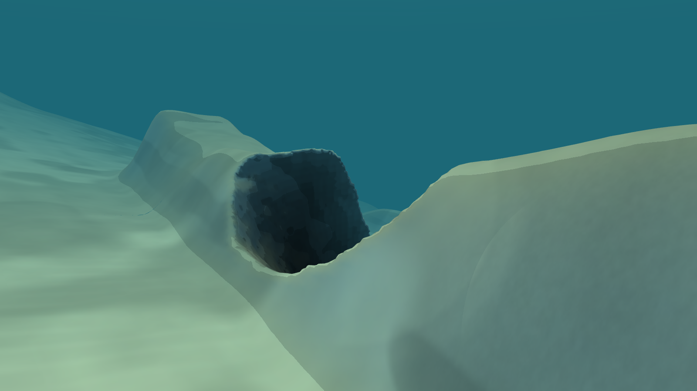 Crown hollow from the shelf | 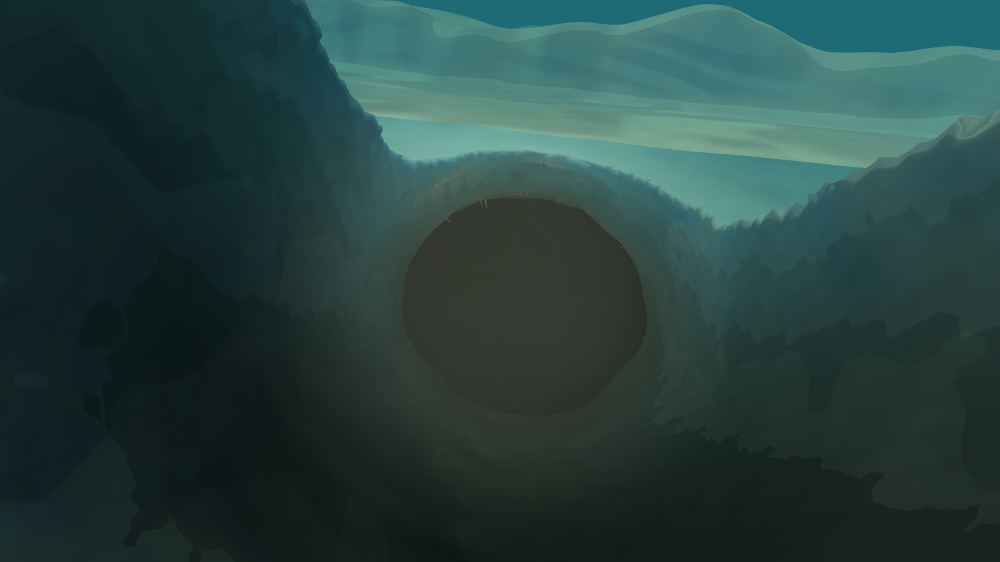 Down the hollow: daylight fades along the path |
| 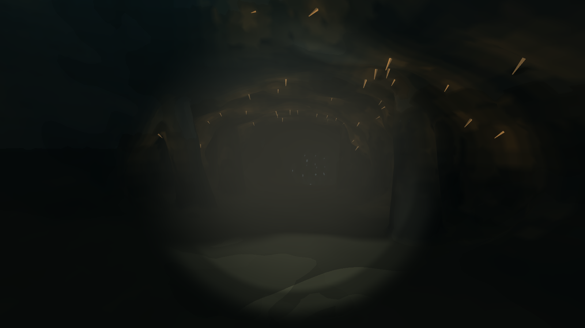 Root hall, lamp on: amber root tips stain the roof | 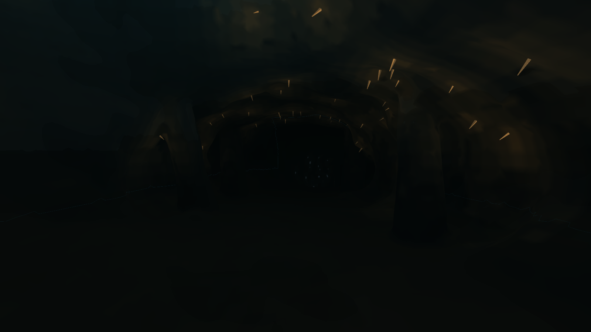 Root hall, lamp off |
| 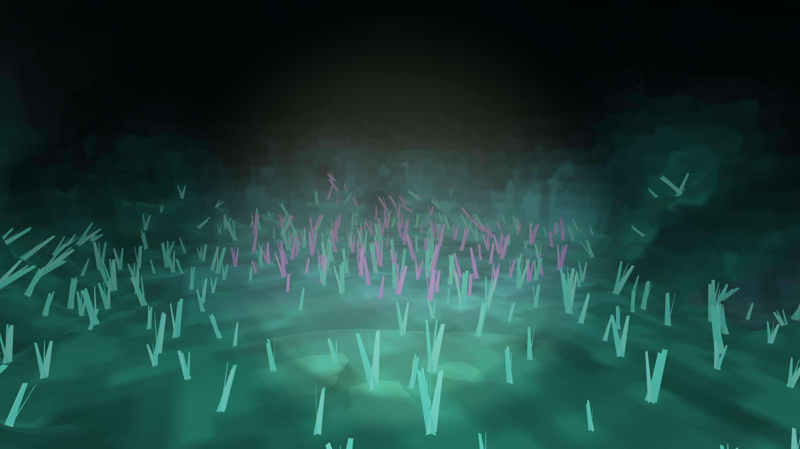 Glow garden: glow lights the rock through water only | 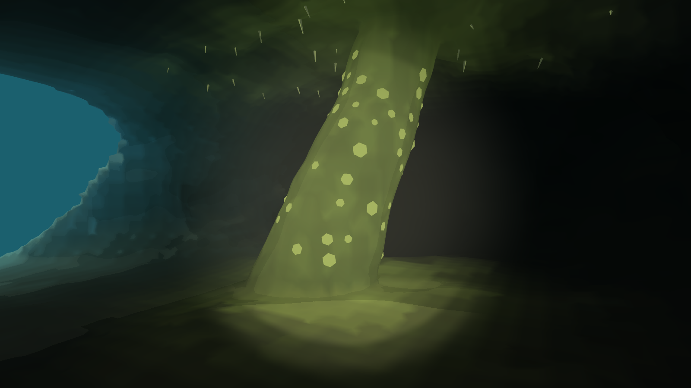 Hub: the great root; the Scarp mouth glows on the left |
| 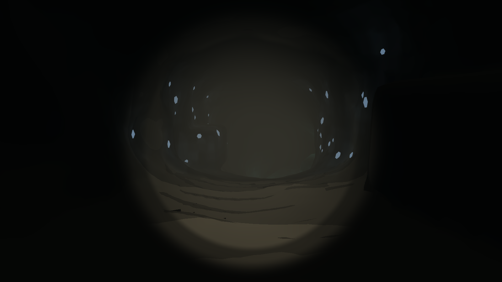 Collapsed gallery: a fallen block in the lamp | 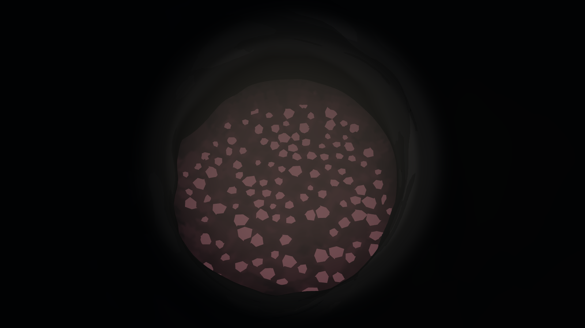 Deep pool, about 187 m |
| 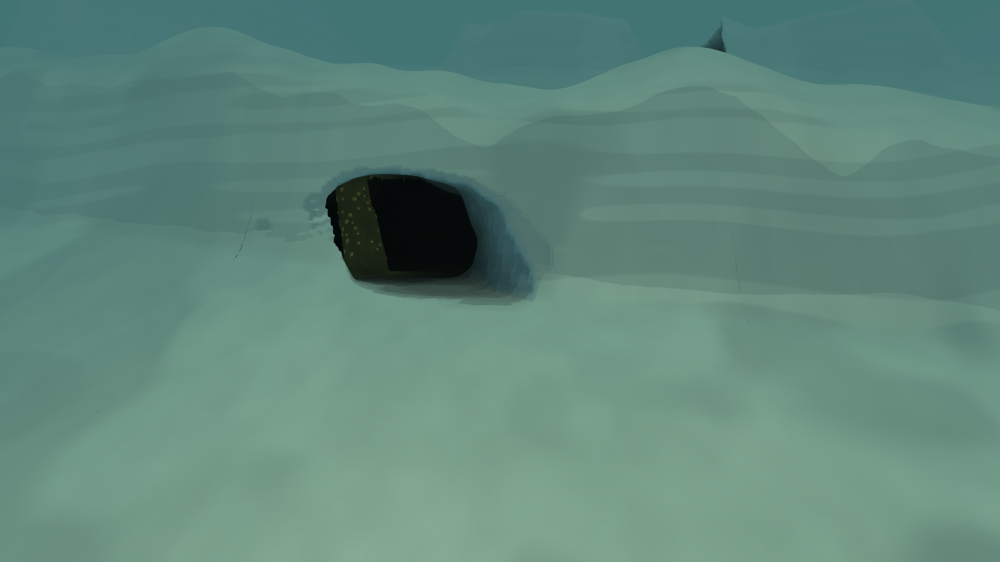 Scarp mouth from the lower terrace | 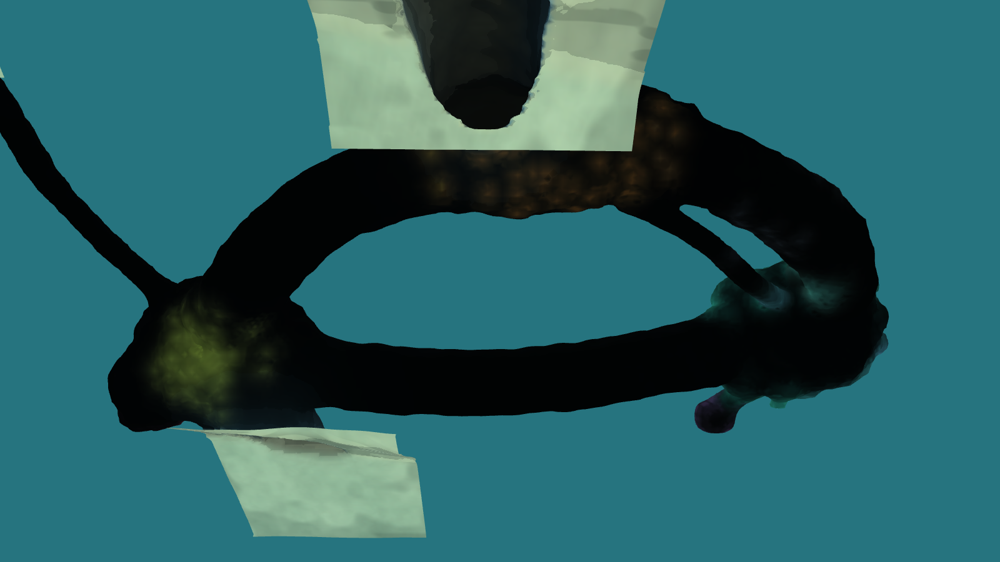 Plan (seabed hidden): hall, east run, hub, low run, garden, gallery, pool, crawl |
| 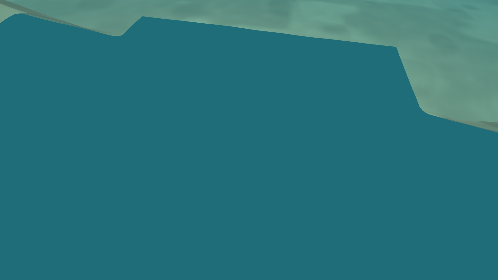 Budget 32 MiB, below fixed + coarse safety: the Dart waits above the Crown hollow, not admitted | 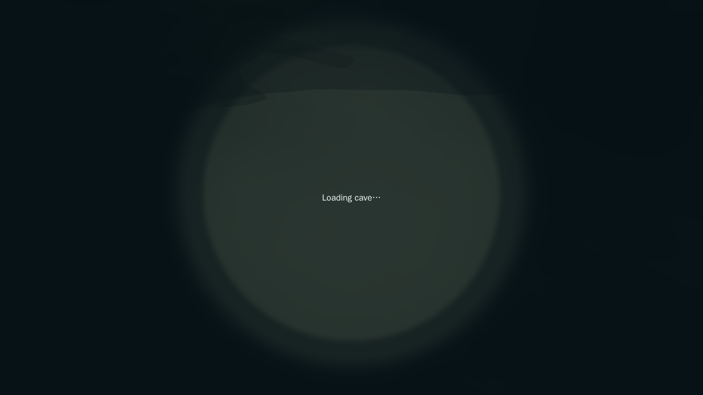 Reload inside at 38 MiB: "Loading cave…", clock paused, before the rescue |

## Limits
- **Collision memory.** It is about 20× W1's boxes per metre of cave: 19 MiB of colliders plus a 13 MB bake resident per biome. See *Memory for four biomes*.
- **Build cost.** A biome builds offline in about a minute. A live build in the browser is lab-only (`?live=1`).
- **Fixed-axis proxies.** Actors keep the world's square boxes, so a diagonal passage needs up to √2 more width. The gallery is 15 m with a 12 m lane for that reason.
- **Light is static per vertex.** Only the player's lamp lights rock dynamically. Life is placeholder geometry, and finds are proposals, not registry items.
- **The lab is not the game.** Its exterior seabed is a 1 m stand-in mesh, so hairline seams show at collar edges. Frame numbers are vsync-capped at 60 Hz in headless Chrome at 1600×900, not representative 1080p play.
- **Placement is a proposal.** The location and depths are in the source's `proposal`. The deep pool (about 187 m) sits below the Canopy's 150 m rating on purpose, as a soft depth gate.
