# POI-1: the deep legs stop feeling empty, and the big landmarks read in the dark

Opus 5.5 high. Branch `t3/deep-route-pois` from `e984a60`, with root merged at `4d3a7b9` (CA-1) and again with W2 phase 1 and ENC-1. Code `9a39ba5`; this page and [the evidence](poi1/) follow it. Answers the M2 audit's #3 (empty deep legs) and #10 (thin landmarks), and ATM-1's note that silhouettes vanish in the dark. Story-neutral: ambiguous wreckage and use, no plot, no resources or recipes.

## What a player sees
**Seven points of interest**, about one per 300 m of each deep leg. Each is lit, so it's glimpsed from the route at 125–245 m, then drawn on approach:

| Leg | POI | What it is |
| --- | --- | --- |
| Basin ↔ Rift | `poi.rift.trench_span` | Three cables sagging across the trench between two concrete posts, with warm floats on the middle one and a broken end hanging into the ember. |
| Basin ↔ Divide | `poi.basin.sounding_line` | A moored line of six lit floats rising 45 m from a sinker, leaning with the drift. |
| | `poi.basin.fall` | A great animal's fall: spine, skull and a cage of bone ribs, with mint growth gathering on it (the creature-gathering spot; ecology may add scavengers). |
| Divide ↔ Meridian | `poi.divide.float_line` | Six cyan instrument floats on tethers, stepping east along the ridge's lee toward Meridian. |
| | `poi.meridian.supply_cable` | A three-cable power run down the slope to the staging shelf's pylon: junction boxes with status lamps, lit couplings, one box burst open. |
| Divide → service ledge | `poi.divide.mirror_wreck` | A capsized hull section adrift on the brine mirror below the bench, its mast lamp still burning. |
| | `poi.divide.crystal_arch` | A rock arch on the slope below the bench's east end, crusted with lilac crystal; the descending route sees through it. |

**Landmark lights**, each in its region's own colour, so the lure chain reads by colour as well as place:
- **Meridian spire:** amber plates up all four faces.
- **Divide gateworks:** lilac lamps on the exposed tower corners and caps, and a band along both lintel faces.
- **Rift head and cliff wall:** an ember seam just under the lip of both walls, 24–444 m down the trench. It outlines the canyon from above.
- **Basin dishes:** a dashed amber band wrapping each drawn rim.
- **Wreck ridge:** glowing bands on the west hull's keel and the bow's rib crowns. These are the "twin ribs": I read it as the ridge's two ribbed hulls, because the reef's twin ribs sit at 0–15 m in full daylight, which ATM-1 leaves unchanged.

**Empty travel**, longest stretch with nothing noticeable (structural measure in `tests/poi.test.ts`; unlit things count within 60 m of the route, lit ones within 150 m; Creel 5 m/s):

| Leg | Before | After |
| --- | --- | --- |
| Basin ↔ Rift (root lane / W2 lane) | 278 m, 56 s | 226 m, 45 s / 225 m, 45 s |
| Basin ↔ Divide (root / W2 lane) | 824 m, 165 s / 801 m, 160 s | 238 m, 48 s |
| Divide ↔ Meridian | 514 m, 103 s | 295 m, 59 s |
| Divide → service ledge | 377 m, 75 s | 208 m, 42 s |

## Contracts and changed files
- **New:**
  - `src/content/poi/` (`sets.ts` holds the solid sets; `legs.ts` holds the deep legs and the empty-stretch measure);
  - `src/render/poi/` (`dressing.ts`: cables, tethers, growth; `landmarks.ts`: `LANDMARK_LIGHTS`);
  - `tests/poi.test.ts`.
- **`src/content/vistaKit.ts` (new):** a pure move of `vistas.ts`'s shape helpers (`block`, `prism`, `beam`, `pieceSolids`, the types), re-exported from `vistas.ts`. The POI module needs them, and importing them from `vistas.ts` would have been an import cycle. New tones: `bone`, plus lit `ember`, `mint` and `lilac`.
- **Registration:**
  - `VISTA_SETS += POI_SETS`, so POI collision reaches `VISTA_SOLIDS` and the sim with no sim edit;
  - `VISTA_DRESSING += POI_DRESSING`;
  - `vistaMesh` also draws `LANDMARK_LIGHTS`.

  Everything is built live per chunk: no re-bake, no extra draw call where a chunk already has vista art.
- **`tests/vistas.test.ts`:** the dressing alpha check accepts ATM-1's faint −0.3, and the invariant counts `LANDMARK_LIGHTS`.
- **Collision:**
  - Every POI solid is a `VistaSet` block or prism: art equals collision, within 0.35 m (envelope test).
  - Landmark lights hug existing collision (within 0.1 m), the rock, or the dishes' drawn rims.
  - Cables, tethers, growth and seams are visual-only, like A1's dressing.
- **Keep-outs (tested):**
  - **Carrier lanes:** 42 m from the centre line (17 m hull plus 25 m).
  - **Small-craft routes:** 12 m.
  - **Scatter's keep-out:** routes, tethers, moorings and structures.
  - **Rescue and first access:** as before.
  - **W2:** its lanes and pinnacles.
  - **Caves:** every footprint (root, CA-1/2/3, W2, the bible's proposals and cave-biome domains), padded 8 m.
  - **Seams:** they lie on the rock like scatter, so they follow scatter's keep-out and skip the kiln tube's mouth.

## Checks
- **`npm run test:fast`:** 1,167/1,167 on the merged branch, including 7 new POI tests:
  - registration and lights at both LODs;
  - clearances;
  - adverse controls: a float 28 m from a carrier lane, art in CA-3's east pocket, W2's crown, a lamp 1 m off the spire, a seam 3 m off the rock;
  - lights hugging their landmark;
  - dish bands on the drawn rim;
  - empty stretches on root's and W2's lanes;
  - the light budget.
- **Heavy (`heavy-check.sh`):** `vistas-envelope` (it caught a 0.37 m arch slab, now fixed), `regions-art`, `render-cache` and `m2-region-render` all pass.
- **`npm run build`:** OK on the merged branch. `bake-terrain --verify`: 220/220.
- **Build cost:** every POI and landmark part builds in about 1 ms (Node, median of 5). The chunk build can only pause between parts, so seams are cut into 16 m parts. The first cut cost 7–20 ms per part, against the owner's no-hitch streaming rule. A1's own shallows parts cost 6–8 ms.
- **Lights:** POI-1 adds 798 emissive clusters (164 in the busiest chunk). ATM-1 sends only the best 12 a frame, so clusters cost only CPU selection. On the deep legs the shader now always gets 12 (before: 1–12).

**3090, ordinary keys:**
- **Setup:**
  - task-owned headless Chrome, ANGLE GL-EGL, "NVIDIA GeForce RTX 3090", 1920×1080;
  - five sessions of at most 25 minutes through `heavy-check.sh`, each closed;
  - Creel saves derived headless from the M2 audit's ([derive](poi1/derive.mjs)), routes flown waypoint by waypoint ([plan](poi1/plan.mjs), [flights](poi1/flights.js), [server](poi1/server.mjs)).
- **Data:** frame gaps are flight-only; `draws` comes from the renderer's instrumentation.

| Leg (flight time) | Before: fps / p95 / p99 / worst ms, draws mean/max | After |
| --- | --- | --- |
| Basin ↔ Rift (117 s) | 59.9 / 16.8 / 16.8 / 67, 143/165 | 59.9 / 16.7 / 16.8 / 50, 147/171 |
| Basin ↔ Divide (179 s) | 59.8 / 16.7 / 16.8 / 50, 106/143 | 58.9 / 16.8 / 33.2 / 133, 108/143 |
| Divide ↔ Meridian (126 s) | 59.6 / 16.8 / 16.8 / 67, 88/101 | 59.4 / 16.8 / 16.8 / 67, 89/104 |
| Divide → service ledge (167 s) | 58.5 / 16.8 / 33.4 / 83, 78/116 | 59.7 / 16.8 / 16.8 / 117, 77/107 |

**Notes on the table:**
- **The p99 33 ms values come and go with host load,** in both builds. Load average was 5.6–7.6 from unlocked jobs. Back-to-back on Basin ↔ Rift, the after build gave p99 16.8 at load 2.0 and the before build 16.8 at load 7.6. The after row for that leg is that A/B run; the other A/B pair failed on save import.
- **Builds behind each row:** the Basin legs' after runs are on the final art. The Divide legs' are on the pass before the seam and arch changes, which don't affect those legs.

| | |
|---|---|
| 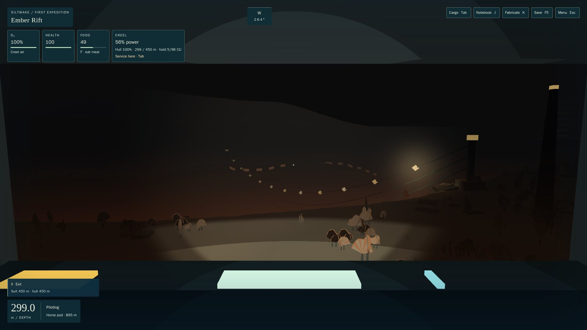 Trench span, 103 m | 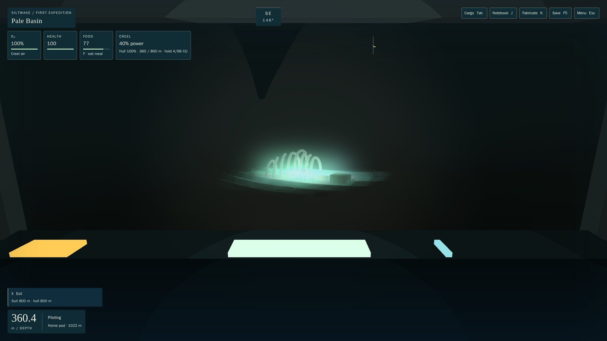 The fall, 87 m |
| 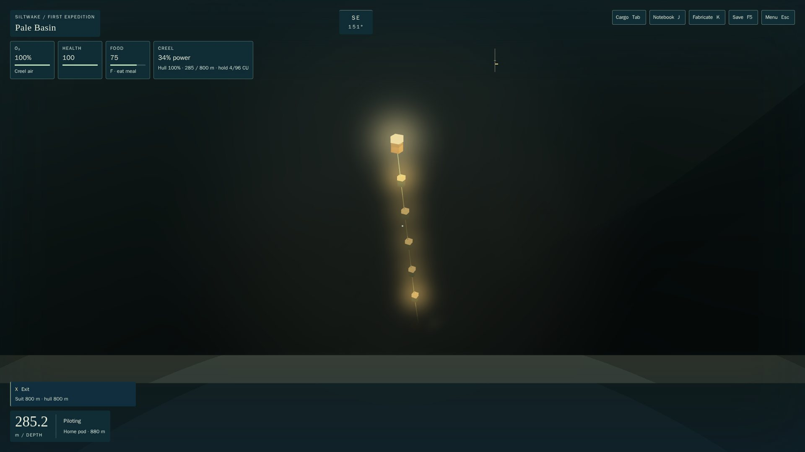 Sounding line, 83 m | 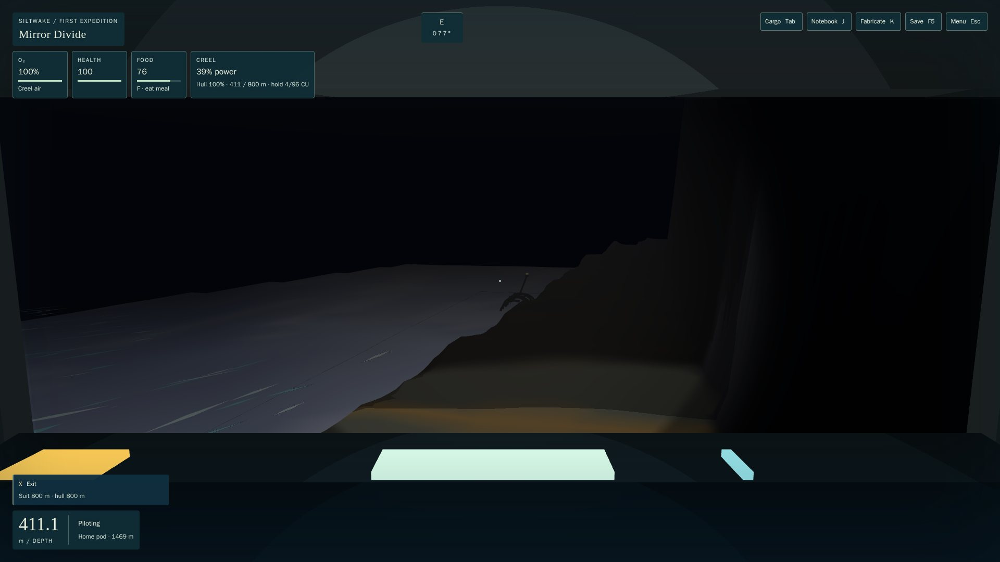 Mirror wreck glimpsed from the bench, 181 m |
| 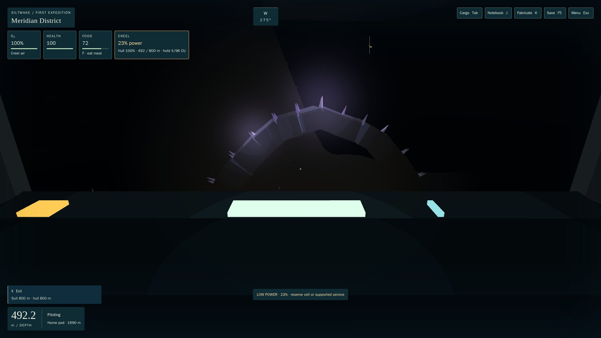 Crystal arch, 60 m | 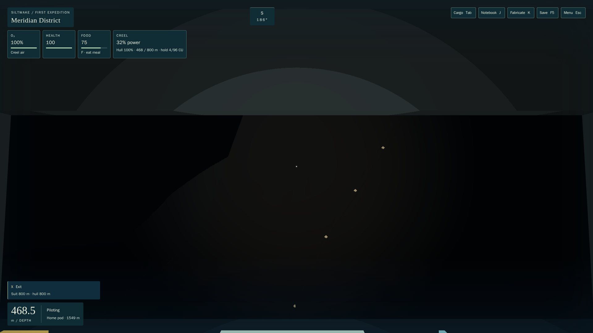 Supply cable, 56 m |
| 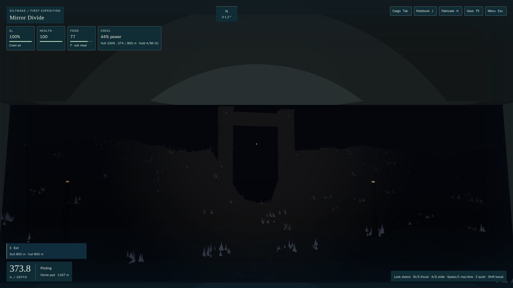 Gateworks, 250 m: before | 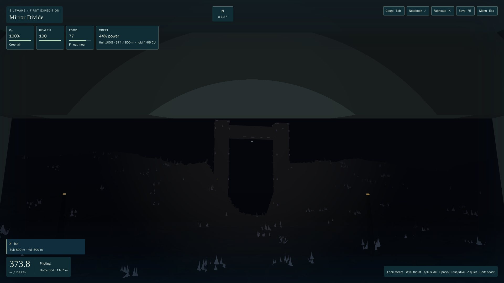 after |
| 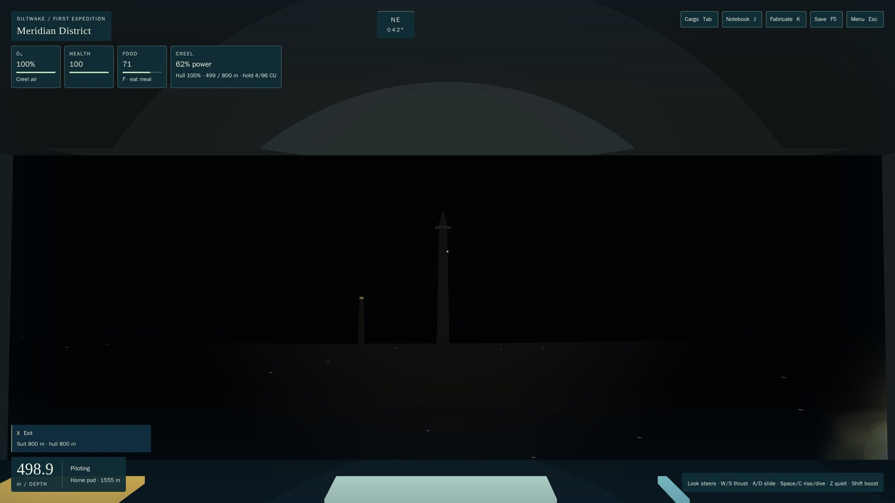 Spire, 247 m: before | 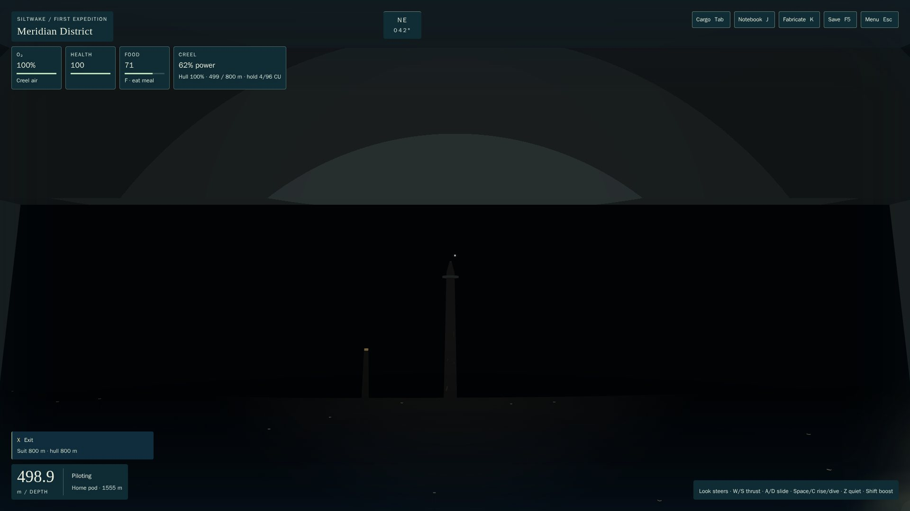 after |
| 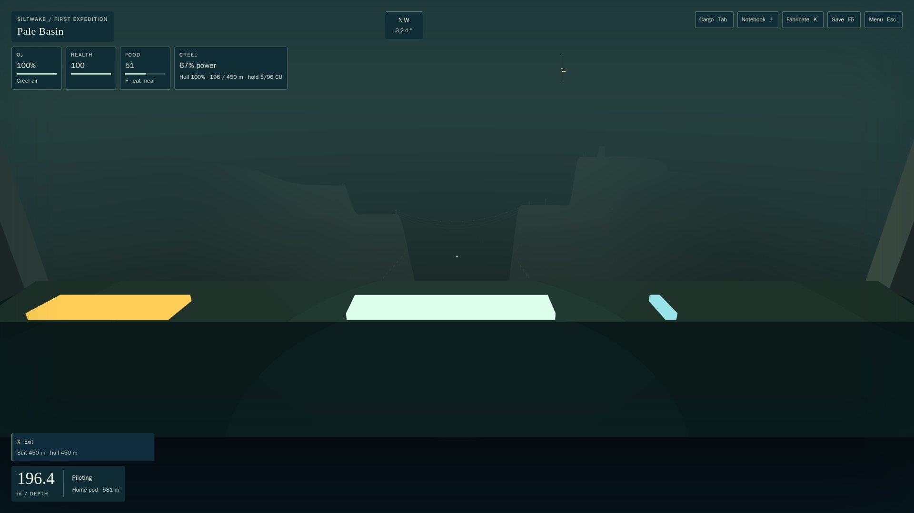 Rift head from the Basin, 260 m: rim seams | 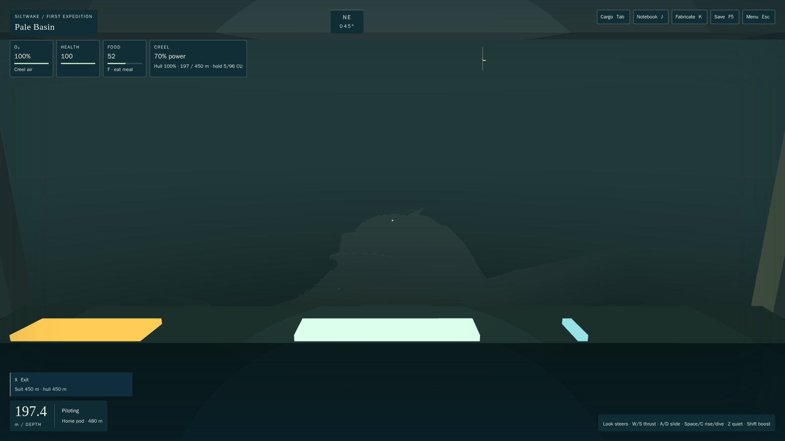 Dishes, 300 m: rim bands |

Every POI has a glimpse shot and a pass shot in [poi1/](poi1/), and every landmark has before and after shots. Raw results: [before3](poi1/before3.json), [after2](poi1/after2.json), [after3](poi1/after3.json), [after4](poi1/after4.json).

## Adverse case: the Pale Basin's bright silt
In the deep regions a lamp keeps 6–10% of its colour at 250–300 m over near-black water. The Divide gateworks, the spire and the trench span read clearly there. The Basin's water is pale (scene mean about 48/255), so the same lamp adds at most about +25/255. At 270–300 m the dish bands and keel bands read only as faint warm dashes ([dishes](poi1/view-dishes-after.jpg), [wreck](poi1/view-wreck-after.jpg)). The Basin silhouettes themselves read better than in the deep regions, so the Basin is the least dark. Emissive is already at its ceiling; anything brighter needs the lighting core (a less-fogged beacon term), which is outside this brief.

## Known limits and notes for the coordinator
- **Found, not fixed (S2, `content/regions/structures.ts`):** the Basin dishes' drawn rims stand 2–13 m above their rim-block collision, so a diver can swim through a drawn rim today. My bands follow the drawn rim.
- **Static lights only:** slow blinking beacons need a renderer hook (time-driven visibility), which is outside my files.
- **The float line** sits 60 m north of the bible's `divide.mixing_station`, which lies on the carrier lane. If the lost-site builder moves the station off the lane, the line can serve as its "buoy chain".
- **Test data:** `tests/poi.test.ts` holds a snapshot of the CA-2/CA-3/W2 cave footprints and W2's lanes, with their SHAs. Now that W2 phase 1 is on root, its entries duplicate live data harmlessly; drop them as the branches land.
- **Evidence vintage:** the shots predate the W2 merge (the hub sits outside every POI's view) and the arch fix, which removed a 0.7 m sideways jitter.
- **Glimpse distances:** the supply cable and the arch are hidden by the slope until about 125 m.
