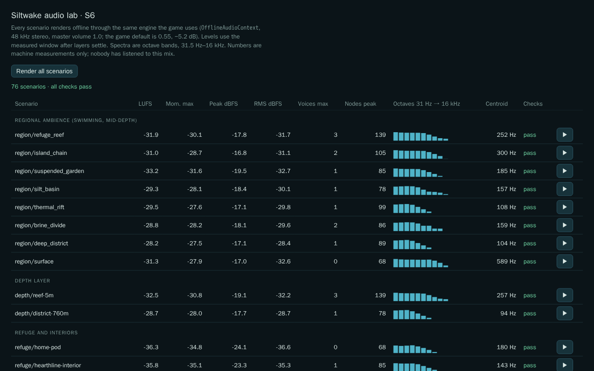

# S6 audio: interface and handoff

Owner Opus 5.5/high · branch `t3/74da9dce` from baseline `6a0fa56` · lab port 5198 · revised for [Sol R1](../reviews/S6-SOL-XHIGH-R1.md) (S6-01..05) and [R2](../reviews/S6-SOL-XHIGH-R2.md) (S6-06..08). **No human has listened to any of this.** The host is muted, so every number below is a machine measurement from offline renders.

## What exists
A procedural soundscape in `src/audio/*` built beside the legacy `sound.ts`, which stays untouched until the coordinator swaps it. Everything is original oscillators and seeded noise, with no asset files and no network.

| Module | Role | Pure? |
| --- | --- | --- |
| `cues.ts` | 32 cues as data: bus, priority, trim, cooldown, caption, essential flag, recipe; the musical motif | yes |
| `profiles.ts` | ambience per region, surface, refuge and interior beds, depth layer, six hull layers, Bobbin, threat layer | yes |
| `scene.ts` | `sceneFromState(state, active, regionAt, previous?)` → `AudioScene`; `regionAt` may return `null` (S1's `WorldMap.regionAt`), which keeps the previous region (first-frame fallback `refuge_reef`): region, depth, medium, shelter, hull, throttle and boost, hull stress, power, threat bearing | yes |
| `mapping.ts` | **`CueMapper`**: `events(batch, s, scene)` (preferred), `event(e, s, scene)` and `observe(s, scene, now)` → `CueRequest[]`; `moment("ending" …)` | yes |
| `mixer.ts` | `VoiceAllocator`: limits, cooldown merging, priority stealing, one body alarm at a time; `duckLevels` | yes |
| `captions.ts` | `CaptionGate` → `{ text, essential, dir }`, independent of mute and voice admission | yes |
| `analysis.ts` | peak, RMS, DC, clipping, BS.1770 LUFS (integrated and momentary), octave spectra | yes |
| `synth.ts`, `beds.ts`, `engine.ts` | WebAudio on any `BaseAudioContext`. Each of 5 buses has a dry and a wet (reverb-send) input behind the same trim × duck control; the shared reverb's return closes on pause. Then master volume → limiter → −0.3 dBFS ceiling | no |
| `director.ts` | **`SiltwakeAudio`**: same surface as `Soundscape` (`settings`, `activate`, `update`, `event`, `dispose`) plus `events`, `moment`, `reset`, `stats`, `onCaption`, `regionAt` | no |

## Cue list
**Regions** (ambience while swimming; refuge and interior beds play under any of them):

| Region | Character | LUFS* |
| --- | --- | --- |
| `refuge_reef` | bright pink-noise bed, snapping-fauna crackle, bubbles, D/A drone | −31.9 |
| `island_chain` | surf-washed bed, pebble clicks; **above water**: wind and surf, ringing damaged mast | −31.0 / −31.3 |
| `suspended_garden` | darker bed, resonant frond creaks, floater-school trills, E/B/E drone | −33.2 |
| `silt_basin` | muffled brown bed, silt hiss swells, distant fallen-dish bell | −29.3 |
| `thermal_rift` | rumble at 41 and 82 Hz, vent bubble bursts, ground groans | −29.5 |
| `brine_divide` | glassy pings, beating F drone (87.3 / 87.9 Hz) | −28.8 |
| `deep_district` | 46 Hz machinery stack, paired metallic knocks, longest reverb | −28.2 |
| home pod / Hearthline interior | warm D add9 chord with tremolo and ventilation; interior adds a room hum; outside muffled to 500 Hz, −12 dB | −36.3 / −35.8 |

Depth closes the bed lowpass up to 55% and adds a pressure rumble (district at 760 m: −28.7, centroid 94 Hz).

**Hulls** (vehicle bus solo, idle → cruise LUFS): Dart −38.8 → −30.6 (**boost −25.5**, with a whine and lifted motor) · Creel −39.0 → −29.2 (9 Hz mechanical flutter) · Hush −46.5 → −40.8 (near-silent; **+4 dB on threat presence and ambient detail**: passive listening) · Spindle −42.2 → −31.5 (wave slap, solar whine) · Mantle −38.5 → −31.0 (cooling-fan flutter) · Hearthline −37.0 → −28.5 (0.7 Hz throb) · Bobbin tow −36.5. Low power sags the motor; a disabled hull goes silent.

**Events → cues**
- **Sim sound cues:** `collect`, `craft` and `scan` map to `action.*`. `refuge`, `opening` and `recovery` map to `refuge.enter`, `opening.pod` and `recovery.wake`.
- **Warnings:**
  - A warning with an origin or `source: "threat-call"` becomes `alert.threat-call`, panned and captioned "[Paired hunter calls, left]".
  - A centred warning keeps its real cause: an explicit `cause` field if present (proposed below), else the oxygen/food hazard notice emitted just before it, else the producer's own conditions in its emission order (pressure → power → hull depth), else `alert.body`.
  - Oxygen and food are never inferred from a meter, so a pressure warning is never relabelled as low air. Every cause, notice-selected or derived, is used once per frame, so simultaneous alarms stay distinct. With `events(batch)`, a notice names only warnings in its own step batch, and an explicit `cause` spends the matching notice.
- **Contact:** `impact` (hull loss) → `hit.impact`, always centred. `threat-damage` and the `damage` sound are one injury: a single `hit.damage` per frame, panned to the batch's emission origin (else the hunter's position that step). Later copies map to nothing.
- **Movement and UI:** `movement-mode-changed` → board, disembark or interior door. `foundation-boundary` → `alert.boundary`. `interaction-panel` → click. An action notice with an error → `action.refused`.
- **From state changes in `observe`:** new evidence → `music.discovery`; new blueprint → `music.blueprint`; vehicle disabled → `hull.failure`; berth lock phase → `carrier.lock`; capture completed → `carrier.clamp`; hunter disengages after investigate or pursue → `threat.disengage`; crossing the waterline → submerge or surface; reaching shelter → `refuge.enter`, or `music.homecoming` after 180 s away; first entry to a region this session → `music.arrival`.
- **Ending:** `moment("ending")` plays a 38.2 s piece (i–VI–III–VII, then the motif settling on a major tonic). It has top priority and is never stolen.
- **Ducking:** while an alarm sounds, ambience ×0.5, vehicle ×0.5, music ×0.35. During a pursuit, ambience ×0.5 and music ×0.25.

\*LUFS at master volume 1.0; the game default of 0.55 is 5.2 dB lower.

## Levels, voice limits, adverse case
- **Voice limits:**
  - 12 one-shot voices in total. Per bus: ambience grains 4, vehicle 2, sfx 5, alert 3, music 1.
  - At most one body alarm at a time; up to 3 others wait their turn for 4 s.
  - Continuous layers are a fixed set. A region or medium change must hold 0.75 s before ambience crossfades; a slot that is still fading is revived rather than rebuilt, and at most 2 fading slots exist (older ones are cut with a 50 ms fade).
  - Every voice, including ambient grains, owns its graph until the graph's last source stops, and a stolen voice is faded and stopped: allocation and synthesis share one timing source (`soundLength`, including stop offsets), so pause, reset, stealing and the one-music-voice limit always reach it.
- **Class targets** (momentary max), all met:
  - essential alarms −22..−12 (measured −21.8..−17.0; `recovery.wake` raised 1 dB to −21.5 once solos stopped carrying other buses' reverb);
  - feedback −36..−20;
  - music −26..−16 (phrases −25.4..−24.0, ending −20.3);
  - every solo cue peaks at or below −6 dBFS.
- **Masking margin** (alarm solo vs. its bed while ducked, both with truly isolated buses since R1), target ≥ 10 LU: hull-stress over Creel in the Rift 10.7 · oxygen over reef swimming 19.4 · power over Dart in the Basin 11.2 · hunter call in the Canopy 19.1 (11.7 before: the old "bed" included the call's own reverb).
- **Silence and isolation** (S6-01): paused reef bed, all buses muted under a busy scene with calls, an alert solo over a Creel, and a music solo over a pursuit all render digital silence (−∞ dBFS; before R1 the paused bed measured −53.4 LUFS / −40.5 dBFS). Paused panel feedback still sounds (−17.0 dBFS) and leaves silence after it.
- **Grain stealing and pause residuals** (S6-06, S6-08): a 10-minute reef swim at 60 Hz (Node) has 0 orphaned graphs at every check and returns to the 71-node layer baseline with 0 voice nodes after pause and reset; before R2 it held 120 orphaned voice nodes. In the lab, a 300 s reef swim saturates the grain pool (3 steals), keeps 0 orphans, and is digitally silent after pause. Pausing out of a pursuit is now digitally silent (was −74.8 dBFS): the pulse and presence release linearly to zero.
- **Phrase lifecycle** (S6-03): blueprint then discovery 2.3 s later holds one music voice; pause in the middle of the ending and reset in the middle of a phrase both leave silence. No unowned graph sounds longer than its 40 ms stop fade at any frame.
- **Boundary chatter** (S6-04): reef/Canopy alternating every frame for 3 s adds no continuous-layer nodes (71 → 71; R1 probe: 61 → 1,987). Alternating every second peaks at 84 layer nodes with 1 fading slot and returns to 71.
- **Adverse case** `adverse/burst-400`: exactly 400 random requests across all 32 cues in 2 s over Dart boost and a pursuit, rendered 48 s so everything drains (play pauses at 46 s).
  - Peak voices were 11 (ambience 4, sfx 5, alert 3, music 1), never over a limit.
  - Peak −6.3 dBFS, no clipping, momentary max −17.5 LUFS.
  - Every cue voice had drained by 40.3 s (the ending phrase admitted in the burst is the last). Nodes: 84 before, peak 382, 84 after; 0 voice nodes and 0 pending at the end.
  - Of the requests: 157 started, 210 merged by cooldown, 52 masked, 95 refused as full, 12 deferred.
  - Of 144 essential requests, 12 sounded and the rest collapsed into those (repeats of a sounding alarm). Captions are emitted independently of that.
- The loudest ordinary scene, a Canopy pursuit with bites, peaks at −2.7 dBFS; the limiter holds the −0.3 dBFS ceiling.

## Wiring into `app.ts` (coordinator)
1. `import { SiltwakeAudio } from "../audio/director.js"`. Construct it with `onCaption: c => view.audioCaption(c)`.
   - Show essential captions always, others only with captions on.
   - Oxygen, food and threat warnings already have hazard notices, so dedupe there. Pressure, power, hull-stress, damage and hull failure have no notice today.
2. The existing `activate`, `update`, `event` and `dispose` calls work unchanged, but prefer one `this.sound.events(result.events, state)` per step batch over per-event calls: it keeps the hunter's bearing on the single injury hit. Add `this.sound.reset()` in `entered()` so a loaded save neither replays its history nor stays suppressed by old cooldowns.
3. Delete the synthetic `{sound: impact}` and `{sound: damage}` injections in `events()`. The mapper reads `impact` and `threat-damage` directly, and a later centred copy in the same frame maps to nothing.
4. Pass S1's `WorldMap.regionAt` directly as `regionAt` once it is composed; `null` outside the authored world keeps the last region. The default `renderRegionAt` knows only the 4 current regions. S5's ending machinery calls `moment("ending")`.
5. Retire `src/audio/sound.ts` and `tests/sound-origin.test.ts`. Their invariants are ported in `tests/audio-director.test.ts` and `tests/audio-mapping.test.ts`.
6. **No persisted fields are needed.** Proposed sim contract for composition (transient, never saved): `cause?: "oxygen" | "food" | "pressure" | "power" | "hull-depth"` on centred `sound: warning` events, set at each emission site in `updateSurvival`. The mapper already honours it (`WarningCause` in `mapping.ts`) and then stops inferring causes. Optional further events that would replace state diffs: `evidence-found`, `vehicle-disabled`, `region-entered`.

## Checks
- `npx tsc --noEmit` is clean, as is `npx tsc --noEmit -p tools/audio-lab.tsconfig.json`.
- `node --test .test-build/tests/audio-*.test.js` passes 33/33, including `audio-r2.test.ts` (10-minute grain run, mixed and stale notice causes, pulse release; each fix's removal fails its test) and `audio-r1.test.ts` (the reviewer's two real `updateSurvival` batches, a real `updateThreat` bite batch, allocation = graph end for every cue, overlap/pause/reset ownership, reverb topology, chatter, nullable region). The legacy `sound-origin` test still passes 4/4. None of these use Babylon.
- Lab: `npx vite --port 5198 --strictPort --host 127.0.0.1`, then open `/tools/audio-lab.html?auto=1`. All 78 scenarios pass (adds silence/isolation including pause after pursuit and a 300 s grain run, phrase lifecycle and boundary chatter; every scenario asserts 0 orphaned graphs); `window.__audioLab.report` holds the JSON.

## Known limits
- No human listening, and no taste judgment beyond the measurements. The live CPU cost and scheduling jitter of the real-time graph (a convolver and about 75 continuous nodes) were not measured.
- Hush and Mantle cruise speeds (6 and 4 m/s) are placeholders; the sim currently moves both at 8.
- Without the proposed `cause` field, pressure/power/hull-depth warnings are matched to the producer's conditions in its emission order; that mirrors `updateSurvival` today but would drift if the producer changes.
- Pause closes the reverb return within about 0.2 s. A reset during play stops the voices but lets the room's existing reverb tail ring out (up to 2.6 s); the lab measures silence after it.
- Region arrival is remembered per session only.
- The music is a short motif family, not an adaptive score.
- Captions aren't displayed until the UI wires `onCaption`.
