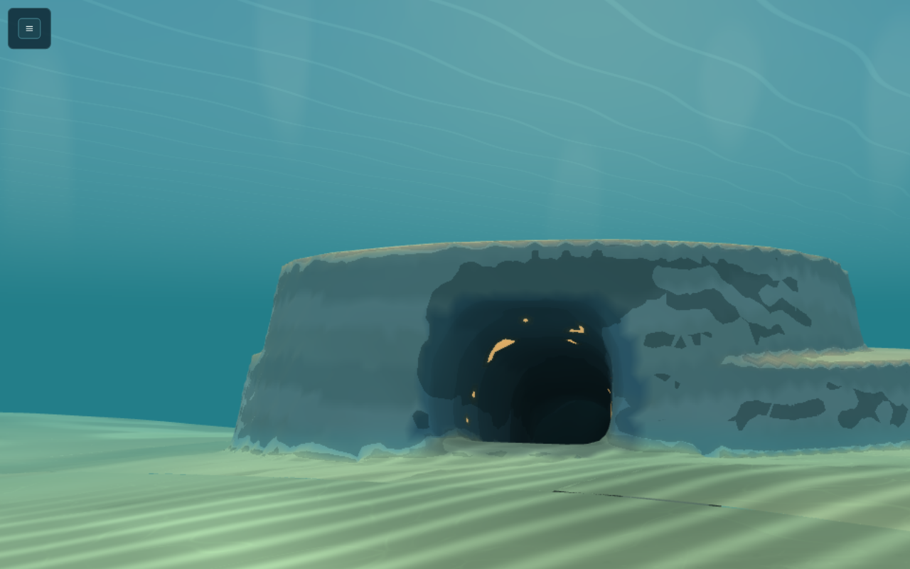
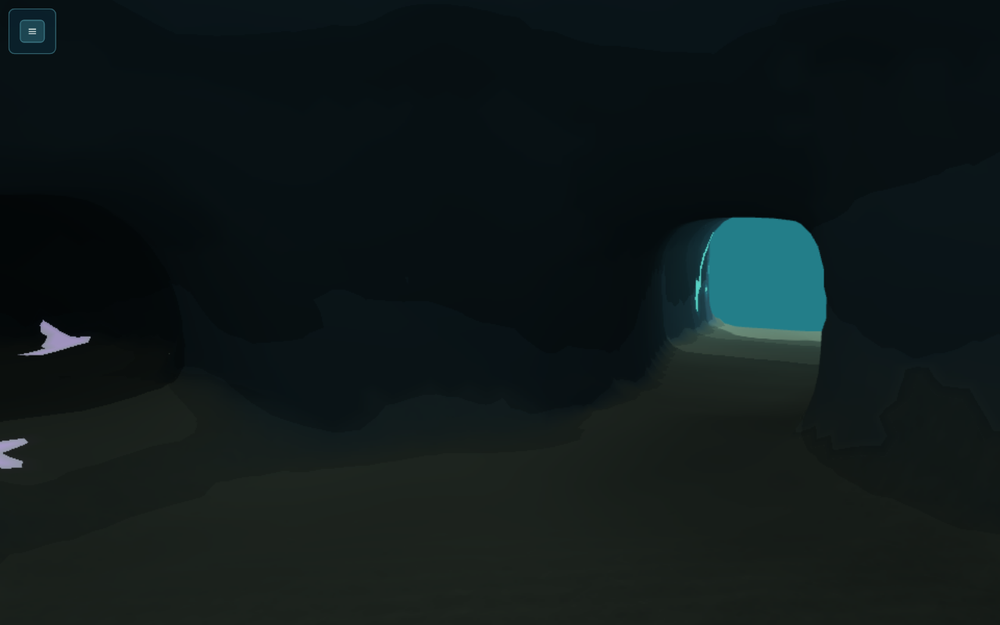
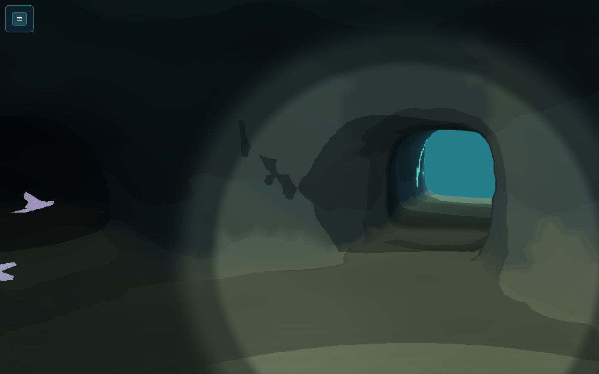
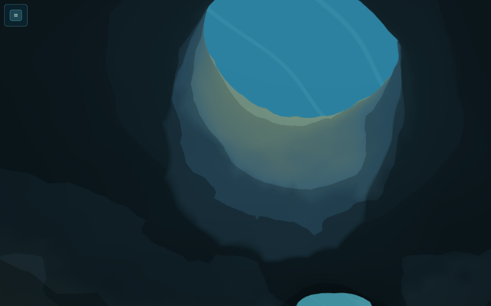
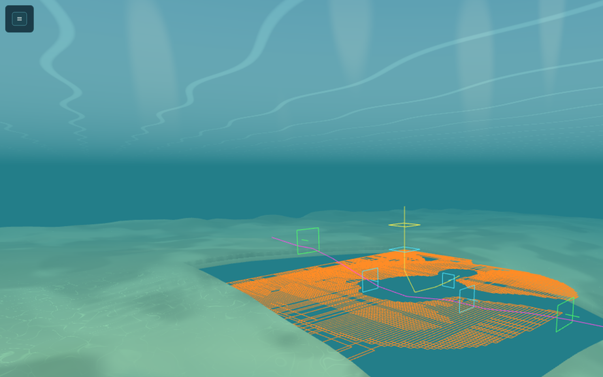
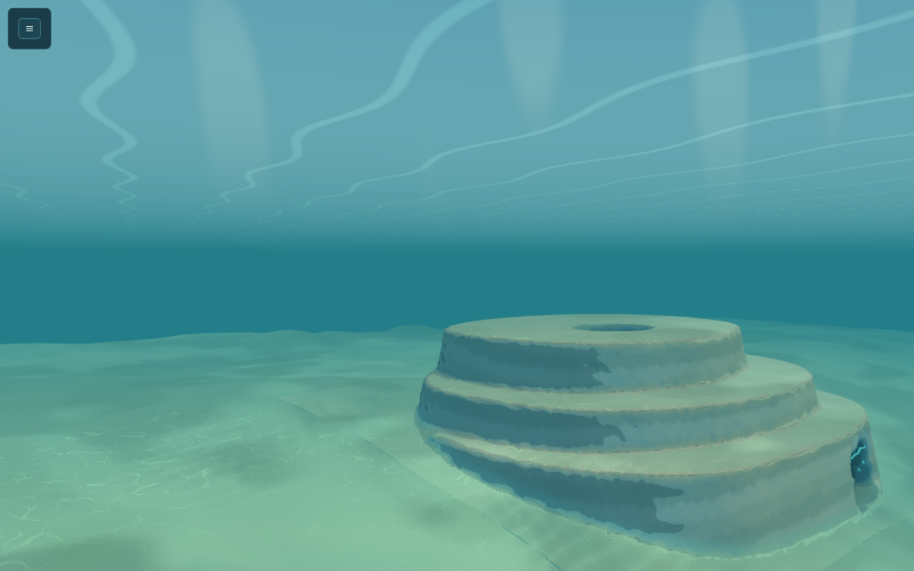
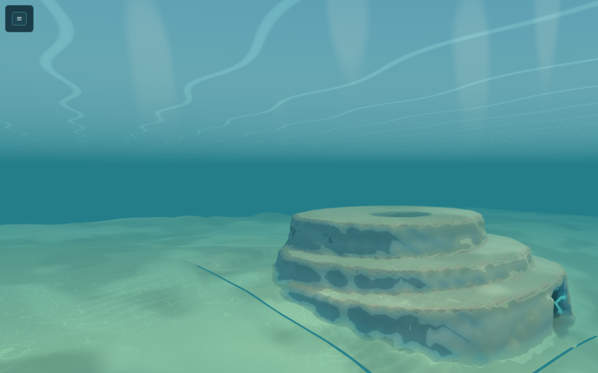

# W1-pre: Fanvault cave kit (handoff)

Opus 5.5, branch `t3/siltwake-fanvault-cave` from `feat/siltwake-first-expedition` `fc46af8`. R0 was `fe00f5e`; this revision answers [Sol R1](../reviews/W1-PRE-SOL-XHIGH-R1.md) (see *R1 fixes*). New files only. No shared root, bake or `materials.ts` edit. Design basis: [CAVES-UNDERGROUND](../../research/CAVES-UNDERGROUND.md).

## R1 fixes
- **R1-01, the lamp-off test.** It is now a real swim. The full diver shape sweeps every hop from the last accepted pose, and destinations must clear. Hops follow only the path-length glow (a sun pool reads full light, so it guides nothing). Arrival must be clear exterior water entered through a mouth or the skylight. Starts are taken every metre along both routes. A sealed-cave negative control must fail.
- **R1-02, lamp light through rock.** The lamp no longer reads the filtered field. It walks every exact 0.5 m collision voxel its ray crosses (a 3D DDA over an R8 occupancy texture, `texelFetch` only), skipping only the 0.45 m surface skin. The TypeScript `lampVisible` mirrors it step for step. Tests check every sampled shell ray through rock and R1's twelve rays (blocked), and the mouth and skylight rays (lit). `tools/cave-gpu-check.mjs` runs the same GLSL on the 3090 and must match the CPU walk ray for ray.
- **R1-03, the floor-wrapper contract.** The prototype adapter `src/sim/caveWorld.ts` adds full-shape ownership in clearance, every sweep and every slide, and routes every non-cave query to the original-identity world, which keeps the legacy guards. `withCaveFloors` is documented as not sufficient on its own.
- **P3 items:**
  - The roof check now allows open sky only from the skylight shaft's own water and the mouth lintels, and R1's `radii.up` 9.5 mutation is a negative control.
  - Overlapping cave footprints throw (`assertDisjointFootprints`).
  - The double `injectCaveLight` is flagged in `caveMaterial.ts`.

## What's built
- **The Fanvault loop**, Hearth Reef. A stepped limestone fan-terrace mound sits on the shelf break west of the Hearth drop. Its footprint is X −316..−264 and Z −92..−40: one 128 m column (`chunk:2:12:0`), outside the legacy preserve, and more than 20 m from `route.basin.reef_west`.
  - **North mouth:** tall, opening onto the shelf at 18.5 m, with amber unlit colonies inside.
  - **South mouth:** broad and low, opening down the slope at 26 m, with teal colonies inside.
  - **Inside:** a vault sunk to 26 m under a 4.5 m roof, with a skylight funnel and a dark catch pocket.
  - **Diver only:** both mouths are narrower than the smallest hull. Small craft park on the shelf about 25 m north-east of the north mouth.
- **`src/content/regions/caves.ts`** holds the contract, the authored `FANVAULT` source, `caveDef(id, floor)` (memoised), `assertDisjointFootprints` and `withCaveFloors`. `withCaveFloors` is only the floor the heightfield leaves; it is not an adapter on its own.
- **`src/sim/caveWorld.ts`** is the prototype ownership adapter, `createCaveWorldQueries`. See *Interface note*.
- **`src/content/regions/caveGeometry.ts`** is the one-source generator. Exterior rock and carved water are both signed distances, sampled once on a 0.5 m grid over the footprint plus a heightfield pad. That one occupancy feeds both outputs:
  - **Rock:** the opening by a 2 m cube, then a greedy cover with maximal boxes. This gives 1,504 `Solid`s, each at least 2 m on every side and allowed to overlap.
  - **Shell:** surface nets with SDF-placed vertices, clamped to 0.2 m per axis of their voxel corner, plus two clamped relax passes. Fine has 27k vertices; coarse (1 m, rock only if all 8 fine voxels are rock) has 6.8k.
  - **Cost:** about 0.27 s to build the rock and 0.2 s per shell. 220 sub-2 m rock voxels out of 380k are dropped from art and collision together.
  - **Codec-ready helpers:** `clipMeshToRect` and `caveShellByColumn` produce layer-0 recipe parts. The collar edge lies exactly on `worldFloor`, and alpha stays integer.
- **`src/render/caves/lightField.ts`** (Babylon-free) builds a 1 m RGBA field per cave in 0.12 s:
  - R: daylight path length through water from the openings, weighted per room by `falloff`;
  - G: direct sun through the skylight, along the cel `LIGHT_DIRECTION`;
  - B: rock fraction (diagnostic only; it is never a visibility test);
  - A: how much of the texel is cave inside.

  `caveDaylight` mirrors the shader's curve. `field.rock` is the exact collision occupancy at 0.5 m (R8, 255 = rock), and `lampVisible` walks it.
- **`src/render/caves/caveLight.ts`** (GLSL, Babylon-free) adds banded darkness by path length (full light in the sun beam), caustics only where the sun reaches, a fog medium darkened inside the cave (so a mouth seen from inside glows), and a lamp cone. The lamp has three Lambert bands and three range rings, is stopped by any collision-rock voxel its ray crosses past the surface skin, and adds a faint beam. Unlit colour stays unlit. `injectCaveLight(CEL_FRAGMENT)` splices this in at five anchors and throws if any anchor moved.
- **`src/render/caves/caveMaterial.ts`** (Babylon) provides `createCaveCelMaterial` and `CaveLighting`. `CaveLighting` owns two 3D textures, the light field (bilinear) and the rock grid (R8, nearest), sets the per-frame uniforms, and activates one cave at a time.
- **`tools/cave-gpu-check.mjs`** runs on a task-owned Chrome with ANGLE GL-EGL, through `heavy-check.sh`. It checks the lamp GLSL against the CPU walk on the GPU and renders the spliced material with the lamp on and off.
- **`tools/cave-lab.html`** shows the Fanvault with its reef terrain: the live recipe for six columns, with the footprint cut as a hole. It has:
  - free swim using the diver's real collision, through the adapter (`C`);
  - a lamp toggle (`L`) and an LOD toggle (`K`);
  - a shell toggle, overlays for a rock plan slice (`?slice=`), portals, routes and rooms;
  - bookmarks, and `window.caveLab.show()` for scripted shots.

  Run it with `npx vite --port <own> --strictPort --host 127.0.0.1`, then open `/tools/cave-lab.html`.

## Interface note (changes from the research sketch)
- **Authored versus derived.** `CaveSource` (terraces, carves, rooms, portals, routes, staging) is authored. `CaveDef` adds the generated `rock`, rooms with measured `bounds` and `portals[]`, `surfaces` (LOD recipes; meshes come from `caveShell(def, lod)`) and `stats`. Nothing generated is hand-edited.
- **The floor is a parameter** (`caveDef(id, worldFloor)`), so `sim/world.ts` can import caves without a cycle, the same pattern as `composeWorldFloor`.
- **Room labels come from geometry.** A voxel's room is the nearest carve, and only for carved water under the exterior top. Portals carry an axis normal, a `clear` rectangle and `admits`. Tests hold every portal to the generated rock and both shells.
- **Room optics are one number** (`falloff`). Darkness is measured through water, never through rock, so no box-shaped light masks are needed.
- **World-query contract (R1-03).** The prototype is `createCaveWorldQueries({ solids, floor, caves })`.
  - **Ownership:** inside a footprint only cave rock exists; outside it the exterior heightfield rules.
  - **Full shape:** any query whose shape, or whose swept move, touches a footprint is answered over the whole actor box against both owners, in clearance, every sweep and every slide. The exterior heightfield in a 5 m collar band becomes conservative 0.5 m column solids, so the existing box CCD sees the ground under every corner.
  - **Size and slicing:** shapes too large for the band (the carrier) are refused at a cave. Moves are sliced so slides stay inside the modelled band.
  - **Legacy guards:** every query that doesn't touch a cave goes to `createWorldQueries(solids, floor)` with the original floor function. Its identity-keyed legacy terrain columns and bench cut walls are therefore preserved. Caves plus their band must stay clear of the legacy preserve, and construction throws otherwise.
  - **Support and floor:** `supportHeight` near a cave reads rock tops and collar columns at or below the actor. `groundHeight` is the masked floor.
  - **Local worlds:** cabin and carrier stay their own local worlds.
  - **Wiring:** this belongs in `sim/world.ts` after C3 (coordinator). Outside caves, the exterior world's existing floor policy (centre-sampled clearance; sweeps not floored) is unchanged and out of scope.
- **Persisted state: none.** Geometry is static and the IDs are stable. Proposal for later: a `player.lampOn` flag plus an input binding (render-only today).

## Checks (R1 revision)
- `npm test`: **760/760**.
  - **`tests/caves.test.ts`, geometry:**
    - the shell sits within 0.35 m of rock;
    - no room cell is inside rock;
    - every aperture, the loop sweep (through the adapter) and the hull block hold;
    - the roof is solid and the roof-hole check passes, with the R1 thin-roof mutation caught;
    - coarse LOD, the codec and the collar hold;
    - overlapping footprints are rejected.
  - **`tests/cave-light.test.ts`:**
    - daylight checks;
    - every sampled shell ray crossing collision rock is blocked, and over 98% of open rays are lit;
    - R1's twelve rays are blocked, while the mouth and skylight controls are lit;
    - the real lamp-off retreat succeeds and its sealed-cave control fails;
    - the splice anchors are found once each.
  - **`tests/cave-world.test.ts`:**
    - the R1 straddle pose is rejected (the wrapper alone accepts it);
    - 1,500 straddling poses and moves never bury a corner;
    - the R1 bench case equals the legacy world (37.66 m);
    - the legacy hotspots match exactly for moves, clearance, support, ground and LOS;
    - guarded and oversize cases are refused, and support is read from below.
- `npm run build`: OK, and the bake is unchanged.
- **Heavy:** `scripts/heavy-check.sh … tests/cave-light.heavy.test.js` passes 3/3 at a 162 MiB peak.
- **GPU:** `scripts/heavy-check.sh --deadline 600 node tools/cave-gpu-check.mjs` passes on the RTX 3090 (ANGLE GL-EGL). [`w1-pre/gpu-check-r1.json`](w1-pre/gpu-check-r1.json) holds the result:
  - the production lamp GLSL equals the CPU walk on all 2,734 rays (0 mismatches);
  - the R1 blocked rays read 0 and the clear controls read 1;
  - there are no GL or page errors;
  - the spliced material's vault frame is brighter with the lamp on (mean 38.1 against 22.8).

  Two bugs surfaced on the way. Rock stored as byte 1 sampled as 1/255, so it is now stored as 255. Repeated 1×1 default-framebuffer readbacks drifted out of order on ANGLE, so the probe now renders 64 rays per draw into an offscreen target.
- **Browser (R0):** software preview with WebGL2. With keyboard swim, collision held: the diver went down the north passage and was stopped by the vault wall, then sank and stopped on the floor, and was never inside rock.
- **Cost:** a diver step inside the cave (move plus support) costs about 30–60 µs against the production 32 m index (R0 measurement).

## Adverse case: lamp off inside
**Starts:** 82, taken every metre along both routes inside the cave.

**Policy:** an unlit diver uses only what is visible. From the current pose, it considers water in clear sight within 7 m whose path-length glow is brighter; open water outside ranks above any lit water inside. It takes the brightest such spot that the full diver can actually reach: the destination clears, and the adapter sweep from the last accepted pose arrives exactly.

**Result:** all 82 starts reach clear exterior water in 169 hops. Exits: north mouth 13, skylight 54, south mouth 15. Each exit is through a mouth or the skylight aperture. With all three openings plugged, at least 90% of starts must fail, and they do.

**In the lab:** the vault with the lamp off shows the south exit glowing and the teal colonies by the mouth (02). The amber north colonies mark the other exit.

| | |
|---|---|
|  North approach, daylight |  Vault, lamp off: the exit glows |
|  Vault, lamp on |  Skylight funnel, sunlit wall |
|  Rock slice at −22.75 m, loop route, mouths, throats and skylight (shell hidden) |  Fine ·  Coarse |

## Integration after C3 (W1)
1. **World-query adapter (`sim/world.ts`).**
   - Wire the *World-query contract* above, with `sim/caveWorld.ts` as the reference. Use `caveOwner(def)` for each cave and the original exterior floor function.
   - **Do not** just swap the floor for `withCaveFloors`. That leaves clearance centre-sampled, so a straddling diver passes with a corner 0.33 m in the ground, and it drops the legacy bench and ramp guards (the R1 bench case goes from 37.66 m to 45 m).
   - `tests/cave-world.test.ts` holds the straddle, swept-move, legacy-equality and refusal regressions. Port them to the wired world.
   - Give cave rock and collar columns their own finer broad phase, about 8 m cells: there are about 6k boxes per cave.
   - Validators (access, drape, rescue) and recovery must query the same adapter.
   - The tests and lab run in a frame shifted by (+300, +90) only because the baseline `WORLD_BOUNDS` is still the legacy rectangle. Drop `SHIFT` once C3's envelope bounds land.
2. **`step.ts` / `hullFloor`.**
   - `hullFloor` and `verticalCorrection` read `groundHeight`; inside a footprint that now returns `baseY − 1`, so nothing is lifted through a roof. Floors come from the swept rock.
   - Make the swim cliff guard in `step.ts` read support instead of raw `groundHeight`. Today it uses `nextFloor > y + 0.22` with `groundHeight`, so it would see a 17 m "cliff" at a mouth threshold and could zero horizontal travel for a diver hugging a sill.
   - Keep cabin and carrier worlds explicit, so they never get the cave floor.
3. **Bake.**
   - Generalise `TessellationOptions.hole` to `holes: Rect[]` (the legacy extent plus cave footprints).
   - In `liveTerrain`, append `caveShellByColumn(def, lod, [chunk])` meshes named `${chunk.id}.cave.<id>`. They already clip to the column, keep integer alpha and encode with `terrainCodec`.
   - Add `caves.ts` and `caveGeometry.ts` to the bake dependency hash.
   - Raise chunk and region Y bounds by `def.bounds`.
   - Keep the shell edge on the floor: it is snapped already. Better still, emit the hole edge from the same collar points so no skirt is needed.
4. **`materials.ts`.**
   - Set `CEL_FRAGMENT = injectCaveLight(base)`, or inline the five splices shown in `caveLight.ts` `ANCHORS`. Then change `caveMaterial.ts`'s `CAVE_CEL_FRAGMENT` to the production fragment as is: splicing twice throws, because the fog anchor is gone.
   - Extend `CEL_UNIFORMS` with `CAVE_UNIFORMS`, and add `samplers: ["caveField", "caveRock"]` in `createCelMaterial` and the kit material. The rock texture must stay R8 with nearest filtering and 255 = rock.
   - Create one `CaveLighting` in the renderer. Each frame, `setField(nearest cave's caveLightField)` and `apply({ on, position, direction })` from the player's head and view.
   - The water, sky and glass materials are untouched.

## Known limits
- **Collision is boxes, so the solid count is high:** 1,504 overlapping boxes. The cost is fine for now (see the step cost above). A 2D column cover or wedges could cut it later.
- **Seam at the footprint edge.** The heightfield and the cave collar meet at the floor, but the edge points differ, so a thin seam line shows in the lab, more in coarse (07). Emitting both from the same collar polyline in the bake fixes it.
- **Walls show cel band edges.** North-facing walls sit near a cel band threshold. The visual style is still rough: stacked disks of terraces with no flora, scatter or resources yet (W3).
- **Lighting is limited.** Only one cave is lit as dark at a time; others draw as open water. They are more than 200 m apart and fogged. The lamp is visual only.
- **Performance is barely measured.** R1 measured the lab vault at a 16.7 ms median frame on the 3090, which is a lab cadence, not a game budget. The lamp walk costs up to 200 voxel steps per lamp-lit cave fragment.
- **Lamp shadowing is conservative.** It is per 0.5 m voxel, and a surface lit at a grazing angle near rock (Lambert below about 0.3) can fall in its own skin's shadow. Fragments outside the cave field are not occluded.
- **Adapter collar is approximate.** Its columns are 0.5 m cells topped at the highest of nine floor samples plus 2 cm, so a shape at a cave edge can rest up to a few centimetres above the true ground. It is a prototype, not the wired world.
- **Not covered here:** no route, access or rescue validator knows about roofs yet (W1 and W2), and no saves are involved.
