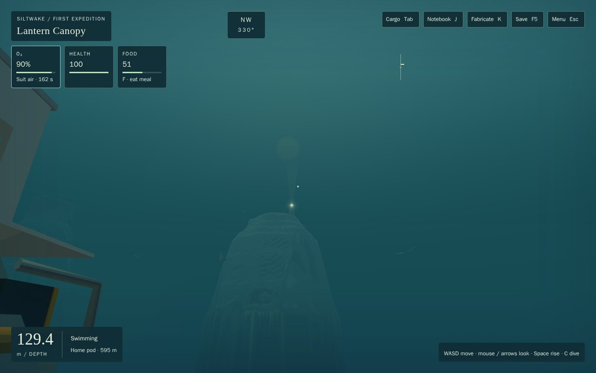
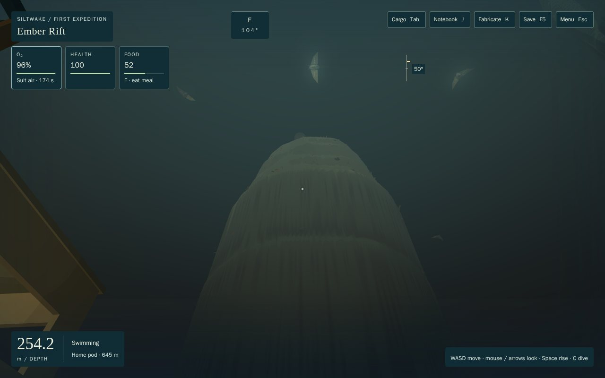
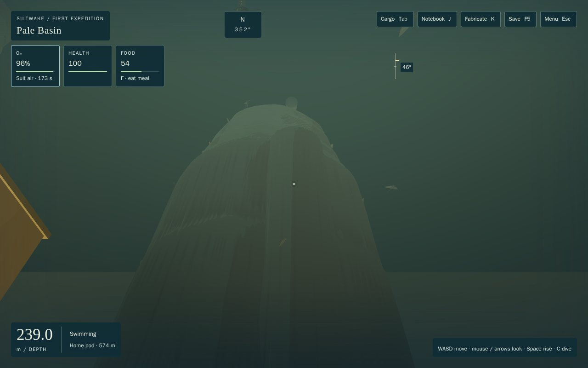
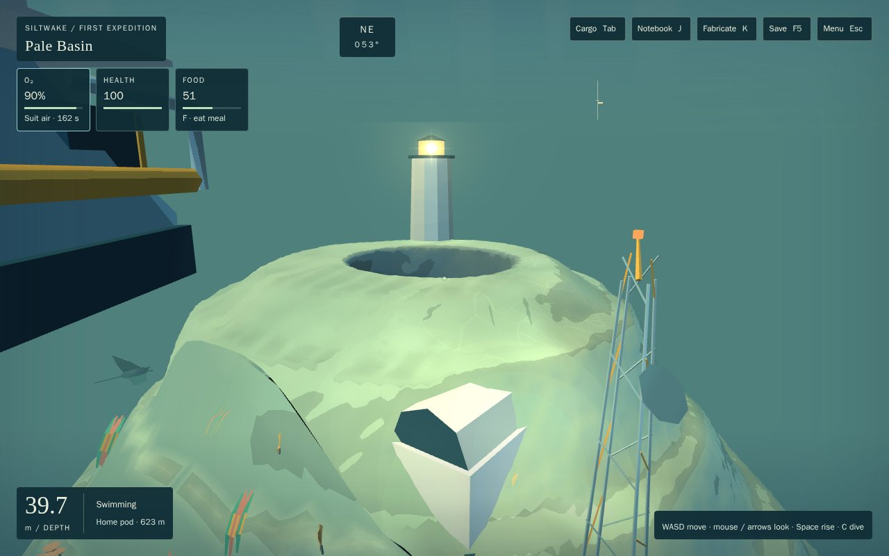
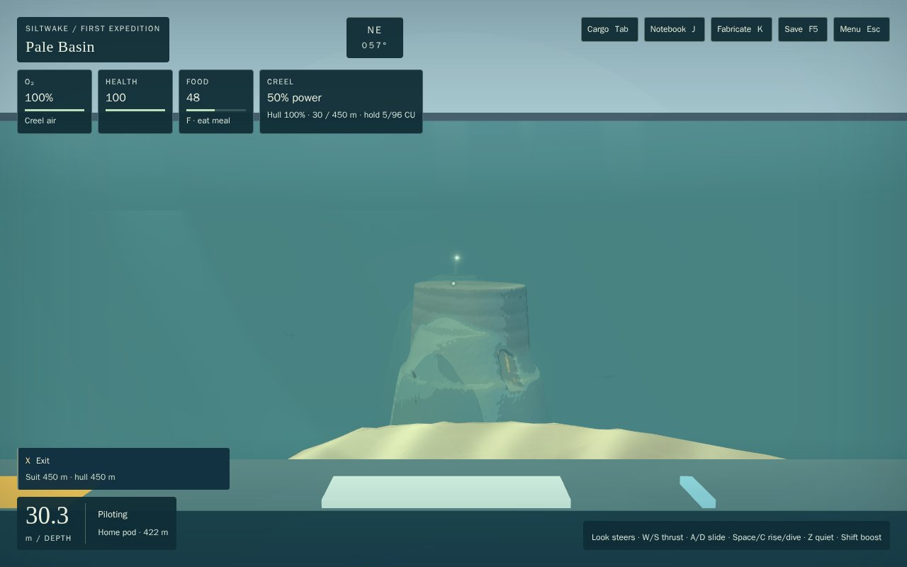
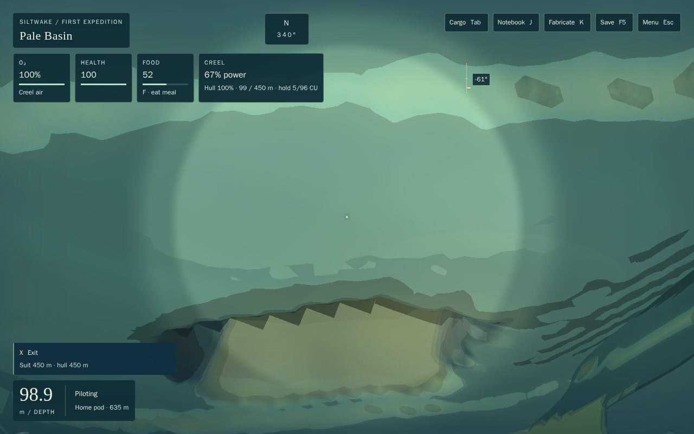

# W2: the central pinnacle hub (handoff)

Opus 5.5 high. Branch `t3/central-pinnacle-hub`, from `feat/siltwake-first-expedition` at `895fae4`, root merged at `0e18752` (ATM-1). Phase 1 (terrain and places): the commit that adds this file. Phase 2 (the crown station): see the end.

## Outcome
From the Lantern Canopy's south edge, a reef-capped pinnacle rises out of the dark Basin with a lit beacon house on top and a faint shaft of light over it. From the Rift head it towers overhead, ringed by the crown rays. A diver can hop the spur from the south apron over two stepping-stone pinnacles to the crown, and a Dart can run the same line at boost without touching rock. The crown shaft spirals through the crown from the summit to a flank mouth at 115 m on the rim balcony, over the carrier anchorage. Both fleet routes still reach the ending.

## What changed (contracts)
- **Terrain (`terrain.ts`).** `HUB_PINNACLES` and `HUB_LEDGES` feed `hubRelief`, applied as `max` over the floor: the spur only ever adds rock. Each pinnacle is a radial profile of terrace treads and risers, warped by noise.
  - **The spur:** two reef heads on the apron lip, at (8, −392) and (40, −376), at 23–29 m; the first step at (80, −400), 38.5 m; the second step at (186, −464), 43.5 m.
  - **The crown:** at (330, −560). Its summit is 46.5 m deep, flat for 12 m, then terraces to a 117–123 m ring. It falls 80° to the Basin floor at about 285 m, so it rises about 240 m. The rim balcony is a 17 m ledge at 121 m on the north lip.
  - **Masks:** new `pinnacle` and `reefCap` masks drive the new `hub_reef` biome (reef flora on the caps, limestone columns on the flanks) and its geology colours.
  - **The legacy preserve is untouched:** `composeWorldFloor` keeps the spur at full height inside the blend band only.
- **Routes (`passages.ts`).**
  - **New:** `route.hub.spur` (Dart, apron to crown), `route.hub.balcony` (medium hull, anchorage up the north cliff to the summit) and `route.hub.canopy` (medium hull, crown to the Canopy mooring).
  - **Moved:** `route.basin.rift` and `route.basin.divide` now leave the anchorage south-west through the 70 m gap between the second step and the crown, at a 245 m keel. No line is lifted over the spur.
  - **Structures:** the anchorage's 180° marker pylon moved to 165° to clear that lane. `RAW_ROUTES` is exported so tests can compare authored and draped lines.
- **Sites (`sites.ts`), structures and art.**
  - **Sites:** `hub.apron_heads`, `hub.step_one`, `hub.step_two`, `hub.crown`, `hub.rim_balcony` (landmarks), `hub.beacon_house` (story) and `hub.crown_station`.
  - **Structures:** the beacon house (a new `beacon` kind, a 14 m lit tower), plus the station hull and mast.
  - **Rescue and access:** unchanged. The spur sits above the 150 m loss depth, and every validator passes as it is.
- **Caves (`hubCaves.ts`, in `CAVE_SOURCES`).**
  - **Apron hollow:** under the apron lip's reef head.
  - **Step arch:** a slot arch through the first step.
  - **Glimmer crack:** through the second step.
  - **Crown shaft (medium):**
    - **Rooms:** crown bowl, a two-turn Dart-wide helix, a flank chamber, and a diver chimney back to the bowl.
    - **Loops:** a Dart loop from the summit to the balcony, and a diver loop up the chimney.
- **W1 kit fix (`render/caves/lightField.ts`).**
  - **The bug:** the daylight Dijkstra stored distances in a `Float32Array`, but compared them as float64 keys. In the crown's 70 m-deep spiral, near-equal grid paths kept passing the stale check and grew the heap until V8 threw `Invalid array length`. The renderer builds this field when you approach the cave.
  - **The fix:** distances are now float64, and relaxation stops at `DISTANCE_RANGE`, which the texture clamps anyway.
  - **Unchanged:** the Fanvault's field and every cave-light test.
- **Landmark presentation (`render/hubView.ts`, Babylon-free; `render/hub.ts`; three lines in `renderer.ts`).**
  - **The beacon:** a flare and a light shaft on their own additive material. Each fades over 230 m per e-fold, where cel fog takes 95 m, and the summit still occludes them. Past the 450 m far plane the flare becomes an impostor on the line of sight.
  - **The crown rays:** six creature-kit manta rays on a slow 170 s ring, 96 m out and 70–90 m deep. Their poses are a pure function of time; nothing is simulated or saved.
- **Playthrough (`scripts/playthrough/later.ts`).** Works visits now stow only as many meals as the diver must shed and the hold can take. Before, the carrier route's slightly longer lane left the Mantle's hold full, and stowing every meal was refused.
- **Saves:** no persisted change.

## Checks
- `npm test`: **1,116/1,116** at phase 1 (1,122 with phase 2's 6). New: `tests/hub.test.ts` (9) and `tests/hub-caves.test.ts` (9). Adjusted:
  - `regions-world`: hub sites keep the reef's shallow band;
  - `content-proposals`: a built proposal may share its ID where it stands; built caves count once;
  - `c4-world`: `CAVE_SOURCES` is no longer one cave.
- **Heavy** (`heavy-check.sh`): **20/20 files**. `cave-light.heavy`'s cave-view test now drains `prepare()` once per cave rather than expecting one cave.
- `npm run build`: OK. `bake-terrain --verify`: 220/220.
- `npm run playthrough -- --jobs 2`: **exit 0, 5/5 complete, no blockers**, every milestone reload matched.
  - **Play times:** creel 172.5 min, carrier 286.5 (283.1 on root), creel-loss 181.6, reverse 177.1, no-optional 171.7.
  - **Carrier:** on root it completes; on this branch it blocked once at the works before the harness fix above. The longer lane shifted a meal. The fixed harness passes.
- **3090:** a task-owned headless Chrome on ANGLE GL-EGL ("NVIDIA GeForce RTX 3090"), through `heavy-check.sh`, closed after 13 minutes.
  - **Saves:** derived headlessly with the game's own step ([derive](w2/derive.mjs)).
  - **Controls:** ordinary keys only ([server](w2/server.mjs), [Creel pass](w2/evidence.js), [diver pass](w2/evidence-diver.js)).
  - **Frame rate:** Creel cruise toward the crown from the Canopy edge, at the anchorage and across the summit ran at 59.9 / 60.0 / 59.7 fps, with p95 16.7–16.8 ms ([session](w2/session.json)).

| | |
|---|---|
|  Canopy edge, 270 m: the crown, its beacon and shaft |  Rift head, 254 m: the crown overhead, rays circling |
|  Carrier anchorage, 239 m: the north cliff |  Summit: beacon house, crown mouth, station and mast, a ray |
|  First step, 30 m: along the spur, the beacon's spark beyond |  Rim balcony: the crown shaft's flank mouth |

## Adverse cases
- **A Dart at boost along the whole spur, both ways,** steered by look and move only: 0 impacts, hull 100.
- **A diver with no power on the summit,** lamp off, 25% air: every summit pose has open water straight up. The real swim (W and Space) surfaces in under 45 s with air left.
- **Lamp off anywhere on a hub cave's routes:** a diver follows the glow out through a mouth in all four caves; the crown shaft uses both mouths. Control: with its mouths plugged, at least 90% of starts are lost.
- **A block across the flank mouth** stops the Dart loop.

## CA-2 overlap (asked for)
- **Lantern Hall** (486–554, −260…−204): `route.hub.canopy` passed 2 m from it at the same depth. It now runs 36 m east.
- **Culvert North** (398–422, −507…−483): the crown's relief reaches its collar band but sits under the existing floor everywhere there, so it changes nothing. `route.hub.canopy` passes 12 m outside its footprint, 170 m above it.
- **Every other CA-1 and CA-2 footprint:** clear of the spur, my routes and my caves.

## Known limits
- **Seen through a Creel's cockpit roof,** the beacon is hidden whenever it sits more than about 2.5° above the view centre; it shows to a diver or from a flatter angle. The roof art is not W2's. From the anchorage and the Rift head, the summit itself hides the lamp, and only the upper shaft shows.
- **The crown shaft's light field takes 363 ms** to build. The Fanvault takes 120 ms. It runs in `caveView.prepare()` idle time, one cave per call, but could still cost a frame once.
- **The crown rays don't react yet** (the bible's "widen the ring around a loud craft"). They have no collision, by design.
- **The spur's flanks fall 3–5 m per metre,** so the hub caves' collar check is bounded by local floor relief. The W1 adapter's collar columns take the highest of nine samples per 0.5 m cell. Every shell collar vertex lies exactly on the floor.
- **Bible deviations:**
  - **Apron hollow:** moved about 65 m, from the apron's lip into the reef head south-east of it, out of the legacy blend band.
  - **Crown station:** at (319, −547), west of the crown mouth.
  - **Flank mouth:** at 115 m, not 120.
- **Not done:** resources (`hub_crown_glass`, `hub_crown_cups`, `hub_shaft_crust`), the beacon house's decode and the cave residents (glimmers) are W3 and lore content.

## Phase 2: the crown station
Next commit.
